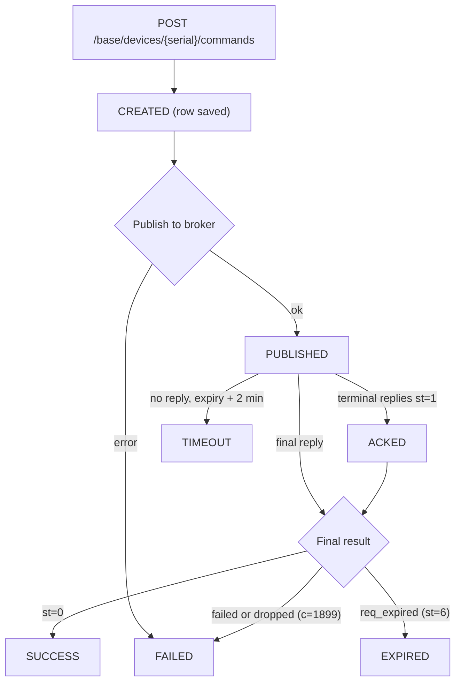

## Device Commands API

Sends one command (for example "start a QR payment" or "re-download your config") to one terminal. Use it from your backend or an admin tool whenever the server must tell a terminal to do something.

### In a nutshell

- A **terminal** (also called device or EDC; a card payment machine) listens on an MQTT topic. MQTT is a message system: the server drops a message on a named channel (the topic) through a broker, and the terminal picks it up.
- You call `POST /base/devices/{serial}/commands` with a `commandCode` (a number such as `112`) and a `payload` (the data for that command).
- The backend finds the terminal, signs the message with the terminal's secret, saves a command row, and publishes it.
- The API answers `201` as soon as the **broker** accepted the message. The terminal answers later and asynchronously. Follow the result with `GET /base/device/command/{id}`.
- If publishing fails, the saved row is kept with status `FAILED`, so there is always an audit trail.

### How a command lives



### Worked example

Goal: ask terminal `SN0001` to download its configuration again (command `200`).

1. Send the command:

```bash
curl -X POST "$BASE_URL/base/devices/SN0001/commands" \
  -H "Authorization: Bearer $TOKEN" \
  -H "Content-Type: application/json" \
  -d '{"commandCode": 200, "ttlSeconds": 60, "payload": {"id": "20260723143500"}}'
```

2. Read the answer. Status `201` and `"status": "PUBLISHED"` mean the broker took it:

```json
{
  "id": "123",
  "commandId": "8d7973d9-4939-4e51-a942-778b6fcedc2f",
  "serialNumber": "SN0001",
  "commandType": "SYNC_CONFIG",
  "commandCode": 200,
  "status": "PUBLISHED",
  "mqttTopic": "base/default/SN0001/cmd",
  "deliveryState": "accepted_by_broker",
  "payload": { "id": "20260723143500" },
  "publishedAt": 1784817300,
  "expiredAt": 1784817360,
  "createdAt": 1784817300
}
```

3. A few seconds later, check the result (use the numeric `id`, here `123`):

```bash
curl "$BASE_URL/base/device/command/123" -H "Authorization: Bearer $TOKEN"
```

4. When `status` is `SUCCESS` the terminal finished. If it is `FAILED`, read `errorCode` and `errorMessage`. If it is still `PUBLISHED` after the expiry time plus 2 minutes, the sweep moves it to `TIMEOUT`.

### Before you start

- A bearer token (see the API guide). Only a Base HUB token works.
- **Write** permission on `edc.device.command` (the model that stores commands). Without it: `403`.
- The terminal must exist and have a signing secret (see "Good to know").
- The backend stores your user id as `createdBy`. You cannot set it in the body. It is not in the POST response but appears in `GET /base/device/command` and `GET /base/device/command/{id}`.

### 1. Request

```http
POST /base/devices/{serial}/commands
Authorization: Bearer <token>
Content-Type: application/json
```

Path parameter:

| Name | Type | Required | What it means |
| --- | --- | --- | --- |
| `serial` | string | Yes | Terminal serial, for example `SN0001`. It is authoritative: a `serial` or `serial_number` key in the body is ignored. A blank or unknown serial gives `404`. One call targets exactly one terminal. |

Body:

```json
{
  "commandCode": 112,
  "ttlSeconds": 60,
  "payload": { "id": "20260723143025", "a": 10000, "cur": "VND", "r": "QR-DEMO-001", "qr": "000201010212...", "qrType": "vietqr", "ttl": 60 }
}
```

| Name | Type | Required | What it means |
| --- | --- | --- | --- |
| `commandCode` | integer | Yes | One of the codes in section 2. `command_code` also works; a numeric string such as `"112"` is accepted. A non-numeric value counts as missing. |
| `payload` | object | No | Data for the command. A value that is not an object (string, array, number) is silently treated as no payload. |
| `ttlSeconds` | integer | No | Time to live in seconds, `30` to `3600`. Default `60` when omitted, `0` or non-numeric. `ttl_seconds` also works. The terminal rejects the command after this time. |

Rules for the payload:

- The backend does not deeply check the payload for each code. It forwards it inside the signed message, and the terminal reports shape problems itself (for example `st=9 invalid_payload`). Still, send the right fields for each code (section 3).
- For transaction commands (`100`-`199`) the backend fills missing identity fields. `id` defaults to the send time as `yyyyMMddHHmmss` (UTC+7; for `101` it falls back to `orig` first). `r` defaults to `id` (never invented for `104`).
- For `109`, `113` and `114` the payload `id` is **required** (`400 payload_id_required`).
- For `113` and `114`, a string `st` is lowercased before signing.
- The payload `id` is the business/transaction id. It is not the `commandId` (the message id the backend generates).

### 2. Supported command codes

Any other code (including `107`, `108`, `206`, `207`, which the terminal does not route) returns `400 unsupported_command_code`.

| Code | Label | What it does |
| --- | --- | --- |
| `100` | `TXN_SALE` | Card sale. |
| `101` | `TXN_VOID` | Void a sale. |
| `102` | `SALE_MOTO` | Mail/phone order sale (the old constant name differs). |
| `103` | `PRE_AUTH` | Pre-authorization (old constant name differs). |
| `104` | `PRE_AUTH_COMP` | Complete a pre-authorization (old constant name differs). |
| `105` | `TXN_SETTLEMENT` | Settlement (close the batch with the bank). |
| `106` | `TXN_INSTALLMENT` | Installment sale. Always runs as installment, `m` is ignored. Same payload as `100`. |
| `109` | `TXN_CANCEL` | Cancel the active card/installment session. Payload `id` required, must match the active transaction. |
| `112` | `TXN_QR_INIT` | Show a QR code on the terminal. |
| `113` | `TXN_QR_RESULT` | Push the QR payment result to the active QR session. |
| `114` | `TXN_QR_UPDATE` | Resolve a QR that was left pending. |
| `119` | `TXN_QR_CANCEL` | Cancel the active QR session. |
| `120` | `TXN_RESYNC` | Ask the terminal to re-publish stored transactions by id (read-only, max 50 ids). |
| `200` | `CFG_SYNC_CONFIG` | Re-import config from the backend. |
| `201` | `CFG_GET_LOG` | Capture and upload bank app logs. |
| `202` | `CFG_SYNC_PAYMENT` | Download and apply a config from a URL. |
| `203` | `CFG_UPDATE_PAYMENT_APP` | Check/download a payment app update (the operator still confirms the install). No payload needed. |

Codes `100`-`199` have `commandType` `START_TRANSACTION`. Codes `200`-`299` have `SYNC_CONFIG`.

### 3. Payload reference and samples

Payload fields used in the samples (`id`, `r`, `a`, `cur`, ... are the terminal's short names):

| Field | Used by | What it means |
| --- | --- | --- |
| `id` | all | Business transaction/request id, e.g. `20260723143025`. |
| `r` | `100`-`106`, `112`-`114`, `120` | Merchant reference, e.g. `SALE-DEMO-001`. |
| `a` | `100`-`106`, `112`-`114` | Amount in the smallest unit, e.g. `10000`. |
| `cur` | `100`, `112`-`114` | Currency, usually `VND`. |
| `m` | `100` | Payment method hint, e.g. `card`. |
| `orig` | `101` | Reference of the original sale to void. |
| `qr`, `qrType`, `ttl` | `112` | The full QR string to show, its type (e.g. `vietqr`), and its life in seconds. |
| `st` | `113`, `114` | Outcome as a lowercase string: `success`, `failed` or `pending`. |
| `rc` | `113`, `114` | Response code, e.g. `00`. |
| `ids` (alias `transactionIds`) | `120` | 1 to 50 unique transaction or request ids. |
| `binCode` | `201` | Optional bank app to collect logs for. Blank or omitted means all. An unknown value is rejected by the terminal (`unknown_bin_code`). |
| `url`, `ver`, `sha` | `202` | Where to download the config file, its version, and its SHA-256 hash. |

Each sample below is the **body** of the request.

**Sale (`100`)**

```json
{ "commandCode": 100, "ttlSeconds": 60,
  "payload": { "id": "20260723143025", "a": 10000, "cur": "VND", "r": "SALE-DEMO-001", "m": "card" } }
```

**Void (`101`)**

```json
{ "commandCode": 101, "ttlSeconds": 60,
  "payload": { "id": "20260723143100", "orig": "SALE-DEMO-001", "a": 10000 } }
```

**Settlement (`105`)**

```json
{ "commandCode": 105, "ttlSeconds": 300, "payload": { "id": "20260723143200" } }
```

**Installment (`106`) and Cancel (`109`).** `106` takes the same payload as `100`. `109` needs the `id` of the transaction to cancel:

```json
{ "commandCode": 109, "ttlSeconds": 60, "payload": { "id": "20260723143025" } }
```

If the sale was already approved, the terminal answers `st=5 rc=no_active_card_session` and the sale stands.

**QR Init (`112`).** Use it when the backend already has the full QR string:

```json
{ "commandCode": 112, "ttlSeconds": 60,
  "payload": { "id": "20260723143300", "a": 10000, "cur": "VND", "r": "QR-DEMO-001",
               "qr": "00020101021238540010A000000727...", "qrType": "vietqr", "ttl": 60 } }
```

**QR Result (`113`).** Use it after the QR payment outcome is known. Use lowercase `st` (`success`, `failed`, `pending`):

```json
{ "commandCode": 113, "ttlSeconds": 60,
  "payload": { "id": "20260723143300", "r": "QR-DEMO-001", "st": "success", "a": 10000, "cur": "VND", "rc": "00" } }
```

`113` is special: the terminal may not send an immediate acknowledgement. The meaningful reply comes after the terminal stores the result.

**QR Update (`114`).** Resolves a QR that was left pending. Same payload as `113`.

**QR Cancel (`119`)**

```json
{ "commandCode": 119, "ttlSeconds": 60, "payload": { "id": "20260723143400" } }
```

**Transaction Resync (`120`).** The terminal re-publishes the stored transactions, one `1120` reply per id (`seq` 1 to `total`). More than 50 ids, or none, is rejected by the terminal (`resync_limit_exceeded`, `missing_resync_ids`).

```json
{ "commandCode": 120, "ttlSeconds": 60,
  "payload": { "id": "20260723143450", "r": "NIGHTLY-2026-07-23", "ids": ["20260723143025", "20260723143300"] } }
```

**Sync Config (`200`).** No special payload:

```json
{ "commandCode": 200, "ttlSeconds": 60, "payload": { "id": "20260723143500" } }
```

**Get Log (`201`)**

```json
{ "commandCode": 201, "ttlSeconds": 60, "payload": { "id": "20260723143600", "binCode": "970418" } }
```

**Sync Payment (`202`).** The terminal expects a downloadable config file:

```json
{ "commandCode": 202, "ttlSeconds": 120,
  "payload": { "id": "20260723143700", "url": "https://download.example.com/config/device-config.json", "ver": 1,
               "sha": "0123456789abcdef0123456789abcdef0123456789abcdef0123456789abcdef" } }
```

**Update Payment App (`203`).** No payload:

```json
{ "commandCode": 203, "ttlSeconds": 60 }
```

### 4. Response (`201 Created`)

This body is **not** wrapped in `{"id","result"}`. Times are Unix seconds.

| Field | What it means |
| --- | --- |
| `id` | Row id, returned as a **string** here (for example `"123"`). |
| `commandId` | Unique id (UUID) of the message, generated by the backend. The terminal copies it into its reply. |
| `serialNumber` | Target terminal serial. |
| `commandType` | `START_TRANSACTION` (codes `100`-`199`) or `SYNC_CONFIG` (`200`-`299`). |
| `commandCode` | The code you sent. |
| `status` | `PUBLISHED` on success. |
| `mqttTopic` | Topic used (section 6). |
| `deliveryState` | Broker result, `accepted_by_broker` on success. |
| `payload` | The payload that went into the signed message (including defaulted `id` / `r`). |
| `ackPayload`, `resultPayload` | Filled later from the terminal's replies. Empty at POST time, so omitted. |
| `publishedAt`, `expiredAt`, `createdAt` | When it was published, when it expires, when the row was created. |

`updatedAt`, `errorCode`, `errorMessage` and `createdBy` are stored but not returned by this POST. Read the full row with `GET /base/device/command/{id}`.

### 5. Status lifecycle

| Status | When it happens |
| --- | --- |
| `CREATED` | The row is saved, before the MQTT publish. |
| `PUBLISHED` | The broker accepted the message. This is what the POST returns. |
| `FAILED` | Publishing failed after the row was saved (the API returns an error but the row stays for audit), or the terminal later reported a failure or dropped the command. |
| `ACKED` | The terminal confirmed receipt (`st=1` pending; reply `c` = command code + 1000, same `i`). |
| `SUCCESS` | The terminal sent a successful final reply. |
| `EXPIRED` | The terminal rejected the command as expired (`st=6 rc=req_expired`). |
| `TIMEOUT` | The sweep (`expire_overdue`) found a command that was never acknowledged, past its expiry plus 2 minutes (`errorCode` `device_no_response`). Acknowledged commands are never swept. |

Final statuses are sticky: duplicate or out-of-order replies never move a finished command backwards.

> **Warning:** a `201` means "the backend saved the command and pushed it to MQTT". It does not mean the terminal finished the action. For money commands, never resend blindly: check the result first.

#### 5.1 When the terminal drops a command (event `c=1899`, `EVT_DEVICE_ERROR`)

A terminal can acknowledge a command (`st=1`) and then fail to finish it (invalid payload, another payment already active, init timeout, result not published, ...). It then publishes a `c=1899` event on `base/evt`. The same event type is also used for general device health errors that belong to no command.

The event's `p.requestId` is the `i` of the command, which is this API's `commandId`. To see why a command never produced a result:

```http
GET /base/device-error-logs?request_id={commandId}
Authorization: Bearer <token>
```

The backend stores every `c=1899` event in `edc.device.error.log`. If the event has a `requestId` that matches a still-open command of that terminal, the backend also closes that command: status `FAILED`, `completedAt` set, `errorCode` = the event's `errorCode` (cut to 64 characters), `errorMessage` = its `errorMsg`. A command already in a final status is not changed.

Delivery rules:

| Rule | Behaviour |
| --- | --- |
| Topic | `base/evt`, on both the direct-broker and the AIDL/launcher transports. |
| Envelope | Standalone event: no `i`, no `rc`, `st` always `0`, signed with `h` like every outbound message. |
| Throttle | The same `errorCode` + `errorMsg` is published at most once per 30 s. The terminal's log file still records every occurrence. |
| Early errors | Errors raised before MQTT connects (for example during splash) are held in memory (max 20, oldest dropped) and published right after the next `c=1800` `EVT_DEVICE_ONLINE`. |
| Guarantee | Best effort, at most once. Held errors are lost if the app process dies before MQTT connects. |
| Timing | `occurredAt` is when the error happened on the terminal, which can be earlier than the envelope `s`. |

Not sent through `c=1899`:

- Transaction failures. They arrive as `c=11xx` results (`CARD_FLOW_RESULT_FAILED`, `QR_FLOW_RESULT_FAILED`, bank-rejected settlement, `TXN_FAILED`, `TXN_CANCELLED`, `TXN_TIMEOUT`, ...).
- MQTT command rejects. The reason is already in the reply's `rc`.
- MQTT connection failures. They cannot be delivered over the broken link.

Sample event:

```json
{
  "v": 1, "sn": "A910123456", "c": 1899, "s": 1790412345, "st": 0, "h": "9f2c…e71a",
  "p": {
    "serialNumber": "A910123456",
    "errorCode": "REMOTE_TXN_PENDING_EXPIRED",
    "errorMsg": "c=100 got no terminal result within 30 min",
    "requestId": "req-20260926-0001",
    "txnId": "20260926101530",
    "appVersion": "2.3.0",
    "occurredAt": 1790412345678,
    "deviceId": "A910123456"
  }
}
```

| `p` field | Always present | What it means |
| --- | --- | --- |
| `serialNumber` | Yes | Terminal serial. |
| `errorCode` | Yes | Stable error code (table below). Branch on this. |
| `errorMsg` | Yes | Human-readable detail. Card-number-like digit runs are replaced with `[REDACTED]`. Max 512 characters. The text can change between app versions. |
| `requestId` | Only when known | The original command `i` (`commandId`). Omitted when empty. |
| `txnId` | Only when known | App transaction id. Omitted when empty. |
| `appVersion` | Yes | Payment app version. |
| `occurredAt` | Yes | Epoch milliseconds when the error happened. |
| `deviceId` | Yes | Added by the transport layer. Same value as `serialNumber`. |

Error codes, and whether the event can be matched to a command:

| `errorCode` | Where it happens | Carries `requestId` |
| --- | --- | --- |
| `REMOTE_CMD_DROPPED` | An inbound command could not be parsed or dispatched. | Never |
| `REMOTE_TXN_REJECTED` | Remote mode or QR/card function disabled, wrong screen, or another payment already active. | When the command had `i` |
| `REMOTE_TXN_INVALID` | Required payload fields missing (payment type, amount, billId/transactionId, ...). | When the command had `i` |
| `REMOTE_TXN_REQUEST_MISSING` | The cached remote request for the bill was not found. | Never |
| `REMOTE_TXN_VALIDATION_FAILED`, `REMOTE_TXN_ACTION_RESOLVE_FAILED`, `REMOTE_TXN_ACTION_IGNORED` | The Remote Pay screen could not resolve the request (for example the void target was not found or not voidable, or the payment type is unsupported). | When the command had `i` |
| `REMOTE_TXN_INIT_VALIDATION_FAILED`, `REMOTE_TXN_INIT_TIMEOUT`, `REMOTE_TXN_INIT_EXCEPTION`, `REMOTE_TXN_QR_DATA_MISSING`, `REMOTE_TXN_PREPARE_FAILED` | Remote payment init/prepare failed (init timeout is 60 s). | When the command had `i` |
| `REMOTE_TXN_PENDING_EXPIRED` | No final result within 30 min. Never sent for `112`; its outcome arrives through the later `113`/`114`. | Always |
| `REMOTE_TXN_RESULT_UNCORRELATED`, `REMOTE_TXN_RESULT_PUBLISH_FAILED` | The final result for this command was produced but **not published**. | Always |
| `REMOTE_TXN_DEFERRED_OVERWRITTEN` | A queued remote payment was replaced by a newer one and will never run. | Always |
| `LAUNCHER_MQTT_UI_FOREGROUND_BLOCKED` | The app could not come to the foreground. The command stays queued and runs when the app is opened. | Never |
| `REMOTE_TXN_PERSIST_FAILED` | Writing to terminal storage failed. The flow continues. | When available |
| `CARD_FLOW_*` | The tap-card flow could not start, launch the bank app, or read/store its result. | Only for remote-driven sessions |
| `QR_FLOW_*` | The QR flow could not start, replace the active QR, or store its state. | Only for remote-driven sessions |
| `TXN_INIT_*`, `TXN_QR_DATA_MISSING`, `TXN_PERSIST_BEFORE_BANK_FAILED` | Local payment setup failed. | When known |
| `TXN_LOCAL_QR_*` | The local-only QR flow failed. | Never |
| `SETTLEMENT_FAILED` | Terminal-side settlement failure (no TID/MID, launcher init error, request exception). A bank rejection is not sent here. | Never |
| `STARTUP_FAILED`, `STARTUP_APPBANK_INIT_FAILED` | Splash/startup failure. Usually delivered after the next `c=1800`. `errorMsg` is the Vietnamese UI text. | Never |

How to use it:

1. After a command gets `st=1`, wait for either the final `c=1xxx` result or a `c=1899` event with the same `requestId`, whichever comes first.
2. Treat `REMOTE_TXN_RESULT_UNCORRELATED` and `REMOTE_TXN_RESULT_PUBLISH_FAILED` with care for money commands: the terminal may have finished the payment. Reconcile through the transaction APIs before retrying.
3. Use events without `requestId` for health monitoring by `errorCode`, not for command tracking.
4. Because of the 30 s throttle, the number of stored events is not the number of occurrences.

### 6. How the topic is built

The topic is chosen after signing (it is not part of the signed bytes), from the terminal's current data:

| Terminal type | Topic |
| --- | --- |
| Direct-broker terminal (default) | `base/<group name>/<serial>/cmd` |
| Launcher AIDL-bridge terminal (`hiddenConfig.useAidl=true` in the live config, else in the assigned template) | `<serial>/cmd` |

`<group name>` is the name of the terminal's group (a terminal belongs to at most one group). A terminal without a group uses the seeded `default` group, so the topic is `base/default/<serial>/cmd`. This is the same value the terminal receives as `mqttConfig.mqttDeviceTopic` from `GET /base/devices/config/{serial}`.

```text
base/default/SN0001/cmd
base/store-hanoi/SN0001/cmd
SN0001/cmd
```

The group name is read at publish time, so moving a terminal to another group changes the topic of later commands. The topic used is stored on the row as `mqttTopic`.

### 7. What the backend does and saves

1. Finds the terminal by `serial`.
2. Finds the signing secret, in this order: `hiddenConfig.secretKey` of the terminal's live config, then of its assigned config template, then the provisioned device secret (decrypted with the server's provisioning key).
3. Builds the signed EDC v1.3 message.
4. Saves a row in `edc.device.command` with status `CREATED`: `command_id`, `serial_number`, `command_type`, `command_code`, `payload` (exactly as signed), `status`, `mqtt_topic`, `expired_at`, `created_by`, `created_at`.
5. Publishes to the topic (section 6).
6. On success, marks the row `PUBLISHED`, sets `published_at`, and writes one outbound row to `edc.mqtt.message` (see `GET /base/mqtt-messages`) in the same transaction.
7. On failure, keeps the row and marks it `FAILED` with a classified `errorCode` (`mqtt_client_unavailable`, `broker_ack_timeout`, `broker_rejected_publish` or generic `publish_failed`) and an `errorMessage`.

### Errors

Errors use the standard format described in the API guide (see "Response" → "Errors"). The text codes below appear in `error.data.reason`; `error.message` starts with the same code, for example `not_found: device not found`.

| HTTP | `error.data.reason` | What it means | What you should do |
| --- | --- | --- | --- |
| `400` | `invalid_json` | The body is not valid JSON. | Fix the body. |
| `400` | `validation_error` | `commandCode` is missing, or `ttlSeconds` is outside `30..3600`. | Fix the field. |
| `400` | `unsupported_command_code` | Code is not in section 2. | Use a supported code. |
| `400` | `payload_id_required` | Code `109`, `113` or `114` without `payload.id`. | Add `payload.id`. |
| `401` | | Missing or invalid token. | Get a new token. |
| `403` | `forbidden` | No access to `edc.device.command`. | Ask an admin. |
| `404` | `not_found` | No terminal has this serial. It is also returned for any other failure whose message contains "not found" or "does not exist". | Check the serial (upper-case). |
| `409` | `device_command_config_missing` | The terminal exists but has no usable signing secret: no `hiddenConfig.secretKey` in its live config (`edc.device.status.device_config`) or assigned template, and no provisioned secret (`edc.device.secret`). | Provision or configure the terminal first. |
| `500` | `provisioning_secret_not_configured` | The server lacks the key needed to decrypt the provisioned secret. | Contact the platform team. |
| `502` | `broker_rejected_publish` | The broker refused the publish. | Check the broker ACL. |
| `503` | `mqtt_client_unavailable` | The server is not connected to the broker. | Retry later. |
| `503` | `command_publish_failed` | Another publish failure, or an unclassified failure such as a database error (`message` is the raw text). | Retry; report the response `id`. |
| `504` | `broker_ack_timeout` | The broker did not confirm in time. | See the warning below. |

> **Warning:** on a publish error the saved row stays and becomes `FAILED`, but after `504` the message may still have reached the terminal. A late reply can still record the real result, so do not blindly resend money commands (`100`-`106`).

### Good to know

- Read `error.data.reason` and the command row (`errorCode`) when something fails. The row is kept even when the API returns an error.
- If you get `device_command_config_missing`, the terminal is known but not ready for signed commands.
- Related: `POST /mqtt/publish` is the old `{topic, message}` form of this same call. `GET /base/device/command` and `GET /base/device/command/{id}` follow a command. `GET /base/mqtt-messages` shows the raw traffic.
- Also available as `POST /base/edc/device/command/dispatch` (RPC `POST /rpc/edc.device.command/dispatch`) with the fields in `kwargs` (`serial_number` or `serial`, `command_code` or `commandCode`, `payload`, `ttl_seconds` or `ttlSeconds`). It replies `{"result": {...}}` with snake_case command fields plus `delivery_state`. Any failure comes back as HTTP `400` with a plain-text message (not the codes above, and not `404`/`503`). A caller without access gets `403`.
