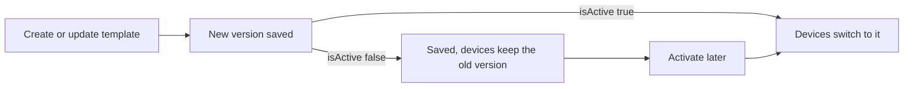

## Create Device Config

Creates a **config template** version. Use it to define the settings (QR bank account, card options, MQTT broker, app version, theme, ...) that terminals should receive.

### In a nutshell

- A **config template** is a named bundle of terminal settings, stored as one JSON object called `configJson`. You write it once and assign it to many terminals.
- A template is saved in **versions**. Each save creates a new row with the same `name` and a higher `version` (1, 2, 3, ...). Old versions are kept.
- At most one version per name is **active** (`isActive: true`). Devices that follow the template use the active version.
- When a template is assigned to a device (see *Assign Device Config*), the terminal downloads `configJson` as its settings.
- Fields you leave out of `configJson` are filled with defaults, so the server always stores a complete object.



### Before you start

You need a bearer token (the login token you send in the `Authorization` header) for a user who is allowed to change config templates. Without that permission you get `403`.

### Request

```http
POST /base/device/config
Authorization: Bearer <token>
Content-Type: application/json
```

Body fields:

| Name | Type | Required | What it means |
| --- | --- | --- | --- |
| `name` | string | Yes | Template name, e.g. `default-retail`. Spaces around it are trimmed. Reusing an existing name does not fail: it adds a **new version** of that template. |
| `configJson` | object | No | The settings sent to the terminal (sections are listed below). Missing keys get defaults: empty string, `0` or `false`; `functions.mqttEnabled` and `mqttConfig.mqttTls` default to `true`. `appConfig.versionName` is no longer part of the contract. |
| `isActive` | bool | No (default `false`) | `true` makes this the active version of its name right away (see "Good to know"). |
| `bankAppInfoIds` | int[] | No | IDs of bank-app (TID/MID) configs to link, e.g. `[3]`. Duplicates and values `<= 0` are ignored. |
| `checksum` | string | No | Free text stored with the version. |
| `createdBy` | string | No | Who created it (free text, e.g. `admin@thebase.vn`). |
| `base_id` (or `id`) | int | No | ID of an existing version to build on. It gives the `name` when you omit it, and its `configJson` when you omit `configJson`. Unknown ID gives `404`. Snake_case only: `baseId` is not read (the `baseId` inside `configJson` is something else). |

Values of the wrong type are ignored, not rejected: a non-object `configJson` counts as omitted, a non-boolean `isActive` as `false`, a non-array `bankAppInfoIds` as empty. The snake_case spellings `config_json`, `is_active`, `bank_app_info_ids` and `created_by` are accepted too.

Sections inside `configJson`:

| Section / key | What it holds |
| --- | --- |
| `owner`, `baseId` | Owner and Base ID text (top level), e.g. `THEBASE`, `B001`. |
| `pingTime` | How often the terminal pings the server, in seconds (top level), e.g. `60`. |
| `bypassSettleWhenUpdate` | bool (top level). Skip settlement when the app updates. |
| `state` | Top-level text. The server replaces it with the device's provisioning status when the terminal reads its config. |
| `ignoreAppBankErrorCodes` | List of bank error codes the app ignores (top level). |
| `appConfig` | App download: `appPath` (URL), `versionCode`, `forceInstall`. |
| `functions` | Feature switches: `apiPayFunc`, `billingFunc`, `cardFunc`, `disableLog`, `edcAppServiceV2Enabled`, `ignoreUpdatePayment`, `instFunc`, `isDemoPromotion`, `manuallyQrConfirmStatusFunc`, `mqttEnabled`, `prefixQrFunc`, `promotionFunc`, `qrFunc`, `voidFunc`. |
| `hiddenConfig` | Hidden options, e.g. `lockConfig`. |
| `qrConfig` | QR payment: `bankAccount`, `bankAccountHolder`, `bankBincode`, `defaultServiceCode`, `numberOfCopies`, `proxyName`, `proxyPrefix`, `proxyValue`, `qrTimeInterval`. |
| `cardConfig` | Card payment: `maxTip`, `numberOfCopies`, `paymentResultCountDown`. |
| `mqttConfig` | MQTT broker: `mqttCacert`, `mqttClientKey`, `mqttClientPem`, `mqttDeviceTopic`, `mqttDomain`, `mqttPassword`, `mqttPort`, `mqttTls`, `mqttUsername`. |
| `merchantInfo` | Shop details: `customerId`, `mmIconFileName`, `mmLogo`, `mmName`, `mmRefCode`, `storeName`. |
| `theme` | Colours: `bgError`, `bgPending`, `bgPrimary`, `bgSecondary`, `bgSuccess`, `error`, `onPrimary`, `onSecondary`, `pending`, `primary`, `secondary`, `success`. |

Extra keys you add are kept as you sent them.

### Example

```bash
curl -X POST "$BASE_URL/base/device/config" \
  -H "Authorization: Bearer $TOKEN" \
  -H "Content-Type: application/json" \
  -d '{
    "name": "default-retail",
    "isActive": true,
    "createdBy": "admin@thebase.vn",
    "bankAppInfoIds": [3],
    "configJson": {
      "owner": "THEBASE",
      "baseId": "B001",
      "pingTime": 60,
      "appConfig": { "appPath": "https://cdn.example.com/edc/app-1.4.2.apk", "versionCode": 142, "forceInstall": false },
      "functions": { "qrFunc": true, "cardFunc": true, "voidFunc": true },
      "qrConfig": { "bankAccount": "0123456789", "bankAccountHolder": "CONG TY ABC", "bankBincode": "970418", "qrTimeInterval": 180 },
      "mqttConfig": { "mqttDomain": "mqtt.example.com", "mqttPort": "8883", "mqttUsername": "edc" },
      "merchantInfo": { "mmName": "ABC Coffee", "storeName": "ABC Coffee Q1" }
    }
  }'
```

### Response

HTTP `201`. The created version, inside the standard `result` envelope. `configJson` comes back with every default filled in. The flat fields (`funcQr`, `mqttDomain`, ...) are read-only copies of values inside `configJson`, for easy display.

```json
{
  "id": "111020261535481234570001",
  "result": {
    "id": 13,
    "name": "default-retail",
    "version": 1,
    "configJson": {
      "owner": "THEBASE",
      "baseId": "B001",
      "pingTime": 60,
      "bypassSettleWhenUpdate": false,
      "state": "",
      "ignoreAppBankErrorCodes": [],
      "appConfig": { "appPath": "https://cdn.example.com/edc/app-1.4.2.apk", "versionCode": 142, "forceInstall": false },
      "functions": {
        "apiPayFunc": false, "billingFunc": false, "cardFunc": true, "disableLog": false,
        "edcAppServiceV2Enabled": false, "ignoreUpdatePayment": false, "instFunc": false,
        "isDemoPromotion": false, "manuallyQrConfirmStatusFunc": false, "mqttEnabled": true,
        "prefixQrFunc": false, "promotionFunc": false, "qrFunc": true, "voidFunc": true
      },
      "hiddenConfig": { "lockConfig": false },
      "qrConfig": {
        "bankAccount": "0123456789", "bankAccountHolder": "CONG TY ABC", "bankBincode": "970418",
        "defaultServiceCode": "", "numberOfCopies": 0, "proxyName": "", "proxyPrefix": "",
        "proxyValue": "", "qrTimeInterval": 180
      },
      "cardConfig": { "maxTip": 0, "numberOfCopies": 0, "paymentResultCountDown": 0 },
      "mqttConfig": {
        "mqttCacert": "", "mqttClientKey": "", "mqttClientPem": "", "mqttDeviceTopic": "", "mqttDomain": "mqtt.example.com",
        "mqttPassword": "", "mqttPort": "8883", "mqttTls": true, "mqttUsername": "edc"
      },
      "merchantInfo": { "customerId": "", "mmIconFileName": "", "mmLogo": "", "mmName": "ABC Coffee", "mmRefCode": "", "storeName": "ABC Coffee Q1" },
      "theme": {
        "bgError": "", "bgPending": "", "bgPrimary": "", "bgSecondary": "", "bgSuccess": "", "error": "",
        "onPrimary": "", "onSecondary": "", "pending": "", "primary": "", "secondary": "", "success": ""
      }
    },
    "appPath": "https://cdn.example.com/edc/app-1.4.2.apk",
    "appVersionCode": 142,
    "appForceInstall": false,
    "funcQr": true,
    "funcPrefixQr": false,
    "funcCard": true,
    "funcInst": false,
    "funcVoid": true,
    "funcApiPay": false,
    "funcBilling": false,
    "funcPromotion": false,
    "funcMqttEnabled": true,
    "qrBankAccount": "0123456789",
    "qrBankAccountHolder": "CONG TY ABC",
    "qrBankBincode": "970418",
    "qrTimeInterval": 180,
    "mqttDomain": "mqtt.example.com",
    "mqttPort": "8883",
    "mqttUsername": "edc",
    "mqttTls": true,
    "merchantName": "ABC Coffee",
    "merchantStoreName": "ABC Coffee Q1",
    "owner": "THEBASE",
    "baseId": "B001",
    "pingTime": 60,
    "bypassSettleWhenUpdate": false,
    "createdBy": "admin@thebase.vn",
    "isActive": true,
    "createdAt": "2026-09-26T08:00:00Z"
  }
}
```

| Field | What it means |
| --- | --- |
| `id` | ID of this version. Use it in the other `/base/device/config/{id}` calls. |
| `name` | Template name. |
| `version` | Set by the server: `1` for a new name, otherwise the highest existing version of that name plus 1. |
| `configJson` | The full settings, with all defaults filled in. |
| `isActive` | `true` if devices following this name use this version. |
| `createdBy`, `createdAt` | Who and when. |
| Flat fields (`appPath`, `funcQr`, `qrBankAccount`, `mqttDomain`, `merchantName`, `owner`, `pingTime`, ...) | Read-only copies of values in `configJson`. Empty ones are left out. |

The response does not include `tidmid` (linked bank apps) or `deviceStatuses` (assigned devices). Call *Get Device Config* for them.

### Errors

Errors use the standard format described in the API guide (see "Response" → "Errors").

| HTTP | `error.code` | What it means | What you should do |
| --- | --- | --- | --- |
| `400` | `-32700` | The body is not valid JSON. | Fix the JSON. |
| `400` | `-32000` / `-32602` | `name` is empty (and no `base_id` gives one), a `bankAppInfoIds` entry does not exist, or the save failed. | Read `message`; send a `name` or valid IDs. |
| `401` | `-32001` | Missing or invalid token. | Log in again and retry. |
| `403` | `-32003` | Your user may not change config templates. | Ask an admin for the permission. |
| `404` | `-32004` | `base_id` / `id` was sent but no such version exists. | Check the ID. |

### Good to know

- With `isActive: true`, every other version with the **same name** becomes inactive, and devices assigned to the previously active version switch to this one (their config changes immediately). Templates with other names are not touched.
- Passwords and keys: the flat `mqttPassword`, `mqttClientKey` and `mqttClientPem` never appear in responses, but `configJson.mqttConfig` contains them and returns them.
- Leave `mqttConfig.mqttDeviceTopic` empty. The real topic (`base/<group name>/<serial>/cmd`) is set per device when the terminal reads its config.
- The flat `theme*` fields may show built-in default colours (e.g. `themePrimary: "#2F5D17"`) even when `configJson.theme` is empty. Terminals receive `configJson`, so set the colours there.
- Also available as the older route `POST /base/edc/device/config/create-version`. Put the fields in `kwargs` (`name`, `config_json` or `configJson`, `is_active` or `isActive`, `bank_app_info_ids` or `bankAppInfoIds`, `checksum`, `created_by` or `createdBy`, `base_id`/`id`). It returns status `200` with the row in snake_case names, any failure is `400` with a plain-text message, and a user without write permission gets `403`.
