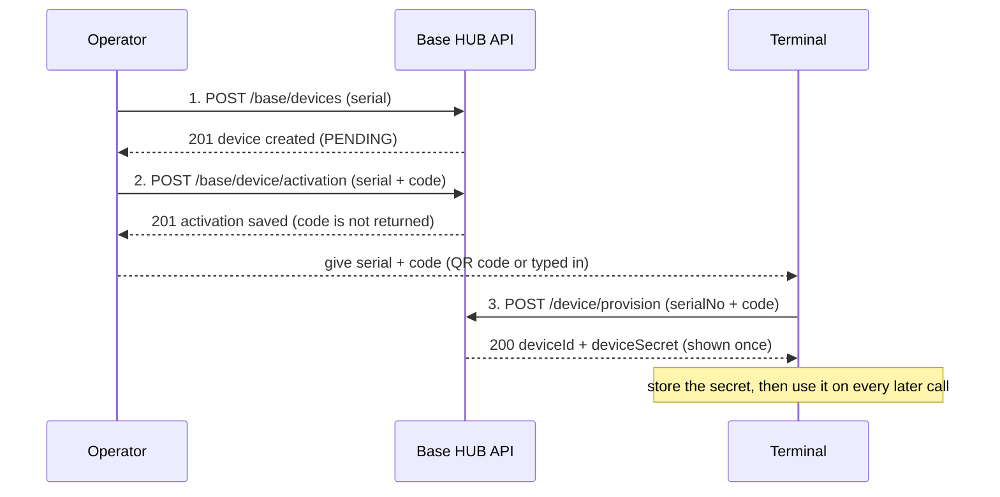

## Create Device (and the onboarding guide)

Registers a new EDC terminal (a payment device) in Base HUB. This is step 1 of onboarding. This page also explains the whole flow: create the device, set an activation code, let the terminal provision itself.

### In a nutshell

- Onboarding takes three calls: **create device**, **set activation code**, **provision**.
- Steps 1 and 2 are made by an operator with a bearer token (the token you get from `POST /oauth/token`, sent as `Authorization: Bearer <token>`).
- Step 3 is made by the terminal itself. It sends its serial and the activation code and receives a **device secret**.
- The device secret is shown **only once**. If it is lost, set a new activation code and provision again.
- Use upper-case serials everywhere (for example `SN0001`).

### The flow



| Step | Who calls it | Route | Auth | Page |
| --- | --- | --- | --- | --- |
| 1. Create the device | Operator | `POST /base/devices` | Bearer token, create access to `edc.device` | this page |
| 2. Set the activation code | Operator | `POST /base/device/activation` | Bearer token, write access to `edc.device.activation` | Create Device Activation |
| 3. Provision the device | Terminal | `POST /device/provision` | None (the activation code is the credential) | Provision Device |

### Step-by-step example

Set two shell variables first: `BASE_URL` (your server, e.g. `https://hub.example.com`) and `TOKEN` (your bearer token).

**Step 1.** Create the device.

```bash
curl -X POST "$BASE_URL/base/devices" \
  -H "Authorization: Bearer $TOKEN" \
  -H "Content-Type: application/json" \
  -d '{"serial":"SN0001","imei":"356938035643809","ownerId":10,"holderId":25}'
```

**Step 2.** Set an 8-digit activation code that expires at the time you choose.

```bash
curl -X POST "$BASE_URL/base/device/activation" \
  -H "Authorization: Bearer $TOKEN" \
  -H "Content-Type: application/json" \
  -d '{"serial":"SN0001","activationCode":"48213907","expiresAt":"2026-09-27T08:00:00Z"}'
```

Give `SN0001` and `48213907` to the terminal through a trusted channel (QR code or manual entry).

**Step 3.** The terminal provisions itself. No token is needed.

```bash
curl -X POST "$BASE_URL/device/provision" \
  -H "Content-Type: application/json" \
  -d '{"serialNo":"SN0001","activationCode":"48213907"}'
```

The response holds `deviceSecret`. Check the result with `GET /base/devices/SN0001`: `provisioningStatus` is now `ACTIVE` and `secretVersion` is `1`.

### Before you start

- **Serials: use upper case.** Step 1 stores the serial exactly as you send it. Steps 2 and 3 upper-case it. Device routes such as `GET /base/devices/{serial}` match it case-sensitively. If you create `sn0001`, those routes will not find `SN0001`.
- **Do step 2 right after step 1.** A new device gets a default activation code, `12345678`. Replace it before the device leaves your hands.
- A token without the needed permission gets `403`.

### Request (step 1)

```http
POST /base/devices
Authorization: Bearer <token>
Content-Type: application/json
```

| Name | Type | Required | What it means |
| --- | --- | --- | --- |
| `serial` | string | Yes | The unique number of the terminal, e.g. `SN0001`. Spaces around it are removed. It must not already exist. |
| `imei` | string | No | The IMEI of the terminal, e.g. `356938035643809`. |
| `ownerId` | int | No | ID of the owner account, e.g. `10`. Default `1`. |
| `holderId` | int | No | ID of the holder (merchant or user), e.g. `25`. Default `1`. |
| `active` | bool | No | Default `true`. Must be `true`, or the terminal cannot provision. |

Other keys (for example `groupId`, `provisioningStatus`) are ignored. A new device joins the `default` group (if it exists) and gets a status row. To change the group later, use `POST /base/groups/{id}/devices`.

### Response (step 1)

`201 Created`:

```json
{
  "id": "111020261535481234570001",
  "result": {
    "id": 42,
    "serial": "SN0001",
    "imei": "356938035643809",
    "ownerId": 10,
    "holderId": 25,
    "groupId": 1,
    "active": true,
    "provisioningStatus": "PENDING",
    "secretVersion": 0,
    "createdAt": "2026-09-26T08:00:00Z",
    "updatedAt": "2026-09-26T08:00:00Z"
  }
}
```

| Field | What it means |
| --- | --- |
| `id` (outer) | Request ID, used for tracing. |
| `result.id` | Numeric ID of the new device. |
| `provisioningStatus` | `PENDING` until the terminal provisions, then `ACTIVE`. |
| `secretVersion` | `0` means no secret yet. It becomes `1` after provisioning. |

> **Check:** Timestamps in `/base/...` rows are shown as RFC 3339 strings here. The API guide says dates are Unix seconds; confirm with a real call.

### Errors (step 1)

Errors use the standard format described in the API guide (see "Response" → "Errors"). The old string code moves to `error.data.reason`.

| HTTP | `error.code` | What it means | What to do |
| --- | --- | --- | --- |
| `400` | `-32700` / `-32000` | The body is not valid JSON, or `serial` is empty, or the device could not be saved. | Fix the body. |
| `401` | `-32001` | Missing or invalid token. | Get a new token. |
| `403` | `-32003` | Your user may not create `edc.device` records. | Ask an admin for access. |
| `409` | `-32009` | A device with this serial already exists (`data.reason` is `duplicate_serial`). | Use the existing device, or pick another serial. |

### Step 2: Set the activation code

Full details are on the **Create Device Activation** page.

```http
POST /base/device/activation
```

| Name | Type | Required | What it means |
| --- | --- | --- | --- |
| `serial` | string | Yes | The serial from step 1, e.g. `SN0001`. |
| `activationCode` | string | Yes | **Exactly 8 digits**, e.g. `48213907`. Other formats are accepted here but can never be used by the terminal. Do not use `12345678`. |
| `expiresAt` | string | No | When the code stops working, e.g. `2026-09-27T08:00:00Z`. Default: 60 minutes from now (setting `edc.provisioning.activation_code_ttl_minutes`). |

The response is `201` with the activation record. The code is never returned or shown again.

> **Warning:** Setting a code **re-arms** the device. If the terminal is already `ACTIVE`, its old secret stops working at once.

### Step 3: Provision (called by the terminal)

Full details are on the **Provision Device** page.

```http
POST /device/provision
```

| Name | Type | Required | What it means |
| --- | --- | --- | --- |
| `serialNo` | string | Yes | The serial, max 128 characters, e.g. `SN0001`. Not case-sensitive. |
| `activationCode` | string | Yes | The 8-digit code from step 2. |

Success (`200`) returns `{"deviceId":"SN0001","deviceSecret":"<64 hex characters>","secretVersion":1}`.

> **Warning:** `deviceSecret` is returned **only once**. The terminal must store it before doing anything else.

Common failures (the body is `{"error":"<name>","message":"..."}`):

| HTTP | `error` | What to do |
| --- | --- | --- |
| `401` | `activation_invalid` | Wrong code, or no code set. Check the code or redo step 2. |
| `404` | `device_not_registered` | No device with this serial. Redo step 1. |
| `409` | `activation_already_used` | The code was already used. Redo step 2 with a new code. |
| `410` | `activation_expired` | The code expired. Redo step 2. |
| `423` | `device_not_eligible` | The device is inactive, revoked or already provisioned. Re-enable it and/or redo step 2. |

### After provisioning

The terminal now uses its secret:

- **Device HTTP routes:** `Authorization: Bearer SN0001:1:<deviceSecret>` (format `<deviceId>:<secretVersion>:<deviceSecret>`).
- **MQTT** (the messaging channel to the terminal): connect with client ID `SN0001`. Commands sent with `POST /base/devices/{serial}/commands` are signed with this secret.

### Re-activating a device

Use this when the terminal lost its secret, was replaced or reset, or its code expired.

1. Set a new code: call `POST /base/device/activation` again, or `PUT /base/device/activation/{id}` with `activationCode` and `expiresAt`.
2. The terminal runs step 3 again.

> **Warning:** A new code immediately disconnects a device that is already `ACTIVE`. Send `expiresAt` **together with** `activationCode`; sending only `expiresAt` replaces the code with an unknown random one.

### Good to know

- Steps 1 and 2 can be retried. Repeating step 1 returns `409`. Repeating step 2 replaces the code.
- If step 3 worked but the terminal lost the response, a retry returns `409 activation_already_used` and the secret is gone. Redo step 2, then step 3.
- If the server has no provisioning key (`app.encryptKey`), the default code is skipped and steps 2 and 3 fail until an admin configures the key.
- To create many devices at once, use `POST /base/devices/bulk-import`, then do step 2 for each serial.
- To replace only the secret of a working device, use **Rotate Device Secret** instead of re-activating.
