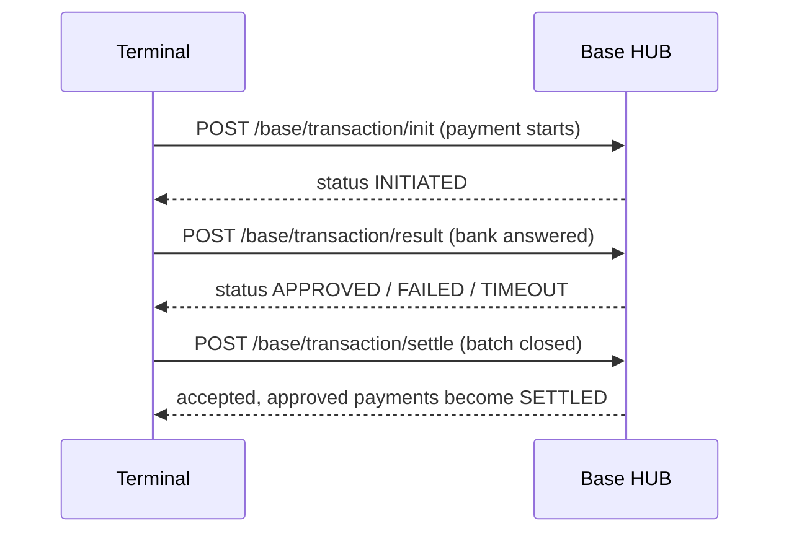

## EDC Transaction Init

The terminal calls this when a payment starts, before the card or QR code is processed. It registers the payment (its ID and amount) so that the later "result" call can be matched to it.

> **Warning:** This is a device callback with a frozen body. The terminal firmware parses the response, so field names and shapes do not change. Do not add or rename fields.

### In a nutshell

1. The terminal starts a payment and calls **init** (`POST /base/transaction/init`). The server records it with status `INITIATED`.
2. The bank app handles the card or QR. The terminal then calls **result** (`POST /base/transaction/result`). The status becomes `APPROVED`, `FAILED` or `TIMEOUT`.
3. At the end of the day the bank app closes the batch. The terminal calls **settle** (`POST /base/transaction/settle`). A **settlement** is the bank's end-of-batch total: "these N payments, this much money, are finalised". Approved payments in that batch become `SETTLED`.



### Before you start

This route does not use a Base HUB user token. The setting `edc.device_http_auth` decides how the terminal proves who it is:

- `public` (default): no token. The server finds the device from `deviceId` in the body. An unknown serial gets `404`.
- `token`: send `Authorization: Bearer <serial>:<secretVersion>:<deviceSecret>`. This is the device token the terminal received during provisioning.

If you send an `Authorization` header, the server always checks it, even in `public` mode. With a valid token, the server uses the serial from the token instead of the body `deviceId`. The headers `X-Device-Serial`, `X-Timestamp`, `X-Nonce` and `X-Signature` are ignored.

### Request

```http
POST /base/transaction/init
Content-Type: application/json
```

| Body field | Type | Required | What it means |
| --- | --- | --- | --- |
| `deviceId` | string (max 128) | Yes | Terminal serial (the unique number printed on the terminal), e.g. `SN0001`. Old key `device_id` also works. |
| `transactionId` | string (max 128) | Yes | ID the terminal creates for this payment. Must be unique per payment, e.g. `TXN20260926000123`. Old key `transaction_id` also works. |
| `requestBody` | string | No | The bank-app request **as a JSON string** (JSON written inside a string). The server reads `transactionAmount` (integer string), `currencyName`, `tranxType`, `thirdPartyId`, `transDateTime`. Old key `request_body`. |
| `response` | string | No | The bank-app response **as a JSON string**: `{Code, Desc, tranxType, Response:{...}}` or a flat object. `Response.totalAmount` replaces the amount; `Response.currency` replaces the currency. |
| `type` | string (max 32) | No | Payment type such as `SALE`. Used only when the JSON strings have no `tranxType`. |
| `gps` | string (max 128) | No | Terminal location as `lat,lng`, e.g. `21.0285,105.8542`. |
| `appVersion` | string (max 128) | No | Terminal app version, e.g. `2.4.1`. |
| `bankApp` | string (max 128) | No | Bank app name, e.g. `BANKAPP`. |

Amounts are **integer strings in whole currency units**: `"150000"` means 150,000 VND. A value with decimals or separators (`"150000.00"`, `"150,000"`) is ignored and the amount is saved as `0`. The currency defaults to `VND`.

### Example

```bash
curl -X POST "$BASE_URL/base/transaction/init" \
  -H "Content-Type: application/json" \
  -d '{
    "deviceId": "SN0001",
    "transactionId": "TXN20260926000123",
    "type": "SALE",
    "requestBody": "{\"transactionID\":\"TXN20260926000123\",\"transactionAmount\":\"150000\",\"currencyName\":\"VND\",\"tranxType\":\"SALE\",\"transDateTime\":\"2026-09-26T08:15:00+07:00\"}",
    "response": "",
    "gps": "21.0285,105.8542",
    "appVersion": "2.4.1",
    "bankApp": "BANKAPP"
  }'
```

### Response

HTTP `200`. This body has its own format (no `result` envelope).

```json
{
  "success": true,
  "data": {
    "accepted": true,
    "transactionId": "TXN20260926000123",
    "status": "INITIATED",
    "amount": 150000,
    "currency": "VND",
    "expiredAt": "2026-09-26T08:20:00.512+07:00",
    "logId": "5530"
  }
}
```

| Field | What it means |
| --- | --- |
| `accepted` | `true` when the server saved the call. |
| `transactionId` | The payment ID you sent. |
| `status` | Current status of the payment. `INITIATED` for a new payment. On a retry it can already be `APPROVED` if the result arrived. |
| `amount` / `currency` | The amount (whole units) and currency the server recorded. |
| `expiredAt` | Init time + 5 minutes. For information only; the server does not expire anything. |
| `logId` | ID of the raw callback log. Use it with `GET /base/txn-logs/{id}`. |

### Errors

Callback errors keep the old device format, not the standard one: `{"code": "...", "message": "..."}`. Validation errors look like `{"errors":[{"field":"DeviceID","message":"..."}]}`.

| HTTP | `code` | What it means | What you should do |
| --- | --- | --- | --- |
| `400` | `invalid_json` | The body is not valid JSON (`detail` has the parse error). | Fix the JSON. |
| `400` | none (`errors` list) | `deviceId` or `transactionId` is missing, or a field is too long. | Send the required fields. |
| `401` | none | Token is missing or wrong (`token` mode, or you sent a bearer header). Body: `{"error":"missing_device_token"` or `"invalid_device_token", ...}`. | Re-provision the terminal or fix the token. |
| `404` | `device_not_found` | No device has this serial. | Check the spelling (serials are upper-case) and that the device exists. |
| `409` | none | Same `transactionId` was already started with a **different amount**, or it belongs to another device. | Use a new `transactionId` for a new payment. |
| `500` | `internal_error` | Server or database error. | Safe to retry. |

### Good to know

- **Retries are safe.** Same `deviceId` + `transactionId` + same amount returns `200` with the original `logId` and `expiredAt` and the **current** `status`. Nothing new is saved.
- Never reuse a `transactionId` for another payment. A different amount gets `409`.
- Init only reserves the record. If a result for the same `transactionId` arrived first, init only links its log and never moves the status backwards.
- If init fails, the terminal can still send the result. The result is accepted without an init.
- The call writes a log row `EDC_INIT_REQUEST` (parse status `IGNORED`) and creates the transaction record.
