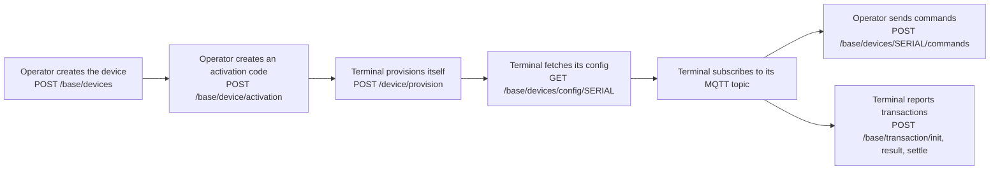

# EDC Device Service

The EDC module of Base HUB is the backend for Android EDC/POS payment terminals. An **EDC terminal** (also called a
"device") is a payment machine in a shop. Admins register terminals here, send them settings and commands, and read the
payments the terminals report.

This page is the map. Read it first, then open the endpoint pages you need.

## 1. Your first call in 5 minutes

**Step 1. Get a token** (a temporary password string).

```bash
curl -X POST "$BASE_URL/oauth/token" \
  -H "Content-Type: application/json" \
  -d '{"grant_type":"password","username":"operator01","password":"<password>"}'
```

```json
{ "access_token": "eyJhbGciOi...", "refresh_token": "5f9d6c3b1a...", "expires_in": 900, "token_type": "Bearer" }
```

`expires_in` is in seconds (900 = 15 minutes). Renew with `grant_type=refresh_token`. `/auth/token` is the same endpoint.

**Step 2. Call the API.**

```bash
curl "$BASE_URL/base/devices?limit=20" -H "Authorization: Bearer $TOKEN"
```

**Step 3. Read the answer.**

```json
{ "id": "111020261535481234570001", "result": { "items": [ { "serial": "SN0001" } ], "total": 128 } }
```

The data is in `result`. A list has `result.items` and `result.total`. If something goes wrong you get `error` instead
(see section 6).

Check who a token belongs to with `GET /auth/me` (same as `GET /oauth/me`).
If the server hosts several tenant databases, also send `X-Database-Name: <db>` (or `?db=<db>`) and pass `"db"` when asking for the token.
A token only works for the database it was issued for.

## 2. Words you will see

| Term | Plain meaning |
| --- | --- |
| Token (bearer token) | Temporary password string sent as `Authorization: Bearer <token>`. |
| Terminal / device | A physical EDC payment machine. |
| Serial | The unique number of a terminal, for example `SN0001`. Always upper-case. |
| Activation code | An 8-digit one-time code created by an operator. The terminal uses it once to register itself. |
| Provisioning | The terminal sends its serial and activation code and receives its permanent secret (shown only once). |
| Device secret | The terminal's own password after provisioning. |
| Config template | A versioned set of settings (including bank app TID/MID) that is pushed to terminals. |
| TID / MID | Terminal ID and Merchant ID: numbers a bank gives to identify a terminal and a shop. |
| MQTT | A lightweight messaging system. The server publishes commands to a topic and the terminal listens. |
| MQTT topic | The "address" a message is sent to, for example `base/default/SN0001/cmd`. |
| Command | A signed message (EDC v1.3) sent to a terminal, for example "reboot". |
| Settlement | The end-of-day batch that totals a terminal's approved transactions. |
| ACL | The permission check. It decides what your user may read or change. A denied call returns `403`. |
| Idempotency key | A unique string in `X-Idempotency-Key` so a retried call is not executed twice. |
| Envelope | The JSON wrapper `{"id": ..., "result": ...}` or `{"id": ..., "error": ...}` around every answer. |

## 3. How a terminal goes live



1. An operator creates the device (`POST /base/devices`). A new device joins the default group.
2. The operator sets an 8-digit activation code (`POST /base/device/activation`).
3. The terminal calls `POST /device/provision` with its serial and the code and receives its permanent secret **once**. Save it.
4. The terminal fetches its config (`GET /base/devices/config/:serial`). The config carries `mqttConfig.mqttDeviceTopic`, the topic to subscribe to.
5. Operators send signed EDC v1.3 commands (`POST /base/devices/{serial}/commands`, or `POST /mqtt/publish`). Commands go to:

```text
base/<group name>/<serial>/cmd
```

`<group name>` is the device's group (falls back to `default`). Devices on the launcher AIDL bridge use `<serial>/cmd`.
Wildcards are not allowed in publish topics. To reach a whole group, send one command per member device.

Terminals report back on the shared topics `base/evt` (events, status) and `base/txn` (transactions). The server handles
these itself; they are not HTTP routes. Read the history with the list routes in section 7.

Device activation and `/device/provision` need provisioning enabled (`app.deviceProvisioningEnable`, default on).

## 4. Which page do I read?

| I want to... | Read the page |
| --- | --- |
| Add one terminal and bring it online | Device Onboarding: Create → Activate → Provision (`POST /base/devices`) |
| Add many terminals at once | Bulk Import Devices |
| Find or inspect terminals | List Devices, Get Device |
| Give a terminal an activation code | Create Device Activation, Issue Device Activation Code |
| Understand what the terminal sends to register | Provision Device |
| Build a settings template | Create Device Config, then Activate Device Config |
| Attach a template to one terminal | Assign Device Config |
| See the config a terminal receives | Get Device Config |
| Rotate a terminal's secret | Rotate Device Secret |
| Send a command (reboot, update, ...) | Device Commands API, Publish MQTT Message |
| See what commands were sent | List Device Commands |
| Group terminals | Create Group, Add Device to Group (`group_device_add_api.md`) |
| Understand what a terminal sends for a payment | EDC Transaction Init, EDC Transaction Result, EDC Batch Settle |
| Look up payments as an admin | Search Transactions, Search Settlements |
| Debug a terminal | List Device Logs, List Audit Logs |
| Get a token or manage admin users | Get Access Token and the `admin_user_*` pages |

Page titles above match the headings in the route index (section 8).

## 5. Who uses this API and how they sign in

| Caller | Typical use | Auth |
| --- | --- | --- |
| Admin web app / operators | Manage devices, configs, groups; read logs and transactions | Base HUB user token: `Authorization: Bearer <access_token>` |
| Automation / service callers | Server-to-server admin calls | The same Bearer token (OAuth client with `grant_type=client_credentials`), or `X-API-Key` when the server enables `app.supportApikey` |
| EDC terminals | Provision themselves, report transactions, fetch config, upload logs | Activation code, then the device token |

**Users.** Access is decided by Base HUB's model access rules (ACL) and record rules, the same as `/rpc`. There are no
`VIEWER` / `OPERATOR` / `ADMIN` roles. Without the right you get `403`. A missing, invalid or expired token gives `401`: get a new token and retry.

**Terminals.** After provisioning, a terminal signs device routes with its own secret:

```http
Authorization: Bearer <SERIAL>:<secretVersion>:<deviceSecret>
```

Example: `Authorization: Bearer SN0001:1:9f1c2e...`. The server setting `edc.device_http_auth` controls this:

* `public` (default): the terminal routes (`/device/provision`, `GET /base/devices/config/:serial`, `POST /base/device/log/upload`,
  `/base/transaction/init|result|settle`) accept calls without a token. A token that is sent is still verified.
* `token`: the token is required and its serial must match the device.

**Public utility routes.** `/health`, `/metrics`, `/qr`, `/banklist/...`, `/keys`, `/aes`, `/aeshmac` and `/jsonstring` need no authentication.

## 6. Conventions, responses and errors

* **Serials** are upper-case (`SN0001`). Some routes match exactly, so `sn0001` will not be found.
* **JSON field names** are camelCase (`ownerId`, `expiresAt`). Some list filters in query strings are snake_case (`owner_id`, `device_serial`); each page lists its parameters. Secrets and hashes are never returned.
* **Times** in the standard envelope are UTC Unix seconds (for example device status `event_at`). Terminal-facing bodies and some request fields keep their own formats (for example RFC 3339 `2026-09-26T08:00:00Z`); each page says which.
* **Amounts** are whole-currency integers in strings, for example `"150000"` = 150,000 VND. No decimals or separators.
* **Pagination.** List routes take `limit` (default `50`) and `offset` (default `0`). The maximum `limit` is `500`; a larger value falls back to `50`.
* An empty page may return `"items": null`. Treat `null` like `[]`.
* **Response shape.** Authenticated routes answer `{"id": "...", "result": ...}`. Deletes and deactivations return `{"deleted": true, "id": N}`.

Errors use the standard format described in the API guide (see "Reading responses and errors"):

```json
{ "id": "111020261535481234570001", "error": { "code": -32004, "message": "device not found" } }
```

Branch your code on `error.code` (a number); `message` is for people and can change. A module-specific string code may appear in `error.data.reason`.

| HTTP | Meaning | What to do |
| --- | --- | --- |
| `400` | Bad input | Fix the request. Do not retry it unchanged. |
| `401` | Missing or expired token, or bad credentials | Get a new token. |
| `403` | Access denied by ACL | Use an account with the required access. |
| `404` | Not found | Check the id or serial (upper-case). |
| `409` | Conflict or duplicate (for example duplicate serial, config in use) | Read `message`; often the first attempt already succeeded. |
| `5xx` | Server-side problem | Retry later with backoff. Contact THE BASE if it persists. |

Some surfaces keep their own format:

* Terminal callbacks (`/base/transaction/init|result|settle`, `/device/provision`, `GET /base/devices/config/:serial`, `POST /base/device/log/upload`) keep the fixed bodies terminals already parse, such as `{ "code": "...", "message": "..." }` or `{ "error": "...", "message": "..." }`. Their pages show them.
* The helpers (`/banklist`, `/keys`, `/aes`, `/aeshmac`, `/jsonstring`) answer `{ "code": 0, "data": ... }` on success and `{ "code": <status>, "message": "..." }` on failure. The HTTP status of a failure is always `500`, so read `code` from the body. `/qr` answers the bare object `{ "qrBase64": "...", "qrString": "..." }` (see `util_qr_generate_api.md`).
* `/auth/token` follows OAuth 2.0: `{ "error": "invalid_grant", "error_description": "..." }`.

> **Check:** the terminal callback pages and the older per-route pages may still describe the pre-JSON-RPC error body
> `{ "error": "not_found", "message": "..." }` for admin routes. Admin `/base/...` routes now return the JSON-RPC error above.

## 7. URL layout

| Prefix | What lives there |
| --- | --- |
| `/base/...` | Admin and terminal business APIs: devices, activation, config, status, commands, groups, logs, transactions, settlements, audit logs, MQTT messages, bank app info. |
| `/device/provision` | Public terminal bootstrap (not under `/base`). |
| `/mqtt/publish` | Publish a signed command (Base HUB token required). Present when the MQTT client is enabled. |
| `/auth/...`, `/oauth/...` | Token, revoke, session info. |
| `/health`, `/metrics` | Public liveness probe and Prometheus metrics. `GET /health/detail` (Bearer token, root company on the home database) adds database, Kafka and MQTT state. |
| `/web/content` | Attachment upload (`POST`, token required) and download (`GET /web/content/{id}`). |
| `/qr`, `/banklist/...`, `/keys`, `/aes`, `/aeshmac`, `/jsonstring` | Public helpers (QR generation, bank list, crypto helpers). |
| `/rpc/{model}/{method}` | The generic RPC every model is reachable through (for example `base.users`, `edc.device`). |
| `/doc`, `/doc/openapi.json` | Machine-readable API docs (authenticated). The admin UI shows these pages at `/web/apidoc`. |

Routes under `/base/...` are REST aliases of module methods (for example `GET /base/devices` is `edc.device.search_read`), so everything is also callable through `/rpc`.

---

## 8. Route index

Each row is one endpoint page. "Page" is the file name; the page title is its first heading. **Device** rows are called by terminals. **Kernel** rows are built-in utilities. **Not available** rows are not implemented here; the page names the equivalent.

### Auth and users

| Page | Route | Note |
| --- | --- | --- |
| `auth_token_api.md` | `POST /auth/token` | OAuth 2.0 token |
| `auth_me_api.md` | `GET /auth/me` | Current session info |
| `admin_user_list_api.md` | `GET /base/admin/users` |  |
| `admin_user_create_api.md` | `POST /base/admin/users` |  |
| `admin_user_update_api.md` | `PUT /base/admin/users/{id}` |  |
| `admin_user_password_reset_api.md` | `POST /base/admin/users/{id}/password` | with divergences |
| `admin_user_roles_set_api.md` | `POST /base/admin/users/{id}/roles` | Not available |

### Devices, activation, status

| Page | Route | Note |
| --- | --- | --- |
| `device_create_api.md` | `POST /base/devices` (+ onboarding guide) | |
| `device_list_api.md` | `GET /base/devices` | |
| `device_get_api.md` | `GET /base/devices/{serial}` | |
| `device_update_api.md` | `PUT /base/devices/{serial}` | |
| `device_deactivate_api.md` | `DELETE /base/devices/{serial}` | |
| `device_search_api.md` | `POST /base/devices/search` | |
| `device_bulk_import_api.md` | `POST /base/devices/bulk-import` | |
| `device_commands_api.md` | `POST /base/devices/{serial}/commands` | |
| `device_resolved_config_api.md` | `GET /base/devices/config/{serial}` | Device (anonymous alias) |
| `device_provision_api.md` | `POST /device/provision` | Device (anonymous alias) |
| `device_activation_create_api.md` | `POST /base/device/activation` | |
| `device_activation_list_api.md` | `GET /base/device/activation` | |
| `device_activation_get_api.md` | `GET /base/device/activation/{id}` | |
| `device_activation_update_api.md` | `PUT /base/device/activation/{id}` | re-issues the code |
| `device_activation_delete_api.md` | `DELETE /base/device/activation/{id}` | |
| `device_status_list_api.md` | `GET /base/device/status` | |
| `device_status_get_api.md` | `GET /base/device/status/{serial}` | |
| `device_status_config_get_api.md` | `GET /base/device/status/{serial}/config` | |
| `device_status_config_assign_api.md` | `PUT /base/device/status/{serial}/config` | |

### Configs, bank apps, groups

| Page | Route | Note |
| --- | --- | --- |
| `device_config_list_api.md` | `GET /base/device/config` | |
| `device_config_get_api.md` | `GET /base/device/config/{id}` | |
| `device_config_create_api.md` | `POST /base/device/config` | |
| `device_config_update_api.md` | `PUT /base/device/config/{id}` | appends a version |
| `device_config_activate_api.md` | `POST /base/device/config/{id}/activate` | |
| `device_config_delete_api.md` | `DELETE /base/device/config/{id}` | |
| `bank_app_info_list_api.md` | `GET /base/bank-app-info` | |
| `bank_app_info_get_api.md` | `GET /base/bank-app-info/{id}` | |
| `bank_app_info_create_api.md` | `POST /base/bank-app-info` | |
| `bank_app_info_update_api.md` | `PUT /base/bank-app-info/{id}` | |
| `bank_app_info_delete_api.md` | `DELETE /base/bank-app-info/{id}` | |
| `group_list_api.md` | `GET /base/groups` | |
| `group_get_api.md` | `GET /base/groups/{id}` | |
| `group_create_api.md` | `POST /base/groups` | |
| `group_update_api.md` | `PUT /base/groups/{id}` | |
| `group_delete_api.md` | `DELETE /base/groups/{id}` | |
| `group_device_list_api.md` | `GET /base/groups/{id}/devices` | |
| `group_device_add_api.md` | `POST /base/groups/{id}/devices` | sets the device's group |
| `group_device_remove_api.md` | `DELETE /base/groups/{id}/devices/{memberID}` | clears the device's group |

### Commands, MQTT, logs

| Page | Route | Note |
| --- | --- | --- |
| `device_command_list_api.md` | `GET /base/device/command` | |
| `device_command_get_api.md` | `GET /base/device/command/{id}` | |
| `mqtt_publish_message_api.md` | `POST /mqtt/publish` | token required; some topics restricted |
| `mqtt_message_list_api.md` | `GET /base/mqtt-messages` | |
| `mqtt_message_get_api.md` | `GET /base/mqtt-messages/{id}` | |
| `device_log_list_api.md` | `GET /base/device/log` | |
| `device_log_get_api.md` | `GET /base/device/log/{id}` | |
| `device_log_upload_api.md` | `POST /base/device/log/upload` | Device (anonymous alias) |
| `device_error_log_list_api.md` | `GET /base/device-error-logs` | |
| `device_error_log_get_api.md` | `GET /base/device-error-logs/{id}` | |
| `audit_log_list_api.md` | `GET /base/audit-logs` | |
| `audit_log_get_api.md` | `GET /base/audit-logs/{id}` | |

### Transactions and settlements

| Page | Route | Note |
| --- | --- | --- |
| `edc_transaction_init_api.md` | `POST /base/transaction/init` | Device (hand-written) |
| `edc_transaction_result_api.md` | `POST /base/transaction/result` | Device (hand-written) |
| `edc_transaction_settle_api.md` | `POST /base/transaction/settle` | Device (hand-written) |
| `transaction_search_api.md` | `POST /base/transaction/search` | |
| `transaction_log_search_api.md` | `POST /base/transaction/logs/search` | |
| `transaction_get_api.md` | `GET /base/transaction/{id}` | |
| `transaction_upsert_api.md` | `PUT /base/transaction` | |
| `transaction_delete_api.md` | `DELETE /base/transaction/{id}` | |
| `txn_log_list_api.md` | `GET /base/txn-logs` | |
| `txn_log_get_api.md` | `GET /base/txn-logs/{id}` | |
| `settlement_search_api.md` | `POST /base/settlement/search` | |
| `settlement_get_api.md` | `GET /base/settlement/{id}` | |
| `settlement_upsert_api.md` | `PUT /base/settlement` | |
| `settlement_delete_api.md` | `DELETE /base/settlement/{id}` | |

### System, utilities, storage

| Page | Route | Note |
| --- | --- | --- |
| `system_health_api.md` | `GET /health` | Kernel (Base HUB shape) |
| `system_metrics_api.md` | `GET /metrics` | Kernel (Prometheus) |
| `system_feature_flags_api.md` | `GET /config/features` | Not available |
| `system_config_get_api.md` | `GET /base/system-config` | Not available |
| `system_config_update_api.md` | `PUT /base/system-config` | Not available |
| `system_config_restart_api.md` | `POST /base/system-config/restart` | Not available |
| `system_config_sync_webhooks_api.md` | `POST /base/system-config/sync-webhooks` | Not available |
| `util_qr_generate_api.md` | `GET /qr` | Kernel |
| `util_bank_list_api.md` | `GET /banklist/{bankCode}` | Kernel |
| `cryptogram_keys_generate_api.md` | `GET /keys` | Kernel |
| `cryptogram_aes_encrypt_decrypt_api.md` | `POST /aes` | Kernel |
| `cryptogram_aes_hmac_sign_api.md` | `POST /aeshmac` | Kernel |
| `cryptogram_query_string_build_api.md` | `POST /jsonstring` | Kernel |
| `s3_upload_file_api.md` | `POST /s3/upload` | See the page; no handler found in this codebase |

---

## Support

This service is built and maintained by **[THE BASE](https://thebase.vn)**. Report issues or request API changes through THE BASE's engineering team.
