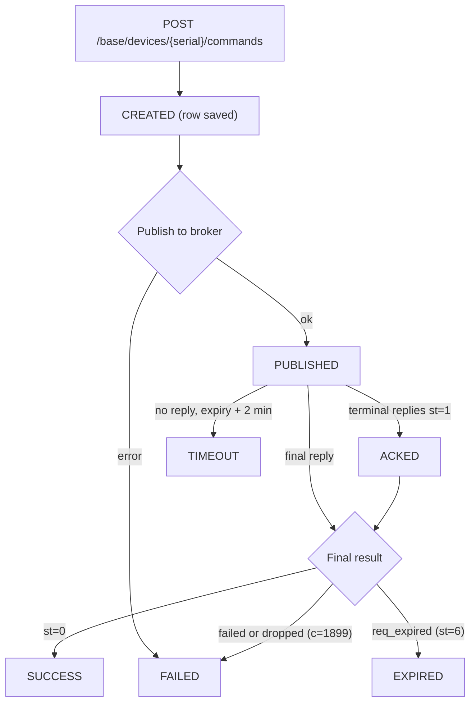

## Device Commands API

Gửi một command (ví dụ "bắt đầu thanh toán QR" hoặc "tải lại cấu hình") tới một terminal. Dùng từ backend hoặc công cụ admin mỗi khi server cần ra lệnh cho terminal làm việc gì đó.

### In a nutshell

- **Terminal** (còn gọi là device hoặc EDC; máy thanh toán thẻ) lắng nghe trên một MQTT topic. MQTT là hệ thống nhắn tin: server thả message vào một kênh có tên (topic) thông qua broker, và terminal nhận nó.
- Bạn gọi `POST /base/devices/{serial}/commands` với `commandCode` (một số như `112`) và `payload` (dữ liệu cho command đó).
- Backend tìm terminal, ký message bằng secret của terminal, lưu một dòng command và publish.
- API trả `201` ngay khi **broker** nhận message. Terminal trả lời sau, bất đồng bộ. Theo dõi kết quả bằng `GET /base/device/command/{id}`.
- Nếu publish lỗi, dòng đã lưu vẫn được giữ với status `FAILED`, nên luôn có dấu vết để audit.

### How a command lives



### Worked example

Mục tiêu: yêu cầu terminal `SN0001` tải lại cấu hình (command `200`).

1. Gửi command:

```bash
curl -X POST "$BASE_URL/base/devices/SN0001/commands" \
  -H "Authorization: Bearer $TOKEN" \
  -H "Content-Type: application/json" \
  -d '{"commandCode": 200, "ttlSeconds": 60, "payload": {"id": "20260723143500"}}'
```

2. Đọc kết quả. Status `201` và `"status": "PUBLISHED"` nghĩa là broker đã nhận:

```json
{
  "id": "123",
  "commandId": "8d7973d9-4939-4e51-a942-778b6fcedc2f",
  "serialNumber": "SN0001",
  "commandType": "SYNC_CONFIG",
  "commandCode": 200,
  "status": "PUBLISHED",
  "mqttTopic": "base/default/SN0001/cmd",
  "deliveryState": "accepted_by_broker",
  "payload": { "id": "20260723143500" },
  "publishedAt": 1784817300,
  "expiredAt": 1784817360,
  "createdAt": 1784817300
}
```

3. Vài giây sau, kiểm tra kết quả (dùng `id` dạng số, ở đây là `123`):

```bash
curl "$BASE_URL/base/device/command/123" -H "Authorization: Bearer $TOKEN"
```

4. Khi `status` là `SUCCESS`, terminal đã làm xong. Nếu là `FAILED`, đọc `errorCode` và `errorMessage`. Nếu vẫn là `PUBLISHED` sau thời gian hết hạn cộng 2 phút, job quét sẽ chuyển nó sang `TIMEOUT`.

### Before you start

- Bearer token (xem API guide). Chỉ token của Base HUB mới dùng được.
- Quyền **write** trên `edc.device.command` (model lưu các command). Thiếu quyền: `403`.
- Terminal phải tồn tại và có signing secret (xem "Good to know").
- Backend lưu id user của bạn vào `createdBy`. Bạn không đặt được nó trong body. Nó không có trong response của POST nhưng xuất hiện ở `GET /base/device/command` và `GET /base/device/command/{id}`.

### 1. Request

```http
POST /base/devices/{serial}/commands
Authorization: Bearer <token>
Content-Type: application/json
```

Path parameter:

| Name | Type | Required | Ý nghĩa |
| --- | --- | --- | --- |
| `serial` | string | Yes | Serial của terminal, ví dụ `SN0001`. Đây là giá trị có thẩm quyền: key `serial` hoặc `serial_number` trong body bị bỏ qua. Serial rỗng hoặc không tồn tại trả `404`. Mỗi lời gọi chỉ nhắm đúng một terminal. |

Body:

```json
{
  "commandCode": 112,
  "ttlSeconds": 60,
  "payload": { "id": "20260723143025", "a": 10000, "cur": "VND", "r": "QR-DEMO-001", "qr": "000201010212...", "qrType": "vietqr", "ttl": 60 }
}
```

| Name | Type | Required | Ý nghĩa |
| --- | --- | --- | --- |
| `commandCode` | integer | Yes | Một trong các mã ở mục 2. `command_code` cũng dùng được; chuỗi số như `"112"` được chấp nhận. Giá trị không phải số coi như thiếu. |
| `payload` | object | No | Dữ liệu của command. Giá trị không phải object (string, array, number) bị coi như không có payload, không báo lỗi. |
| `ttlSeconds` | integer | No | Thời gian sống tính bằng giây, `30` đến `3600`. Mặc định `60` khi bỏ trống, bằng `0` hoặc không phải số. `ttl_seconds` cũng dùng được. Sau thời gian này terminal từ chối command. |

Quy tắc cho payload:

- Backend không kiểm tra sâu payload của từng mã. Nó chuyển tiếp payload vào message đã ký, và terminal tự báo lỗi sai định dạng (ví dụ `st=9 invalid_payload`). Dù vậy, hãy gửi đúng field cho từng mã (mục 3).
- Với command giao dịch (`100`-`199`) backend điền các field định danh còn thiếu. `id` mặc định là thời điểm gửi dạng `yyyyMMddHHmmss` (UTC+7; với `101` thì ưu tiên lấy `orig`). `r` mặc định bằng `id` (không bao giờ tự bịa cho `104`).
- Với `109`, `113` và `114`, `id` trong payload là **bắt buộc** (`400 payload_id_required`).
- Với `113` và `114`, `st` dạng string được chuyển thành chữ thường trước khi ký.
- `id` trong payload là id nghiệp vụ/giao dịch. Nó không phải `commandId` (id của message do backend sinh ra).

### 2. Supported command codes

Mã khác (gồm `107`, `108`, `206`, `207`, những mã terminal không xử lý) trả `400 unsupported_command_code`.

| Code | Label | Làm gì |
| --- | --- | --- |
| `100` | `TXN_SALE` | Bán hàng bằng thẻ. |
| `101` | `TXN_VOID` | Hủy một giao dịch bán. |
| `102` | `SALE_MOTO` | Bán hàng qua thư/điện thoại (tên hằng số cũ khác). |
| `103` | `PRE_AUTH` | Pre-authorization (tên hằng số cũ khác). |
| `104` | `PRE_AUTH_COMP` | Hoàn tất pre-authorization (tên hằng số cũ khác). |
| `105` | `TXN_SETTLEMENT` | Settlement (chốt batch với ngân hàng). |
| `106` | `TXN_INSTALLMENT` | Bán trả góp. Luôn chạy như trả góp, `m` bị bỏ qua. Payload giống `100`. |
| `109` | `TXN_CANCEL` | Hủy phiên thẻ/trả góp đang chạy. Bắt buộc có `id` trong payload, phải khớp giao dịch đang chạy. |
| `112` | `TXN_QR_INIT` | Hiển thị mã QR trên terminal. |
| `113` | `TXN_QR_RESULT` | Đẩy kết quả thanh toán QR vào phiên QR đang chạy. |
| `114` | `TXN_QR_UPDATE` | Xử lý một QR đang để pending. |
| `119` | `TXN_QR_CANCEL` | Hủy phiên QR đang chạy. |
| `120` | `TXN_RESYNC` | Yêu cầu terminal publish lại các giao dịch đã lưu theo id (chỉ đọc, tối đa 50 id). |
| `200` | `CFG_SYNC_CONFIG` | Nhập lại cấu hình từ backend. |
| `201` | `CFG_GET_LOG` | Thu thập và upload log của bank app. |
| `202` | `CFG_SYNC_PAYMENT` | Tải và áp dụng cấu hình từ một URL. |
| `203` | `CFG_UPDATE_PAYMENT_APP` | Kiểm tra/tải bản cập nhật payment app (operator vẫn phải xác nhận cài). Không cần payload. |

Code `100`-`199` có `commandType` là `START_TRANSACTION`. Code `200`-`299` là `SYNC_CONFIG`.

### 3. Payload reference and samples

Các field payload dùng trong ví dụ (`id`, `r`, `a`, `cur`, ... là tên ngắn của terminal):

| Field | Dùng bởi | Ý nghĩa |
| --- | --- | --- |
| `id` | tất cả | Id nghiệp vụ/giao dịch/request, ví dụ `20260723143025`. |
| `r` | `100`-`106`, `112`-`114`, `120` | Merchant reference, ví dụ `SALE-DEMO-001`. |
| `a` | `100`-`106`, `112`-`114` | Số tiền theo đơn vị nhỏ nhất, ví dụ `10000`. |
| `cur` | `100`, `112`-`114` | Tiền tệ, thường là `VND`. |
| `m` | `100` | Gợi ý phương thức thanh toán, ví dụ `card`. |
| `orig` | `101` | Reference của giao dịch bán gốc cần hủy. |
| `qr`, `qrType`, `ttl` | `112` | Chuỗi QR đầy đủ để hiển thị, loại của nó (ví dụ `vietqr`), và thời gian sống tính bằng giây. |
| `st` | `113`, `114` | Kết quả dạng string chữ thường: `success`, `failed` hoặc `pending`. |
| `rc` | `113`, `114` | Response code, ví dụ `00`. |
| `ids` (alias `transactionIds`) | `120` | 1 đến 50 transaction id hoặc request id không trùng. |
| `binCode` | `201` | Bank app muốn lấy log (không bắt buộc). Để trống hoặc bỏ qua nghĩa là tất cả. Giá trị lạ bị terminal từ chối (`unknown_bin_code`). |
| `url`, `ver`, `sha` | `202` | Nơi tải file cấu hình, version của nó và hash SHA-256. |

Mỗi ví dụ dưới đây là **body** của request.

**Sale (`100`)**

```json
{ "commandCode": 100, "ttlSeconds": 60,
  "payload": { "id": "20260723143025", "a": 10000, "cur": "VND", "r": "SALE-DEMO-001", "m": "card" } }
```

**Void (`101`)**

```json
{ "commandCode": 101, "ttlSeconds": 60,
  "payload": { "id": "20260723143100", "orig": "SALE-DEMO-001", "a": 10000 } }
```

**Settlement (`105`)**

```json
{ "commandCode": 105, "ttlSeconds": 300, "payload": { "id": "20260723143200" } }
```

**Installment (`106`) và Cancel (`109`).** `106` dùng payload giống `100`. `109` cần `id` của giao dịch cần hủy:

```json
{ "commandCode": 109, "ttlSeconds": 60, "payload": { "id": "20260723143025" } }
```

Nếu giao dịch bán đã được duyệt, terminal trả `st=5 rc=no_active_card_session` và giao dịch vẫn giữ nguyên.

**QR Init (`112`).** Dùng khi backend đã có đầy đủ chuỗi QR:

```json
{ "commandCode": 112, "ttlSeconds": 60,
  "payload": { "id": "20260723143300", "a": 10000, "cur": "VND", "r": "QR-DEMO-001",
               "qr": "00020101021238540010A000000727...", "qrType": "vietqr", "ttl": 60 } }
```

**QR Result (`113`).** Dùng sau khi đã biết kết quả thanh toán QR. Dùng `st` chữ thường (`success`, `failed`, `pending`):

```json
{ "commandCode": 113, "ttlSeconds": 60,
  "payload": { "id": "20260723143300", "r": "QR-DEMO-001", "st": "success", "a": 10000, "cur": "VND", "rc": "00" } }
```

`113` đặc biệt: terminal có thể không gửi acknowledgement ngay. Reply có ý nghĩa đến sau khi terminal lưu kết quả.

**QR Update (`114`).** Xử lý một QR đang pending. Payload giống `113`.

**QR Cancel (`119`)**

```json
{ "commandCode": 119, "ttlSeconds": 60, "payload": { "id": "20260723143400" } }
```

**Transaction Resync (`120`).** Terminal publish lại các giao dịch đã lưu, mỗi id một reply `1120` (`seq` từ 1 đến `total`). Nhiều hơn 50 id, hoặc không có id nào, bị terminal từ chối (`resync_limit_exceeded`, `missing_resync_ids`).

```json
{ "commandCode": 120, "ttlSeconds": 60,
  "payload": { "id": "20260723143450", "r": "NIGHTLY-2026-07-23", "ids": ["20260723143025", "20260723143300"] } }
```

**Sync Config (`200`).** Không cần payload đặc biệt:

```json
{ "commandCode": 200, "ttlSeconds": 60, "payload": { "id": "20260723143500" } }
```

**Get Log (`201`)**

```json
{ "commandCode": 201, "ttlSeconds": 60, "payload": { "id": "20260723143600", "binCode": "970418" } }
```

**Sync Payment (`202`).** Terminal cần một file cấu hình có thể tải về:

```json
{ "commandCode": 202, "ttlSeconds": 120,
  "payload": { "id": "20260723143700", "url": "https://download.example.com/config/device-config.json", "ver": 1,
               "sha": "0123456789abcdef0123456789abcdef0123456789abcdef0123456789abcdef" } }
```

**Update Payment App (`203`).** Không cần payload:

```json
{ "commandCode": 203, "ttlSeconds": 60 }
```

### 4. Response (`201 Created`)

Body này **không** được bọc trong `{"id","result"}`. Thời gian là Unix seconds.

| Field | Ý nghĩa |
| --- | --- |
| `id` | Id của dòng, ở đây trả về dạng **string** (ví dụ `"123"`). |
| `commandId` | Id duy nhất (UUID) của message, do backend sinh. Terminal chép nó vào reply. |
| `serialNumber` | Serial của terminal đích. |
| `commandType` | `START_TRANSACTION` (code `100`-`199`) hoặc `SYNC_CONFIG` (`200`-`299`). |
| `commandCode` | Mã bạn đã gửi. |
| `status` | `PUBLISHED` khi thành công. |
| `mqttTopic` | Topic đã dùng (mục 6). |
| `deliveryState` | Kết quả từ broker, `accepted_by_broker` khi thành công. |
| `payload` | Payload đã đưa vào message đã ký (gồm `id` / `r` được điền mặc định). |
| `ackPayload`, `resultPayload` | Được điền sau từ reply của terminal. Rỗng lúc POST nên bị bỏ qua. |
| `publishedAt`, `expiredAt`, `createdAt` | Thời điểm publish, hết hạn, và tạo dòng. |

`updatedAt`, `errorCode`, `errorMessage` và `createdBy` được lưu nhưng POST không trả về. Đọc đầy đủ dòng bằng `GET /base/device/command/{id}`.

### 5. Status lifecycle

| Status | Khi nào xảy ra |
| --- | --- |
| `CREATED` | Dòng đã được lưu, trước khi publish MQTT. |
| `PUBLISHED` | Broker đã nhận message. POST trả về status này. |
| `FAILED` | Publish thất bại sau khi dòng đã lưu (API trả lỗi nhưng dòng vẫn giữ để audit), hoặc sau đó terminal báo lỗi hoặc bỏ command. |
| `ACKED` | Terminal xác nhận đã nhận (`st=1` pending; reply có `c` = mã command + 1000, cùng `i`). |
| `SUCCESS` | Terminal gửi reply cuối thành công. |
| `EXPIRED` | Terminal từ chối command vì hết hạn (`st=6 rc=req_expired`). |
| `TIMEOUT` | Job quét (`expire_overdue`) thấy command chưa từng được acknowledge, quá hạn cộng 2 phút (`errorCode` `device_no_response`). Command đã acknowledge không bao giờ bị quét. |

Trạng thái cuối là "dính": reply trùng lặp hoặc sai thứ tự không bao giờ đưa command đã xong quay lui.

> **Warning:** `201` nghĩa là "backend đã lưu command và đẩy vào MQTT". Nó không có nghĩa terminal đã làm xong. Với command liên quan tiền, đừng bao giờ gửi lại một cách mù quáng: hãy kiểm tra kết quả trước.

#### 5.1 Khi terminal bỏ một command (event `c=1899`, `EVT_DEVICE_ERROR`)

Terminal có thể acknowledge command (`st=1`) rồi không hoàn tất được (payload sai, đã có thanh toán khác đang chạy, init timeout, không publish được kết quả, ...). Khi đó nó publish một event `c=1899` lên `base/evt`. Loại event này cũng dùng cho các lỗi sức khỏe thiết bị chung không thuộc command nào.

`p.requestId` của event là `i` của command, tức `commandId` của API này. Để xem vì sao command không có kết quả:

```http
GET /base/device-error-logs?request_id={commandId}
Authorization: Bearer <token>
```

Backend lưu mọi event `c=1899` vào `edc.device.error.log`. Nếu event có `requestId` khớp một command còn mở của terminal đó, backend còn đóng command: status `FAILED`, đặt `completedAt`, `errorCode` = `errorCode` của event (cắt còn 64 ký tự), `errorMessage` = `errorMsg` của nó. Command đã ở trạng thái cuối thì không bị đổi.

Quy tắc giao nhận:

| Quy tắc | Hành vi |
| --- | --- |
| Topic | `base/evt`, trên cả transport direct-broker lẫn AIDL/launcher. |
| Envelope | Event độc lập: không có `i`, không có `rc`, `st` luôn là `0`, ký bằng `h` như mọi message gửi đi. |
| Throttle | Cùng `errorCode` + `errorMsg` được publish tối đa một lần mỗi 30 giây. File log của terminal vẫn ghi mọi lần xảy ra. |
| Early errors | Lỗi xảy ra trước khi MQTT kết nối (ví dụ lúc splash) được giữ trong bộ nhớ (tối đa 20, bỏ cái cũ nhất) và publish ngay sau `c=1800` `EVT_DEVICE_ONLINE` kế tiếp. |
| Guarantee | Cố gắng hết sức, tối đa một lần. Lỗi đang giữ sẽ mất nếu tiến trình app chết trước khi MQTT kết nối. |
| Timing | `occurredAt` là lúc lỗi xảy ra trên terminal, có thể sớm hơn `s` của envelope. |

Không gửi qua `c=1899`:

- Lỗi giao dịch. Chúng đến dưới dạng kết quả `c=11xx` (`CARD_FLOW_RESULT_FAILED`, `QR_FLOW_RESULT_FAILED`, ngân hàng từ chối settlement, `TXN_FAILED`, `TXN_CANCELLED`, `TXN_TIMEOUT`, ...).
- Command bị MQTT từ chối. Lý do đã nằm trong `rc` của reply.
- Lỗi kết nối MQTT. Chúng không thể gửi qua đường truyền đã đứt.

Event mẫu:

```json
{
  "v": 1, "sn": "A910123456", "c": 1899, "s": 1790412345, "st": 0, "h": "9f2c…e71a",
  "p": {
    "serialNumber": "A910123456",
    "errorCode": "REMOTE_TXN_PENDING_EXPIRED",
    "errorMsg": "c=100 got no terminal result within 30 min",
    "requestId": "req-20260926-0001",
    "txnId": "20260926101530",
    "appVersion": "2.3.0",
    "occurredAt": 1790412345678,
    "deviceId": "A910123456"
  }
}
```

| Field `p` | Luôn có | Ý nghĩa |
| --- | --- | --- |
| `serialNumber` | Yes | Serial của terminal. |
| `errorCode` | Yes | Mã lỗi ổn định (bảng bên dưới). Hãy rẽ nhánh theo field này. |
| `errorMsg` | Yes | Chi tiết cho người đọc. Chuỗi số giống số thẻ bị thay bằng `[REDACTED]`. Tối đa 512 ký tự. Nội dung có thể đổi giữa các phiên bản app. |
| `requestId` | Chỉ khi biết | `i` gốc của command (`commandId`). Bỏ qua khi rỗng. |
| `txnId` | Chỉ khi biết | Transaction id của app. Bỏ qua khi rỗng. |
| `appVersion` | Yes | Version của payment app. |
| `occurredAt` | Yes | Epoch milliseconds lúc lỗi xảy ra. |
| `deviceId` | Yes | Do lớp transport thêm vào. Cùng giá trị với `serialNumber`. |

Các mã lỗi, và event có ghép được với command hay không:

| `errorCode` | Xảy ra ở đâu | Có `requestId` |
| --- | --- | --- |
| `REMOTE_CMD_DROPPED` | Command đến không parse hoặc dispatch được. | Không bao giờ |
| `REMOTE_TXN_REJECTED` | Remote mode hoặc chức năng QR/thẻ bị tắt, sai màn hình, hoặc đã có thanh toán khác đang chạy. | Khi command có `i` |
| `REMOTE_TXN_INVALID` | Thiếu field bắt buộc trong payload (loại thanh toán, số tiền, billId/transactionId, ...). | Khi command có `i` |
| `REMOTE_TXN_REQUEST_MISSING` | Không tìm thấy remote request đã cache cho bill. | Không bao giờ |
| `REMOTE_TXN_VALIDATION_FAILED`, `REMOTE_TXN_ACTION_RESOLVE_FAILED`, `REMOTE_TXN_ACTION_IGNORED` | Màn hình Remote Pay không xử lý được request (ví dụ không tìm thấy giao dịch cần void hoặc không void được, loại thanh toán không hỗ trợ). | Khi command có `i` |
| `REMOTE_TXN_INIT_VALIDATION_FAILED`, `REMOTE_TXN_INIT_TIMEOUT`, `REMOTE_TXN_INIT_EXCEPTION`, `REMOTE_TXN_QR_DATA_MISSING`, `REMOTE_TXN_PREPARE_FAILED` | Khởi tạo/chuẩn bị thanh toán từ xa thất bại (init timeout là 60 giây). | Khi command có `i` |
| `REMOTE_TXN_PENDING_EXPIRED` | Không có kết quả cuối trong 30 phút. Không bao giờ gửi cho `112`; kết quả của nó đến qua `113`/`114` sau đó. | Luôn có |
| `REMOTE_TXN_RESULT_UNCORRELATED`, `REMOTE_TXN_RESULT_PUBLISH_FAILED` | Kết quả cuối của command đã được tạo nhưng **không được publish**. | Luôn có |
| `REMOTE_TXN_DEFERRED_OVERWRITTEN` | Một thanh toán từ xa đang xếp hàng bị thanh toán mới hơn thay thế và sẽ không bao giờ chạy. | Luôn có |
| `LAUNCHER_MQTT_UI_FOREGROUND_BLOCKED` | App không lên được foreground. Command vẫn xếp hàng và chạy khi app được mở. | Không bao giờ |
| `REMOTE_TXN_PERSIST_FAILED` | Ghi vào bộ nhớ của terminal thất bại. Luồng vẫn tiếp tục. | Khi có |
| `CARD_FLOW_*` | Luồng quẹt/chạm thẻ không khởi động được, không mở được bank app, hoặc không đọc/lưu được kết quả. | Chỉ với phiên điều khiển từ xa |
| `QR_FLOW_*` | Luồng QR không khởi động được, không thay được QR đang chạy, hoặc không lưu được trạng thái. | Chỉ với phiên điều khiển từ xa |
| `TXN_INIT_*`, `TXN_QR_DATA_MISSING`, `TXN_PERSIST_BEFORE_BANK_FAILED` | Chuẩn bị thanh toán cục bộ thất bại. | Khi biết |
| `TXN_LOCAL_QR_*` | Luồng QR chỉ chạy cục bộ thất bại. | Không bao giờ |
| `SETTLEMENT_FAILED` | Lỗi settlement phía terminal (không có TID/MID, lỗi khởi tạo launcher, exception khi request). Ngân hàng từ chối thì không gửi ở đây. | Không bao giờ |
| `STARTUP_FAILED`, `STARTUP_APPBANK_INIT_FAILED` | Lỗi splash/khởi động. Thường được gửi sau `c=1800` kế tiếp. `errorMsg` là text giao diện tiếng Việt. | Không bao giờ |

Cách dùng:

1. Sau khi command nhận `st=1`, chờ kết quả cuối `c=1xxx` hoặc event `c=1899` có cùng `requestId`, cái nào đến trước.
2. Với command liên quan tiền, xử lý cẩn thận `REMOTE_TXN_RESULT_UNCORRELATED` và `REMOTE_TXN_RESULT_PUBLISH_FAILED`: terminal có thể đã hoàn tất thanh toán. Hãy đối soát qua API giao dịch trước khi thử lại.
3. Dùng event không có `requestId` để giám sát sức khỏe theo `errorCode`, không dùng để theo dõi command.
4. Do throttle 30 giây, số event đã lưu không bằng số lần xảy ra.

### 6. How the topic is built

Topic được chọn sau khi ký (nó không nằm trong dữ liệu được ký), dựa trên dữ liệu hiện tại của terminal:

| Loại terminal | Topic |
| --- | --- |
| Terminal direct-broker (mặc định) | `base/<group name>/<serial>/cmd` |
| Terminal launcher AIDL-bridge (`hiddenConfig.useAidl=true` trong live config, nếu không thì trong template được gán) | `<serial>/cmd` |

`<group name>` là tên group của terminal (một terminal thuộc nhiều nhất một group). Terminal không có group dùng group `default` có sẵn, nên topic là `base/default/<serial>/cmd`. Đây cũng là giá trị terminal nhận được dưới dạng `mqttConfig.mqttDeviceTopic` từ `GET /base/devices/config/{serial}`.

```text
base/default/SN0001/cmd
base/store-hanoi/SN0001/cmd
SN0001/cmd
```

Group name được đọc lúc publish, nên chuyển terminal sang group khác sẽ đổi topic của các command sau đó. Topic đã dùng được lưu trên dòng dưới tên `mqttTopic`.

### 7. What the backend does and saves

1. Tìm terminal theo `serial`.
2. Tìm signing secret, theo thứ tự: `hiddenConfig.secretKey` của live config của terminal, rồi của config template được gán, rồi đến device secret đã provision (giải mã bằng provisioning key của server).
3. Dựng message EDC v1.3 đã ký.
4. Lưu một dòng trong `edc.device.command` với status `CREATED`: `command_id`, `serial_number`, `command_type`, `command_code`, `payload` (đúng như đã ký), `status`, `mqtt_topic`, `expired_at`, `created_by`, `created_at`.
5. Publish lên topic (mục 6).
6. Khi thành công, đánh dấu dòng `PUBLISHED`, đặt `published_at`, và ghi một dòng gửi đi vào `edc.mqtt.message` (xem `GET /base/mqtt-messages`) trong cùng một transaction.
7. Khi thất bại, giữ dòng và đánh dấu `FAILED` với `errorCode` đã phân loại (`mqtt_client_unavailable`, `broker_ack_timeout`, `broker_rejected_publish` hoặc `publish_failed` chung) cùng `errorMessage`.

### Errors

Lỗi dùng định dạng chuẩn trong API guide (xem "Response" → "Errors"). Các mã text bên dưới nằm trong `error.data.reason`; `error.message` bắt đầu bằng cùng mã đó, ví dụ `not_found: device not found`.

| HTTP | `error.data.reason` | Ý nghĩa | Bạn nên làm gì |
| --- | --- | --- | --- |
| `400` | `invalid_json` | Body không phải JSON hợp lệ. | Sửa body. |
| `400` | `validation_error` | Thiếu `commandCode`, hoặc `ttlSeconds` ngoài khoảng `30..3600`. | Sửa field. |
| `400` | `unsupported_command_code` | Mã không có trong mục 2. | Dùng mã được hỗ trợ. |
| `400` | `payload_id_required` | Mã `109`, `113` hoặc `114` thiếu `payload.id`. | Thêm `payload.id`. |
| `401` | | Thiếu hoặc sai token. | Lấy token mới. |
| `403` | `forbidden` | Không có quyền trên `edc.device.command`. | Nhờ admin. |
| `404` | `not_found` | Không có terminal nào với serial này. Cũng trả cho mọi lỗi khác có message chứa "not found" hoặc "does not exist". | Kiểm tra serial (chữ hoa). |
| `409` | `device_command_config_missing` | Terminal tồn tại nhưng không có signing secret dùng được: không có `hiddenConfig.secretKey` trong live config (`edc.device.status.device_config`) hoặc template được gán, và không có secret đã provision (`edc.device.secret`). | Provision hoặc cấu hình terminal trước. |
| `500` | `provisioning_secret_not_configured` | Server thiếu key để giải mã secret đã provision. | Liên hệ đội nền tảng. |
| `502` | `broker_rejected_publish` | Broker từ chối publish. | Kiểm tra ACL của broker. |
| `503` | `mqtt_client_unavailable` | Server chưa kết nối broker. | Thử lại sau. |
| `503` | `command_publish_failed` | Lỗi publish khác, hoặc lỗi chưa phân loại như lỗi database (`message` là text lỗi gốc). | Thử lại; báo kèm `id` của response. |
| `504` | `broker_ack_timeout` | Broker không xác nhận kịp. | Xem cảnh báo bên dưới. |

> **Warning:** khi publish lỗi, dòng đã lưu vẫn còn và chuyển thành `FAILED`, nhưng sau `504` message vẫn có thể đã tới terminal. Một reply muộn vẫn có thể ghi kết quả thật, nên đừng gửi lại một cách mù quáng các command liên quan tiền (`100`-`106`).

### Good to know

- Khi có lỗi, hãy đọc `error.data.reason` và dòng command (`errorCode`). Dòng vẫn được giữ kể cả khi API trả lỗi.
- Nếu nhận `device_command_config_missing`, terminal đã được biết đến nhưng chưa sẵn sàng nhận command đã ký.
- Liên quan: `POST /mqtt/publish` là dạng `{topic, message}` cũ của chính lời gọi này. `GET /base/device/command` và `GET /base/device/command/{id}` dùng để theo dõi command. `GET /base/mqtt-messages` cho xem traffic thô.
- Cũng gọi được bằng `POST /base/edc/device/command/dispatch` (RPC `POST /rpc/edc.device.command/dispatch`) với các field trong `kwargs` (`serial_number` hoặc `serial`, `command_code` hoặc `commandCode`, `payload`, `ttl_seconds` hoặc `ttlSeconds`). Nó trả `{"result": {...}}` với các field command dạng snake_case cùng `delivery_state`. Mọi lỗi trả về HTTP `400` kèm message dạng text thuần (không phải các mã ở trên, và không phải `404`/`503`). Caller không có quyền nhận `403`.
