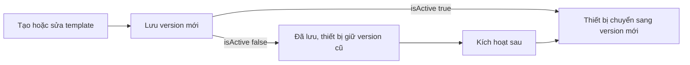

## Create Device Config

Tạo một version của **config template** (mẫu cấu hình). Dùng để định nghĩa các cài đặt (tài khoản ngân hàng QR, tùy chọn thẻ, MQTT broker, phiên bản app, theme, ...) mà máy POS cần nhận.

### Tóm tắt

- **Config template** là một bộ cài đặt có tên cho máy POS, lưu dưới dạng một object JSON gọi là `configJson`. Bạn viết một lần và gán cho nhiều máy.
- Template được lưu theo **version**. Mỗi lần lưu tạo một dòng mới cùng `name` và `version` cao hơn (1, 2, 3, ...). Các version cũ vẫn được giữ.
- Tối đa một version cho mỗi tên là **active** (`isActive: true`). Thiết bị theo template sẽ dùng version active.
- Khi template được gán cho thiết bị (xem *Assign Device Config*), máy POS tải `configJson` làm cài đặt của nó.
- Trường bạn bỏ khỏi `configJson` được điền giá trị mặc định, nên server luôn lưu một object đầy đủ.



### Trước khi bắt đầu

Bạn cần bearer token (token đăng nhập, gửi trong header `Authorization`) của user có quyền sửa config template. Không có quyền sẽ nhận `403`.

### Request

```http
POST /base/device/config
Authorization: Bearer <token>
Content-Type: application/json
```

Các trường của body:

| Tên | Kiểu | Bắt buộc | Ý nghĩa |
| --- | --- | --- | --- |
| `name` | string | Có | Tên template, ví dụ `default-retail`. Khoảng trắng hai đầu bị cắt. Dùng lại tên đã có không báo lỗi: nó thêm một **version mới** cho template đó. |
| `configJson` | object | Không | Cài đặt gửi cho máy POS (các section ở bảng bên dưới). Khóa thiếu sẽ có mặc định: chuỗi rỗng, `0` hoặc `false`; `functions.mqttEnabled` và `mqttConfig.mqttTls` mặc định là `true`. `appConfig.versionName` không còn thuộc hợp đồng. |
| `isActive` | bool | Không (mặc định `false`) | `true` làm version này thành version active của tên đó ngay (xem "Cần biết"). |
| `bankAppInfoIds` | int[] | Không | ID cấu hình bank app (TID/MID) cần liên kết, ví dụ `[3]`. Giá trị trùng và giá trị `<= 0` bị bỏ qua. |
| `checksum` | string | Không | Văn bản tự do, lưu cùng version. |
| `createdBy` | string | Không | Người tạo (văn bản tự do, ví dụ `admin@thebase.vn`). |
| `base_id` (hoặc `id`) | int | Không | ID của một version có sẵn để làm nền. Nó cung cấp `name` khi bạn bỏ `name`, và `configJson` của nó khi bạn bỏ `configJson`. ID không tồn tại trả `404`. Chỉ dạng snake_case: `baseId` không được đọc (`baseId` bên trong `configJson` là thứ khác). |

Giá trị sai kiểu bị bỏ qua, không bị từ chối: `configJson` không phải object coi như bỏ, `isActive` không phải boolean coi như `false`, `bankAppInfoIds` không phải mảng coi như rỗng. Các tên snake_case `config_json`, `is_active`, `bank_app_info_ids` và `created_by` cũng được nhận.

Các section trong `configJson`:

| Section / khóa | Nội dung |
| --- | --- |
| `owner`, `baseId` | Chuỗi owner và Base ID (cấp cao nhất), ví dụ `THEBASE`, `B001`. |
| `pingTime` | Máy POS ping server bao lâu một lần, tính bằng giây (cấp cao nhất), ví dụ `60`. |
| `bypassSettleWhenUpdate` | bool (cấp cao nhất). Bỏ qua settlement (quyết toán) khi app cập nhật. |
| `state` | Chuỗi cấp cao nhất. Server thay bằng trạng thái provisioning của thiết bị khi máy POS đọc cấu hình. |
| `ignoreAppBankErrorCodes` | Danh sách mã lỗi ngân hàng mà app bỏ qua (cấp cao nhất). |
| `appConfig` | Tải app: `appPath` (URL), `versionCode`, `forceInstall`. |
| `functions` | Công tắc tính năng: `apiPayFunc`, `billingFunc`, `cardFunc`, `disableLog`, `edcAppServiceV2Enabled`, `ignoreUpdatePayment`, `instFunc`, `isDemoPromotion`, `manuallyQrConfirmStatusFunc`, `mqttEnabled`, `prefixQrFunc`, `promotionFunc`, `qrFunc`, `voidFunc`. |
| `hiddenConfig` | Tùy chọn ẩn, ví dụ `lockConfig`. |
| `qrConfig` | Thanh toán QR: `bankAccount`, `bankAccountHolder`, `bankBincode`, `defaultServiceCode`, `numberOfCopies`, `proxyName`, `proxyPrefix`, `proxyValue`, `qrTimeInterval`. |
| `cardConfig` | Thanh toán thẻ: `maxTip`, `numberOfCopies`, `paymentResultCountDown`. |
| `mqttConfig` | MQTT broker: `mqttCacert`, `mqttClientKey`, `mqttClientPem`, `mqttDeviceTopic`, `mqttDomain`, `mqttPassword`, `mqttPort`, `mqttTls`, `mqttUsername`. |
| `merchantInfo` | Thông tin cửa hàng: `customerId`, `mmIconFileName`, `mmLogo`, `mmName`, `mmRefCode`, `storeName`. |
| `theme` | Màu sắc: `bgError`, `bgPending`, `bgPrimary`, `bgSecondary`, `bgSuccess`, `error`, `onPrimary`, `onSecondary`, `pending`, `primary`, `secondary`, `success`. |

Các khóa thêm bạn tự đưa vào được giữ nguyên như bạn gửi.

### Ví dụ

```bash
curl -X POST "$BASE_URL/base/device/config" \
  -H "Authorization: Bearer $TOKEN" \
  -H "Content-Type: application/json" \
  -d '{
    "name": "default-retail",
    "isActive": true,
    "createdBy": "admin@thebase.vn",
    "bankAppInfoIds": [3],
    "configJson": {
      "owner": "THEBASE",
      "baseId": "B001",
      "pingTime": 60,
      "appConfig": { "appPath": "https://cdn.example.com/edc/app-1.4.2.apk", "versionCode": 142, "forceInstall": false },
      "functions": { "qrFunc": true, "cardFunc": true, "voidFunc": true },
      "qrConfig": { "bankAccount": "0123456789", "bankAccountHolder": "CONG TY ABC", "bankBincode": "970418", "qrTimeInterval": 180 },
      "mqttConfig": { "mqttDomain": "mqtt.example.com", "mqttPort": "8883", "mqttUsername": "edc" },
      "merchantInfo": { "mmName": "ABC Coffee", "storeName": "ABC Coffee Q1" }
    }
  }'
```

### Response

HTTP `201`. Version vừa tạo, nằm trong envelope `result` chuẩn. `configJson` trả về với mọi giá trị mặc định đã được điền. Các trường phẳng (`funcQr`, `mqttDomain`, ...) là bản sao chỉ-đọc của giá trị trong `configJson`, để hiển thị cho tiện.

```json
{
  "id": "111020261535481234570001",
  "result": {
    "id": 13,
    "name": "default-retail",
    "version": 1,
    "configJson": {
      "owner": "THEBASE",
      "baseId": "B001",
      "pingTime": 60,
      "bypassSettleWhenUpdate": false,
      "state": "",
      "ignoreAppBankErrorCodes": [],
      "appConfig": { "appPath": "https://cdn.example.com/edc/app-1.4.2.apk", "versionCode": 142, "forceInstall": false },
      "functions": {
        "apiPayFunc": false, "billingFunc": false, "cardFunc": true, "disableLog": false,
        "edcAppServiceV2Enabled": false, "ignoreUpdatePayment": false, "instFunc": false,
        "isDemoPromotion": false, "manuallyQrConfirmStatusFunc": false, "mqttEnabled": true,
        "prefixQrFunc": false, "promotionFunc": false, "qrFunc": true, "voidFunc": true
      },
      "hiddenConfig": { "lockConfig": false },
      "qrConfig": {
        "bankAccount": "0123456789", "bankAccountHolder": "CONG TY ABC", "bankBincode": "970418",
        "defaultServiceCode": "", "numberOfCopies": 0, "proxyName": "", "proxyPrefix": "",
        "proxyValue": "", "qrTimeInterval": 180
      },
      "cardConfig": { "maxTip": 0, "numberOfCopies": 0, "paymentResultCountDown": 0 },
      "mqttConfig": {
        "mqttCacert": "", "mqttClientKey": "", "mqttClientPem": "", "mqttDeviceTopic": "", "mqttDomain": "mqtt.example.com",
        "mqttPassword": "", "mqttPort": "8883", "mqttTls": true, "mqttUsername": "edc"
      },
      "merchantInfo": { "customerId": "", "mmIconFileName": "", "mmLogo": "", "mmName": "ABC Coffee", "mmRefCode": "", "storeName": "ABC Coffee Q1" },
      "theme": {
        "bgError": "", "bgPending": "", "bgPrimary": "", "bgSecondary": "", "bgSuccess": "", "error": "",
        "onPrimary": "", "onSecondary": "", "pending": "", "primary": "", "secondary": "", "success": ""
      }
    },
    "appPath": "https://cdn.example.com/edc/app-1.4.2.apk",
    "appVersionCode": 142,
    "appForceInstall": false,
    "funcQr": true,
    "funcPrefixQr": false,
    "funcCard": true,
    "funcInst": false,
    "funcVoid": true,
    "funcApiPay": false,
    "funcBilling": false,
    "funcPromotion": false,
    "funcMqttEnabled": true,
    "qrBankAccount": "0123456789",
    "qrBankAccountHolder": "CONG TY ABC",
    "qrBankBincode": "970418",
    "qrTimeInterval": 180,
    "mqttDomain": "mqtt.example.com",
    "mqttPort": "8883",
    "mqttUsername": "edc",
    "mqttTls": true,
    "merchantName": "ABC Coffee",
    "merchantStoreName": "ABC Coffee Q1",
    "owner": "THEBASE",
    "baseId": "B001",
    "pingTime": 60,
    "bypassSettleWhenUpdate": false,
    "createdBy": "admin@thebase.vn",
    "isActive": true,
    "createdAt": "2026-09-26T08:00:00Z"
  }
}
```

| Trường | Ý nghĩa |
| --- | --- |
| `id` | ID của version này. Dùng trong các lời gọi `/base/device/config/{id}` khác. |
| `name` | Tên template. |
| `version` | Do server đặt: `1` cho tên mới, ngược lại là version cao nhất hiện có của tên đó cộng 1. |
| `configJson` | Toàn bộ cài đặt, đã điền đủ giá trị mặc định. |
| `isActive` | `true` nếu thiết bị theo tên này đang dùng version này. |
| `createdBy`, `createdAt` | Ai tạo và khi nào. |
| Trường phẳng (`appPath`, `funcQr`, `qrBankAccount`, `mqttDomain`, `merchantName`, `owner`, `pingTime`, ...) | Bản sao chỉ-đọc của giá trị trong `configJson`. Trường rỗng bị bỏ. |

Response không có `tidmid` (bank app đã liên kết) hay `deviceStatuses` (thiết bị đã gán). Hãy gọi *Get Device Config* để lấy chúng.

### Lỗi

Lỗi dùng định dạng chuẩn được mô tả trong API guide (xem "Response" → "Errors").

| HTTP | `error.code` | Ý nghĩa | Bạn nên làm gì |
| --- | --- | --- | --- |
| `400` | `-32700` | Body không phải JSON hợp lệ. | Sửa lại JSON. |
| `400` | `-32000` / `-32602` | `name` rỗng (và không có `base_id` cung cấp tên), một phần tử `bankAppInfoIds` không tồn tại, hoặc lưu thất bại. | Đọc `message`; gửi `name` hoặc ID hợp lệ. |
| `401` | `-32001` | Thiếu token hoặc token không hợp lệ. | Đăng nhập lại rồi gọi lại. |
| `403` | `-32003` | User không có quyền sửa config template. | Nhờ admin cấp quyền. |
| `404` | `-32004` | Có gửi `base_id` / `id` nhưng không có version đó. | Kiểm tra lại ID. |

### Cần biết

- Với `isActive: true`, mọi version khác có **cùng tên** thành inactive, và thiết bị đang gán version active trước đó chuyển sang version này (cấu hình của chúng đổi ngay). Template tên khác không bị ảnh hưởng.
- Mật khẩu và khóa: các trường phẳng `mqttPassword`, `mqttClientKey` và `mqttClientPem` không bao giờ xuất hiện trong response, nhưng `configJson.mqttConfig` chứa chúng và có trả về.
- Hãy để trống `mqttConfig.mqttDeviceTopic`. Topic thật (`base/<group name>/<serial>/cmd`) được đặt riêng cho từng thiết bị khi máy POS đọc cấu hình.
- Các trường phẳng `theme*` có thể hiện màu mặc định có sẵn (ví dụ `themePrimary: "#2F5D17"`) dù `configJson.theme` đang rỗng. Máy POS nhận `configJson`, nên hãy đặt màu ở đó.
- Cũng có route cũ `POST /base/edc/device/config/create-version`. Đặt các trường trong `kwargs` (`name`, `config_json` hoặc `configJson`, `is_active` hoặc `isActive`, `bank_app_info_ids` hoặc `bankAppInfoIds`, `checksum`, `created_by` hoặc `createdBy`, `base_id`/`id`). Route này trả status `200` với bản ghi dạng tên snake_case, mọi lỗi là `400` với thông báo dạng văn bản thuần, và user không có quyền ghi nhận `403`.
