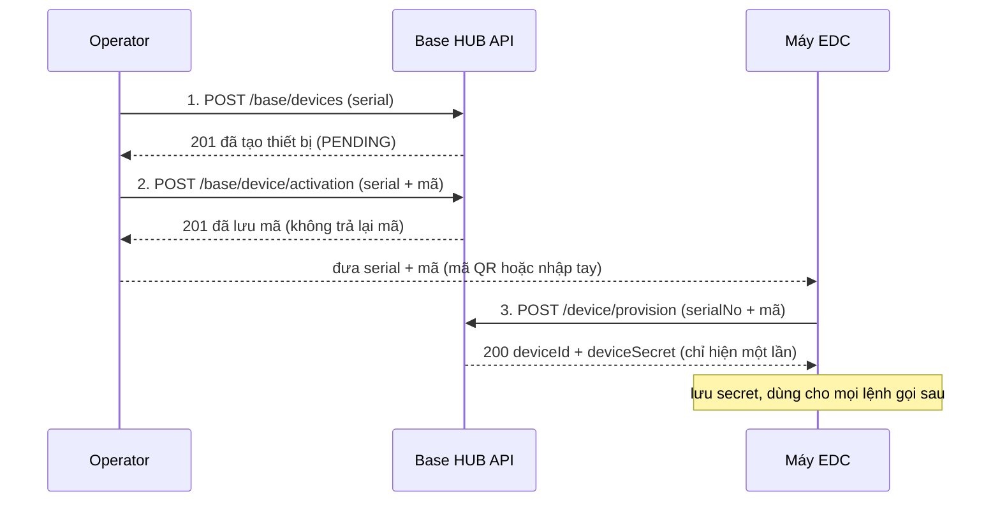

## Tạo thiết bị (và hướng dẫn onboarding)

Đăng ký một máy EDC mới (thiết bị thanh toán) vào Base HUB. Đây là bước 1 của onboarding. Trang này cũng giải thích toàn bộ quy trình: tạo thiết bị, đặt mã kích hoạt, để máy tự provision.

### Tóm tắt

- Onboarding gồm ba lệnh gọi: **tạo thiết bị**, **đặt mã kích hoạt**, **provision**.
- Bước 1 và 2 do operator (người vận hành) gọi bằng bearer token (token lấy từ `POST /oauth/token`, gửi dưới dạng `Authorization: Bearer <token>`).
- Bước 3 do chính máy gọi. Máy gửi serial và mã kích hoạt, rồi nhận **device secret**.
- Device secret chỉ hiện **một lần**. Nếu mất, hãy đặt mã kích hoạt mới và provision lại.
- Luôn dùng serial viết hoa (ví dụ `SN0001`).

### Quy trình



| Bước | Ai gọi | Route | Xác thực | Trang |
| --- | --- | --- | --- | --- |
| 1. Tạo thiết bị | Operator | `POST /base/devices` | Bearer token, quyền tạo `edc.device` | trang này |
| 2. Đặt mã kích hoạt | Operator | `POST /base/device/activation` | Bearer token, quyền ghi `edc.device.activation` | Create Device Activation |
| 3. Provision thiết bị | Máy EDC | `POST /device/provision` | Không có (mã kích hoạt chính là thông tin xác thực) | Provision Device |

### Ví dụ từng bước

Trước tiên đặt hai biến shell: `BASE_URL` (địa chỉ server, ví dụ `https://hub.example.com`) và `TOKEN` (bearer token của bạn).

**Bước 1.** Tạo thiết bị.

```bash
curl -X POST "$BASE_URL/base/devices" \
  -H "Authorization: Bearer $TOKEN" \
  -H "Content-Type: application/json" \
  -d '{"serial":"SN0001","imei":"356938035643809","ownerId":10,"holderId":25}'
```

**Bước 2.** Đặt mã kích hoạt gồm 8 chữ số, hết hạn vào thời điểm bạn chọn.

```bash
curl -X POST "$BASE_URL/base/device/activation" \
  -H "Authorization: Bearer $TOKEN" \
  -H "Content-Type: application/json" \
  -d '{"serial":"SN0001","activationCode":"48213907","expiresAt":"2026-09-27T08:00:00Z"}'
```

Đưa `SN0001` và `48213907` cho máy qua kênh tin cậy (mã QR hoặc nhập tay).

**Bước 3.** Máy tự provision. Không cần token.

```bash
curl -X POST "$BASE_URL/device/provision" \
  -H "Content-Type: application/json" \
  -d '{"serialNo":"SN0001","activationCode":"48213907"}'
```

Phản hồi chứa `deviceSecret`. Kiểm tra kết quả bằng `GET /base/devices/SN0001`: `provisioningStatus` lúc này là `ACTIVE` và `secretVersion` là `1`.

### Trước khi bắt đầu

- **Serial: dùng chữ hoa.** Bước 1 lưu serial đúng như bạn gửi. Bước 2 và 3 tự viết hoa serial. Các route thiết bị như `GET /base/devices/{serial}` so khớp phân biệt hoa thường. Nếu bạn tạo `sn0001`, các route đó sẽ không tìm thấy `SN0001`.
- **Làm bước 2 ngay sau bước 1.** Thiết bị mới có sẵn mã kích hoạt mặc định `12345678`. Hãy thay mã này trước khi giao máy đi.
- Token không đủ quyền sẽ nhận `403`.

### Request (bước 1)

```http
POST /base/devices
Authorization: Bearer <token>
Content-Type: application/json
```

| Tên | Kiểu | Bắt buộc | Ý nghĩa |
| --- | --- | --- | --- |
| `serial` | string | Có | Số duy nhất của máy, ví dụ `SN0001`. Khoảng trắng hai đầu bị bỏ. Không được trùng với serial đã có. |
| `imei` | string | Không | IMEI của máy, ví dụ `356938035643809`. |
| `ownerId` | int | Không | ID tài khoản chủ sở hữu, ví dụ `10`. Mặc định `1`. |
| `holderId` | int | Không | ID người giữ máy (merchant hoặc user), ví dụ `25`. Mặc định `1`. |
| `active` | bool | Không | Mặc định `true`. Phải là `true`, nếu không máy không thể provision. |

Các key khác (ví dụ `groupId`, `provisioningStatus`) bị bỏ qua. Thiết bị mới được đưa vào nhóm `default` (nếu có) và có một dòng trạng thái. Muốn đổi nhóm sau này, dùng `POST /base/groups/{id}/devices`.

### Response (bước 1)

`201 Created`:

```json
{
  "id": "111020261535481234570001",
  "result": {
    "id": 42,
    "serial": "SN0001",
    "imei": "356938035643809",
    "ownerId": 10,
    "holderId": 25,
    "groupId": 1,
    "active": true,
    "provisioningStatus": "PENDING",
    "secretVersion": 0,
    "createdAt": "2026-09-26T08:00:00Z",
    "updatedAt": "2026-09-26T08:00:00Z"
  }
}
```

| Trường | Ý nghĩa |
| --- | --- |
| `id` (ngoài cùng) | ID của request, dùng để truy vết. |
| `result.id` | ID số của thiết bị mới. |
| `provisioningStatus` | `PENDING` cho đến khi máy provision, sau đó là `ACTIVE`. |
| `secretVersion` | `0` nghĩa là chưa có secret. Thành `1` sau khi provision. |

> **Check:** Timestamp trong các dòng `/base/...` ở đây là chuỗi RFC 3339. Hướng dẫn API nói ngày giờ là Unix seconds; hãy xác nhận bằng một lệnh gọi thật.

### Lỗi (bước 1)

Lỗi dùng định dạng chuẩn được mô tả trong hướng dẫn API (xem "Response" → "Errors"). Mã chuỗi cũ nằm trong `error.data.reason`.

| HTTP | `error.code` | Ý nghĩa | Bạn nên làm gì |
| --- | --- | --- | --- |
| `400` | `-32700` / `-32000` | Body không phải JSON hợp lệ, hoặc `serial` trống, hoặc không lưu được thiết bị. | Sửa body. |
| `401` | `-32001` | Thiếu token hoặc token không hợp lệ. | Lấy token mới. |
| `403` | `-32003` | User của bạn không được tạo bản ghi `edc.device`. | Nhờ admin cấp quyền. |
| `409` | `-32009` | Đã có thiết bị với serial này (`data.reason` là `duplicate_serial`). | Dùng thiết bị đã có, hoặc chọn serial khác. |

### Bước 2: Đặt mã kích hoạt

Chi tiết đầy đủ ở trang **Create Device Activation**.

```http
POST /base/device/activation
```

| Tên | Kiểu | Bắt buộc | Ý nghĩa |
| --- | --- | --- | --- |
| `serial` | string | Có | Serial từ bước 1, ví dụ `SN0001`. |
| `activationCode` | string | Có | **Đúng 8 chữ số**, ví dụ `48213907`. Định dạng khác vẫn được nhận ở đây nhưng máy không bao giờ dùng được. Không dùng `12345678`. |
| `expiresAt` | string | Không | Thời điểm mã hết hạn, ví dụ `2026-09-27T08:00:00Z`. Mặc định: 60 phút kể từ bây giờ (cài đặt `edc.provisioning.activation_code_ttl_minutes`). |

Phản hồi là `201` kèm bản ghi activation. Mã không bao giờ được trả lại hay hiển thị lại.

> **Warning:** Đặt mã sẽ **re-arm** (đưa về trạng thái chờ) thiết bị. Nếu máy đang `ACTIVE`, secret cũ ngừng hoạt động ngay lập tức.

### Bước 3: Provision (do máy gọi)

Chi tiết đầy đủ ở trang **Provision Device**.

```http
POST /device/provision
```

| Tên | Kiểu | Bắt buộc | Ý nghĩa |
| --- | --- | --- | --- |
| `serialNo` | string | Có | Serial, tối đa 128 ký tự, ví dụ `SN0001`. Không phân biệt hoa thường. |
| `activationCode` | string | Có | Mã 8 chữ số từ bước 2. |

Thành công (`200`) trả về `{"deviceId":"SN0001","deviceSecret":"<64 ký tự hex>","secretVersion":1}`.

> **Warning:** `deviceSecret` chỉ được trả về **một lần**. Máy phải lưu nó trước khi làm bất cứ việc gì khác.

Các lỗi thường gặp (body là `{"error":"<tên>","message":"..."}`):

| HTTP | `error` | Bạn nên làm gì |
| --- | --- | --- |
| `401` | `activation_invalid` | Sai mã, hoặc chưa đặt mã. Kiểm tra mã hoặc làm lại bước 2. |
| `404` | `device_not_registered` | Không có thiết bị với serial này. Làm lại bước 1. |
| `409` | `activation_already_used` | Mã đã được dùng. Làm lại bước 2 với mã mới. |
| `410` | `activation_expired` | Mã đã hết hạn. Làm lại bước 2. |
| `423` | `device_not_eligible` | Thiết bị đang inactive, bị revoke hoặc đã provision. Bật lại và/hoặc làm lại bước 2. |

### Sau khi provision

Máy bây giờ dùng secret của nó:

- **Route HTTP của thiết bị:** `Authorization: Bearer SN0001:1:<deviceSecret>` (định dạng `<deviceId>:<secretVersion>:<deviceSecret>`).
- **MQTT** (kênh nhắn tin tới máy): kết nối với client ID `SN0001`. Các lệnh gửi bằng `POST /base/devices/{serial}/commands` được ký bằng secret này.

### Kích hoạt lại thiết bị

Dùng khi máy mất secret, bị thay mới hoặc reset, hoặc mã đã hết hạn.

1. Đặt mã mới: gọi lại `POST /base/device/activation`, hoặc `PUT /base/device/activation/{id}` với `activationCode` và `expiresAt`.
2. Máy chạy lại bước 3.

> **Warning:** Mã mới ngắt kết nối ngay một thiết bị đang `ACTIVE`. Hãy gửi `expiresAt` **cùng với** `activationCode`; nếu chỉ gửi `expiresAt`, mã sẽ bị thay bằng một mã ngẫu nhiên không ai biết.

### Cần biết

- Bước 1 và 2 có thể thử lại. Gọi lại bước 1 trả về `409`. Gọi lại bước 2 sẽ thay mã.
- Nếu bước 3 thành công nhưng máy mất phản hồi, thử lại sẽ trả `409 activation_already_used` và secret đã mất. Làm lại bước 2, rồi bước 3.
- Nếu server không có provisioning key (`app.encryptKey`), mã mặc định bị bỏ qua và bước 2, 3 sẽ lỗi cho đến khi admin cấu hình key.
- Muốn tạo nhiều thiết bị cùng lúc, dùng `POST /base/devices/bulk-import`, rồi làm bước 2 cho từng serial.
- Muốn chỉ đổi secret của một máy đang chạy, dùng **Rotate Device Secret** thay vì kích hoạt lại.
