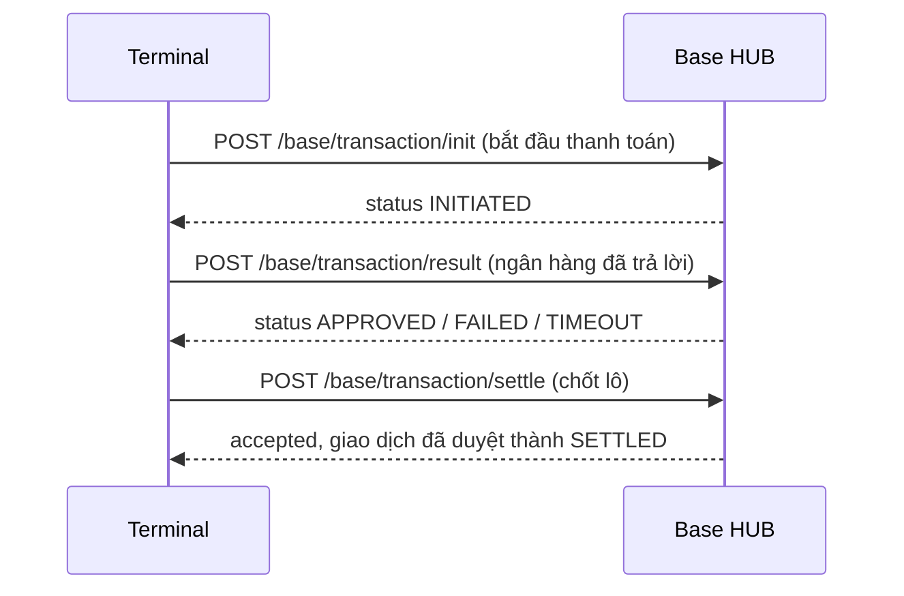

## EDC Transaction Init

Terminal gọi API này khi một giao dịch thanh toán bắt đầu, trước khi xử lý thẻ hoặc mã QR. Server ghi lại giao dịch (ID và số tiền) để lần gọi "result" sau đó khớp được với giao dịch này.

> **Warning:** Đây là callback của thiết bị với body bị đóng băng (frozen). Firmware của terminal đọc response này, nên tên field và cấu trúc không thay đổi. Đừng thêm hay đổi tên field.

### In a nutshell

1. Terminal bắt đầu thanh toán và gọi **init** (`POST /base/transaction/init`). Server ghi giao dịch với status `INITIATED`.
2. Bank app xử lý thẻ hoặc QR. Sau đó terminal gọi **result** (`POST /base/transaction/result`). Status trở thành `APPROVED`, `FAILED` hoặc `TIMEOUT`.
3. Cuối ngày bank app chốt lô (batch). Terminal gọi **settle** (`POST /base/transaction/settle`). **Settlement** (quyết toán) là tổng kết cuối lô của ngân hàng: "N giao dịch này, số tiền này đã được chốt". Các giao dịch đã duyệt trong lô chuyển sang `SETTLED`.



### Before you start

Route này không dùng token người dùng của Base HUB. Cài đặt `edc.device_http_auth` quyết định cách terminal chứng minh danh tính:

- `public` (mặc định): không cần token. Server tìm thiết bị từ `deviceId` trong body. Serial không tồn tại trả về `404`.
- `token`: gửi `Authorization: Bearer <serial>:<secretVersion>:<deviceSecret>`. Đây là device token terminal nhận được khi provisioning (cấp phát thiết bị).

Nếu bạn gửi header `Authorization`, server luôn kiểm tra nó, kể cả ở chế độ `public`. Với token hợp lệ, server dùng serial trong token thay cho `deviceId` trong body. Các header `X-Device-Serial`, `X-Timestamp`, `X-Nonce`, `X-Signature` bị bỏ qua.

### Request

```http
POST /base/transaction/init
Content-Type: application/json
```

| Body field | Type | Required | Ý nghĩa |
| --- | --- | --- | --- |
| `deviceId` | string (tối đa 128) | Yes | Serial của terminal (số duy nhất in trên máy), ví dụ `SN0001`. Key cũ `device_id` cũng dùng được. |
| `transactionId` | string (tối đa 128) | Yes | ID do terminal tạo cho giao dịch này. Phải duy nhất theo từng giao dịch, ví dụ `TXN20260926000123`. Key cũ `transaction_id` cũng dùng được. |
| `requestBody` | string | No | Request của bank app **dưới dạng chuỗi JSON** (JSON viết bên trong một chuỗi). Server đọc `transactionAmount` (chuỗi số nguyên), `currencyName`, `tranxType`, `thirdPartyId`, `transDateTime`. Key cũ `request_body`. |
| `response` | string | No | Response của bank app **dưới dạng chuỗi JSON**: `{Code, Desc, tranxType, Response:{...}}` hoặc một object phẳng. `Response.totalAmount` thay số tiền; `Response.currency` thay loại tiền. |
| `type` | string (tối đa 32) | No | Loại giao dịch như `SALE`. Chỉ dùng khi các chuỗi JSON không có `tranxType`. |
| `gps` | string (tối đa 128) | No | Vị trí terminal dạng `lat,lng`, ví dụ `21.0285,105.8542`. |
| `appVersion` | string (tối đa 128) | No | Phiên bản app trên terminal, ví dụ `2.4.1`. |
| `bankApp` | string (tối đa 128) | No | Tên bank app, ví dụ `BANKAPP`. |

Số tiền là **chuỗi số nguyên theo đơn vị tiền nguyên**: `"150000"` nghĩa là 150.000 VND. Giá trị có số thập phân hoặc dấu phân cách (`"150000.00"`, `"150,000"`) bị bỏ qua và số tiền được lưu là `0`. Loại tiền mặc định là `VND`.

### Example

```bash
curl -X POST "$BASE_URL/base/transaction/init" \
  -H "Content-Type: application/json" \
  -d '{
    "deviceId": "SN0001",
    "transactionId": "TXN20260926000123",
    "type": "SALE",
    "requestBody": "{\"transactionID\":\"TXN20260926000123\",\"transactionAmount\":\"150000\",\"currencyName\":\"VND\",\"tranxType\":\"SALE\",\"transDateTime\":\"2026-09-26T08:15:00+07:00\"}",
    "response": "",
    "gps": "21.0285,105.8542",
    "appVersion": "2.4.1",
    "bankApp": "BANKAPP"
  }'
```

### Response

HTTP `200`. Body có định dạng riêng (không có envelope `result`).

```json
{
  "success": true,
  "data": {
    "accepted": true,
    "transactionId": "TXN20260926000123",
    "status": "INITIATED",
    "amount": 150000,
    "currency": "VND",
    "expiredAt": "2026-09-26T08:20:00.512+07:00",
    "logId": "5530"
  }
}
```

| Field | Ý nghĩa |
| --- | --- |
| `accepted` | `true` khi server đã lưu lần gọi này. |
| `transactionId` | ID giao dịch bạn đã gửi. |
| `status` | Status hiện tại của giao dịch. `INITIATED` với giao dịch mới. Khi gọi lại, có thể đã là `APPROVED` nếu result đã đến. |
| `amount` / `currency` | Số tiền (đơn vị nguyên) và loại tiền server đã ghi. |
| `expiredAt` | Thời điểm init + 5 phút. Chỉ để tham khảo; server không tự hết hạn gì cả. |
| `logId` | ID của log callback thô. Dùng với `GET /base/txn-logs/{id}`. |

### Errors

Lỗi của callback giữ định dạng cũ của thiết bị, không phải định dạng chuẩn: `{"code": "...", "message": "..."}`. Lỗi validation có dạng `{"errors":[{"field":"DeviceID","message":"..."}]}`.

| HTTP | `code` | Ý nghĩa | Bạn nên làm gì |
| --- | --- | --- | --- |
| `400` | `invalid_json` | Body không phải JSON hợp lệ (`detail` chứa lỗi parse). | Sửa JSON. |
| `400` | không có (danh sách `errors`) | Thiếu `deviceId` hoặc `transactionId`, hoặc một field quá dài. | Gửi đủ các field bắt buộc. |
| `401` | không có | Thiếu hoặc sai token (chế độ `token`, hoặc bạn có gửi header bearer). Body: `{"error":"missing_device_token"` hoặc `"invalid_device_token", ...}`. | Provision lại terminal hoặc sửa token. |
| `404` | `device_not_found` | Không có thiết bị nào có serial này. | Kiểm tra chính tả (serial viết hoa) và thiết bị đã tồn tại. |
| `409` | không có | Cùng `transactionId` đã được khởi tạo với **số tiền khác**, hoặc nó thuộc thiết bị khác. | Dùng `transactionId` mới cho giao dịch mới. |
| `500` | `internal_error` | Lỗi server hoặc database. | Có thể thử lại an toàn. |

### Good to know

- **Gọi lại là an toàn.** Cùng `deviceId` + `transactionId` + cùng số tiền trả về `200` với `logId` và `expiredAt` ban đầu cùng `status` **hiện tại**. Không có gì mới được lưu.
- Không bao giờ dùng lại `transactionId` cho giao dịch khác. Số tiền khác sẽ bị `409`.
- Init chỉ giữ chỗ cho bản ghi. Nếu result của cùng `transactionId` đến trước, init chỉ liên kết log của nó và không bao giờ đưa status lùi lại.
- Nếu init lỗi, terminal vẫn có thể gửi result. Result được chấp nhận dù chưa có init.
- Lần gọi này ghi một dòng log `EDC_INIT_REQUEST` (parse status `IGNORED`) và tạo bản ghi giao dịch.
