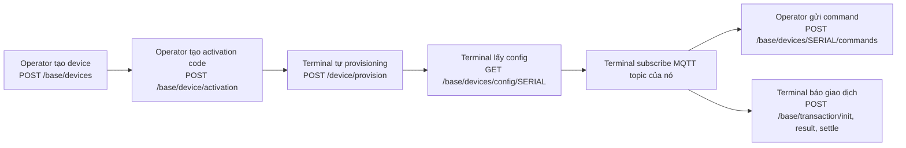

# EDC Device Service

Module EDC của Base HUB là backend cho các terminal thanh toán EDC/POS chạy Android. Một **terminal EDC** (còn gọi là
"device") là máy thanh toán đặt ở cửa hàng. Admin đăng ký terminal tại đây, gửi cấu hình và command cho chúng, và đọc
các giao dịch mà terminal báo lên.

Trang này là bản đồ. Hãy đọc nó trước, rồi mở các trang endpoint bạn cần.

## 1. Lần gọi đầu tiên trong 5 phút

**Bước 1. Lấy token** (chuỗi mật khẩu tạm thời).

```bash
curl -X POST "$BASE_URL/oauth/token" \
  -H "Content-Type: application/json" \
  -d '{"grant_type":"password","username":"operator01","password":"<password>"}'
```

```json
{ "access_token": "eyJhbGciOi...", "refresh_token": "5f9d6c3b1a...", "expires_in": 900, "token_type": "Bearer" }
```

`expires_in` tính bằng giây (900 = 15 phút). Gia hạn bằng `grant_type=refresh_token`. `/auth/token` là cùng endpoint.

**Bước 2. Gọi API.**

```bash
curl "$BASE_URL/base/devices?limit=20" -H "Authorization: Bearer $TOKEN"
```

**Bước 3. Đọc câu trả lời.**

```json
{ "id": "111020261535481234570001", "result": { "items": [ { "serial": "SN0001" } ], "total": 128 } }
```

Dữ liệu nằm trong `result`. Danh sách có `result.items` và `result.total`. Nếu có sự cố, bạn nhận `error` thay vào đó
(xem mục 6).

Kiểm tra token thuộc về ai bằng `GET /auth/me` (giống `GET /oauth/me`).
Nếu server chứa nhiều database tenant, hãy gửi thêm `X-Database-Name: <db>` (hoặc `?db=<db>`) và truyền `"db"` khi xin token.
Token chỉ dùng được cho database mà nó được cấp.

## 2. Các thuật ngữ bạn sẽ gặp

| Thuật ngữ | Ý nghĩa đơn giản |
| --- | --- |
| Token (bearer token) | Chuỗi mật khẩu tạm thời, gửi dưới dạng `Authorization: Bearer <token>`. |
| Terminal / device | Một máy thanh toán EDC thật. |
| Serial | Số định danh duy nhất của terminal, ví dụ `SN0001`. Luôn viết hoa. |
| Activation code | Mã dùng một lần gồm 8 chữ số do operator tạo. Terminal dùng nó một lần để tự đăng ký. |
| Provisioning | Terminal gửi serial và activation code và nhận secret vĩnh viễn (chỉ hiển thị một lần). |
| Device secret | Mật khẩu riêng của terminal sau khi provisioning. |
| Config template | Bộ cấu hình có phiên bản (gồm cả cài đặt bank app TID/MID) được đẩy xuống terminal. |
| TID / MID | Terminal ID và Merchant ID: các số do ngân hàng cấp để nhận diện terminal và cửa hàng. |
| MQTT | Hệ thống nhắn tin nhẹ. Server publish command vào một topic và terminal lắng nghe. |
| MQTT topic | "Địa chỉ" nơi tin nhắn được gửi tới, ví dụ `base/default/SN0001/cmd`. |
| Command | Tin nhắn có chữ ký (EDC v1.3) gửi xuống terminal, ví dụ "reboot". |
| Settlement | Đợt chốt cuối ngày tổng hợp các giao dịch đã được duyệt của terminal. |
| ACL | Bước kiểm tra quyền. Nó quyết định user được đọc hay sửa gì. Bị từ chối sẽ trả `403`. |
| Idempotency key | Chuỗi duy nhất trong `X-Idempotency-Key` để lời gọi được thử lại không bị thực hiện hai lần. |
| Envelope | Lớp JSON `{"id": ..., "result": ...}` hoặc `{"id": ..., "error": ...}` bọc mọi câu trả lời. |

## 3. Terminal lên online như thế nào



1. Operator tạo device (`POST /base/devices`). Device mới được vào group mặc định.
2. Operator đặt activation code 8 chữ số (`POST /base/device/activation`).
3. Terminal gọi `POST /device/provision` với serial và mã, và nhận secret vĩnh viễn **một lần duy nhất**. Hãy lưu lại.
4. Terminal lấy config (`GET /base/devices/config/:serial`). Config chứa `mqttConfig.mqttDeviceTopic`, topic cần subscribe.
5. Operator gửi command EDC v1.3 có chữ ký (`POST /base/devices/{serial}/commands`, hoặc `POST /mqtt/publish`). Command được gửi tới:

```text
base/<group name>/<serial>/cmd
```

`<group name>` là group của device (mặc định là `default`). Device dùng launcher AIDL bridge dùng `<serial>/cmd`.
Không cho phép wildcard trong topic publish. Muốn gửi cho cả group, hãy gửi từng command cho mỗi device thành viên.

Terminal báo ngược lại trên các topic chung `base/evt` (sự kiện, trạng thái) và `base/txn` (giao dịch). Server tự xử lý
chúng; đây không phải route HTTP. Đọc lịch sử bằng các route list ở mục 7.

Việc kích hoạt device và `/device/provision` cần bật provisioning (`app.deviceProvisioningEnable`, mặc định bật).

## 4. Tôi nên đọc trang nào?

| Tôi muốn... | Đọc trang |
| --- | --- |
| Thêm một terminal và đưa lên online | Device Onboarding: Create → Activate → Provision (`POST /base/devices`) |
| Thêm nhiều terminal cùng lúc | Bulk Import Devices |
| Tìm hoặc xem terminal | List Devices, Get Device |
| Cấp activation code cho terminal | Create Device Activation, Issue Device Activation Code |
| Hiểu terminal gửi gì để đăng ký | Provision Device |
| Tạo template cấu hình | Create Device Config, rồi Activate Device Config |
| Gắn template cho một terminal | Assign Device Config |
| Xem config mà terminal nhận | Get Device Config |
| Đổi secret của terminal | Rotate Device Secret |
| Gửi command (reboot, update, ...) | Device Commands API, Publish MQTT Message |
| Xem các command đã gửi | List Device Commands |
| Gom terminal thành group | Create Group, Add Device to Group (`group_device_add_api.md`) |
| Hiểu terminal gửi gì khi thanh toán | EDC Transaction Init, EDC Transaction Result, EDC Batch Settle |
| Tra cứu giao dịch với tư cách admin | Search Transactions, Search Settlements |
| Debug terminal | List Device Logs, List Audit Logs |
| Lấy token hoặc quản lý admin user | Get Access Token và các trang `admin_user_*` |

Tiêu đề trang ở trên khớp với heading trong mục lục route (mục 8).

## 5. Ai dùng API này và đăng nhập thế nào

| Người gọi | Cách dùng thường gặp | Xác thực |
| --- | --- | --- |
| Admin web app / operator | Quản lý device, config, group; đọc log và giao dịch | Token user Base HUB: `Authorization: Bearer <access_token>` |
| Automation / service caller | Gọi admin giữa các server | Cùng Bearer token (OAuth client với `grant_type=client_credentials`), hoặc `X-API-Key` khi server bật `app.supportApikey` |
| Terminal EDC | Tự provisioning, báo giao dịch, lấy config, upload log | Activation code, sau đó là device token |

**User.** Quyền truy cập do access rule của model Base HUB (ACL) và record rule quyết định, giống `/rpc`. Không có các role
`VIEWER` / `OPERATOR` / `ADMIN`. Không đủ quyền sẽ nhận `403`. Token thiếu, sai hoặc hết hạn trả `401`: hãy lấy token mới rồi thử lại.

**Terminal.** Sau provisioning, terminal ký các route device bằng secret riêng:

```http
Authorization: Bearer <SERIAL>:<secretVersion>:<deviceSecret>
```

Ví dụ: `Authorization: Bearer SN0001:1:9f1c2e...`. Cấu hình server `edc.device_http_auth` điều khiển việc này:

* `public` (mặc định): các route của terminal (`/device/provision`, `GET /base/devices/config/:serial`, `POST /base/device/log/upload`,
  `/base/transaction/init|result|settle`) chấp nhận lời gọi không có token. Token nếu được gửi vẫn được kiểm tra.
* `token`: bắt buộc có token và serial của token phải khớp với device.

**Route tiện ích công khai.** `/health`, `/metrics`, `/qr`, `/banklist/...`, `/keys`, `/aes`, `/aeshmac` và `/jsonstring` không cần xác thực.

## 6. Quy ước, response và lỗi

* **Serial** viết hoa (`SN0001`). Một số route so khớp chính xác, nên `sn0001` sẽ không được tìm thấy.
* **Tên field JSON** là camelCase (`ownerId`, `expiresAt`). Một số filter list trong query string là snake_case (`owner_id`, `device_serial`); mỗi trang liệt kê tham số của nó. Secret và hash không bao giờ được trả về.
* **Thời gian** trong envelope chuẩn là Unix seconds UTC (ví dụ `event_at` của device status). Body dành cho terminal và một số field request giữ định dạng riêng (ví dụ RFC 3339 `2026-09-26T08:00:00Z`); mỗi trang nói rõ.
* **Số tiền** là số nguyên đơn vị tiền tệ chính, dạng chuỗi, ví dụ `"150000"` = 150,000 VND. Không dùng số thập phân hay dấu phân cách.
* **Phân trang.** Route list nhận `limit` (mặc định `50`) và `offset` (mặc định `0`). `limit` tối đa là `500`; giá trị lớn hơn sẽ quay về `50`.
* Một trang rỗng có thể trả `"items": null`. Hãy coi `null` như `[]`.
* **Dạng response.** Route đã xác thực trả `{"id": "...", "result": ...}`. Xóa và vô hiệu hóa trả `{"deleted": true, "id": N}`.

Lỗi dùng định dạng chuẩn mô tả trong hướng dẫn API (xem "Đọc response và lỗi"):

```json
{ "id": "111020261535481234570001", "error": { "code": -32004, "message": "device not found" } }
```

Hãy rẽ nhánh code theo `error.code` (số); `message` dành cho người đọc và có thể đổi bất cứ lúc nào. Mã chuỗi riêng của module có thể xuất hiện ở `error.data.reason`.

| HTTP | Ý nghĩa | Nên làm gì |
| --- | --- | --- |
| `400` | Đầu vào sai | Sửa request. Không thử lại nguyên văn. |
| `401` | Token thiếu hoặc hết hạn, hoặc sai thông tin đăng nhập | Lấy token mới. |
| `403` | ACL từ chối truy cập | Dùng tài khoản có quyền cần thiết. |
| `404` | Không tìm thấy | Kiểm tra id hoặc serial (viết hoa). |
| `409` | Xung đột hoặc trùng lặp (ví dụ trùng serial, config đang được dùng) | Đọc `message`; thường lần thử đầu đã thành công. |
| `5xx` | Lỗi phía server | Thử lại sau với backoff. Liên hệ THE BASE nếu còn lỗi. |

Một số surface giữ định dạng riêng:

* Callback của terminal (`/base/transaction/init|result|settle`, `/device/provision`, `GET /base/devices/config/:serial`, `POST /base/device/log/upload`) giữ các body cố định mà terminal đã parse, như `{ "code": "...", "message": "..." }` hoặc `{ "error": "...", "message": "..." }`. Các trang của chúng nêu rõ.
* Các helper (`/banklist`, `/keys`, `/aes`, `/aeshmac`, `/jsonstring`) trả `{ "code": 0, "data": ... }` khi thành công và `{ "code": <status>, "message": "..." }` khi thất bại. HTTP status khi thất bại luôn là `500`, nên hãy đọc `code` trong body. `/qr` trả object trần `{ "qrBase64": "...", "qrString": "..." }` (xem `util_qr_generate_api.md`).
* `/auth/token` theo OAuth 2.0: `{ "error": "invalid_grant", "error_description": "..." }`.

> **Check:** các trang callback của terminal và các trang route cũ hơn có thể vẫn mô tả body lỗi trước JSON-RPC
> `{ "error": "not_found", "message": "..." }` cho route admin. Các route admin `/base/...` hiện trả lỗi JSON-RPC như trên.

## 7. Cấu trúc URL

| Tiền tố | Nội dung |
| --- | --- |
| `/base/...` | API nghiệp vụ admin và terminal: device, activation, config, status, command, group, log, transaction, settlement, audit log, MQTT message, bank app info. |
| `/device/provision` | Bootstrap công khai cho terminal (không nằm dưới `/base`). |
| `/mqtt/publish` | Publish command có chữ ký (cần token Base HUB). Có mặt khi MQTT client được bật. |
| `/auth/...`, `/oauth/...` | Token, revoke, thông tin session. |
| `/health`, `/metrics` | Probe liveness công khai và metric Prometheus. `GET /health/detail` (Bearer token, root company trên home database) thêm trạng thái database, Kafka và MQTT. |
| `/web/content` | Upload attachment (`POST`, cần token) và download (`GET /web/content/{id}`). |
| `/qr`, `/banklist/...`, `/keys`, `/aes`, `/aeshmac`, `/jsonstring` | Helper công khai (tạo QR, danh sách ngân hàng, helper mã hóa). |
| `/rpc/{model}/{method}` | RPC chung mà mọi model đều gọi được (ví dụ `base.users`, `edc.device`). |
| `/doc`, `/doc/openapi.json` | Tài liệu API cho máy đọc (cần xác thực). UI admin hiển thị các trang này tại `/web/apidoc`. |

Các route dưới `/base/...` là REST alias của method module (ví dụ `GET /base/devices` là `edc.device.search_read`), nên mọi thứ cũng gọi được qua `/rpc`.

---

## 8. Mục lục route

Mỗi dòng là một trang endpoint. "Page" là tên file; tiêu đề trang là heading đầu tiên của nó. Dòng **Device** do terminal gọi. Dòng **Kernel** là tiện ích có sẵn. Dòng **Not available** chưa được triển khai ở đây; trang sẽ nêu cách thay thế.

### Auth và user

| Page | Route | Ghi chú |
| --- | --- | --- |
| `auth_token_api.md` | `POST /auth/token` | Token OAuth 2.0 |
| `auth_me_api.md` | `GET /auth/me` | Thông tin session hiện tại |
| `admin_user_list_api.md` | `GET /base/admin/users` |  |
| `admin_user_create_api.md` | `POST /base/admin/users` |  |
| `admin_user_update_api.md` | `PUT /base/admin/users/{id}` |  |
| `admin_user_password_reset_api.md` | `POST /base/admin/users/{id}/password` | có điểm khác biệt |
| `admin_user_roles_set_api.md` | `POST /base/admin/users/{id}/roles` | Not available |

### Device, activation, status

| Page | Route | Ghi chú |
| --- | --- | --- |
| `device_create_api.md` | `POST /base/devices` (+ onboarding guide) | |
| `device_list_api.md` | `GET /base/devices` | |
| `device_get_api.md` | `GET /base/devices/{serial}` | |
| `device_update_api.md` | `PUT /base/devices/{serial}` | |
| `device_deactivate_api.md` | `DELETE /base/devices/{serial}` | |
| `device_search_api.md` | `POST /base/devices/search` | |
| `device_bulk_import_api.md` | `POST /base/devices/bulk-import` | |
| `device_commands_api.md` | `POST /base/devices/{serial}/commands` | |
| `device_resolved_config_api.md` | `GET /base/devices/config/{serial}` | Device (alias ẩn danh) |
| `device_provision_api.md` | `POST /device/provision` | Device (alias ẩn danh) |
| `device_activation_create_api.md` | `POST /base/device/activation` | |
| `device_activation_list_api.md` | `GET /base/device/activation` | |
| `device_activation_get_api.md` | `GET /base/device/activation/{id}` | |
| `device_activation_update_api.md` | `PUT /base/device/activation/{id}` | cấp lại mã |
| `device_activation_delete_api.md` | `DELETE /base/device/activation/{id}` | |
| `device_status_list_api.md` | `GET /base/device/status` | |
| `device_status_get_api.md` | `GET /base/device/status/{serial}` | |
| `device_status_config_get_api.md` | `GET /base/device/status/{serial}/config` | |
| `device_status_config_assign_api.md` | `PUT /base/device/status/{serial}/config` | |

### Config, bank app, group

| Page | Route | Ghi chú |
| --- | --- | --- |
| `device_config_list_api.md` | `GET /base/device/config` | |
| `device_config_get_api.md` | `GET /base/device/config/{id}` | |
| `device_config_create_api.md` | `POST /base/device/config` | |
| `device_config_update_api.md` | `PUT /base/device/config/{id}` | thêm một phiên bản |
| `device_config_activate_api.md` | `POST /base/device/config/{id}/activate` | |
| `device_config_delete_api.md` | `DELETE /base/device/config/{id}` | |
| `bank_app_info_list_api.md` | `GET /base/bank-app-info` | |
| `bank_app_info_get_api.md` | `GET /base/bank-app-info/{id}` | |
| `bank_app_info_create_api.md` | `POST /base/bank-app-info` | |
| `bank_app_info_update_api.md` | `PUT /base/bank-app-info/{id}` | |
| `bank_app_info_delete_api.md` | `DELETE /base/bank-app-info/{id}` | |
| `group_list_api.md` | `GET /base/groups` | |
| `group_get_api.md` | `GET /base/groups/{id}` | |
| `group_create_api.md` | `POST /base/groups` | |
| `group_update_api.md` | `PUT /base/groups/{id}` | |
| `group_delete_api.md` | `DELETE /base/groups/{id}` | |
| `group_device_list_api.md` | `GET /base/groups/{id}/devices` | |
| `group_device_add_api.md` | `POST /base/groups/{id}/devices` | đặt group cho device |
| `group_device_remove_api.md` | `DELETE /base/groups/{id}/devices/{memberID}` | xóa group của device |

### Command, MQTT, log

| Page | Route | Ghi chú |
| --- | --- | --- |
| `device_command_list_api.md` | `GET /base/device/command` | |
| `device_command_get_api.md` | `GET /base/device/command/{id}` | |
| `mqtt_publish_message_api.md` | `POST /mqtt/publish` | cần token; một số topic bị hạn chế |
| `mqtt_message_list_api.md` | `GET /base/mqtt-messages` | |
| `mqtt_message_get_api.md` | `GET /base/mqtt-messages/{id}` | |
| `device_log_list_api.md` | `GET /base/device/log` | |
| `device_log_get_api.md` | `GET /base/device/log/{id}` | |
| `device_log_upload_api.md` | `POST /base/device/log/upload` | Device (alias ẩn danh) |
| `device_error_log_list_api.md` | `GET /base/device-error-logs` | |
| `device_error_log_get_api.md` | `GET /base/device-error-logs/{id}` | |
| `audit_log_list_api.md` | `GET /base/audit-logs` | |
| `audit_log_get_api.md` | `GET /base/audit-logs/{id}` | |

### Transaction và settlement

| Page | Route | Ghi chú |
| --- | --- | --- |
| `edc_transaction_init_api.md` | `POST /base/transaction/init` | Device (viết tay) |
| `edc_transaction_result_api.md` | `POST /base/transaction/result` | Device (viết tay) |
| `edc_transaction_settle_api.md` | `POST /base/transaction/settle` | Device (viết tay) |
| `transaction_search_api.md` | `POST /base/transaction/search` | |
| `transaction_log_search_api.md` | `POST /base/transaction/logs/search` | |
| `transaction_get_api.md` | `GET /base/transaction/{id}` | |
| `transaction_upsert_api.md` | `PUT /base/transaction` | |
| `transaction_delete_api.md` | `DELETE /base/transaction/{id}` | |
| `txn_log_list_api.md` | `GET /base/txn-logs` | |
| `txn_log_get_api.md` | `GET /base/txn-logs/{id}` | |
| `settlement_search_api.md` | `POST /base/settlement/search` | |
| `settlement_get_api.md` | `GET /base/settlement/{id}` | |
| `settlement_upsert_api.md` | `PUT /base/settlement` | |
| `settlement_delete_api.md` | `DELETE /base/settlement/{id}` | |

### System, tiện ích, storage

| Page | Route | Ghi chú |
| --- | --- | --- |
| `system_health_api.md` | `GET /health` | Kernel |
| `system_metrics_api.md` | `GET /metrics` | Kernel (Prometheus) |
| `system_feature_flags_api.md` | `GET /config/features` | Not available |
| `system_config_get_api.md` | `GET /base/system-config` | Not available |
| `system_config_update_api.md` | `PUT /base/system-config` | Not available |
| `system_config_restart_api.md` | `POST /base/system-config/restart` | Not available |
| `system_config_sync_webhooks_api.md` | `POST /base/system-config/sync-webhooks` | Not available |
| `util_qr_generate_api.md` | `GET /qr` | Kernel |
| `util_bank_list_api.md` | `GET /banklist/{bankCode}` | Kernel |
| `cryptogram_keys_generate_api.md` | `GET /keys` | Kernel |
| `cryptogram_aes_encrypt_decrypt_api.md` | `POST /aes` | Kernel |
| `cryptogram_aes_hmac_sign_api.md` | `POST /aeshmac` | Kernel |
| `cryptogram_query_string_build_api.md` | `POST /jsonstring` | Kernel |
| `s3_upload_file_api.md` | `POST /s3/upload` | Xem trang; không tìm thấy handler trong codebase này |

---

## Hỗ trợ

Dịch vụ này do **[THE BASE](https://thebase.vn)** xây dựng và bảo trì. Hãy báo lỗi hoặc yêu cầu thay đổi API qua đội kỹ thuật của THE BASE.
