# SRS: Backend Service Startup Flow

| Field | Value |
|---|---|
| Author | Codex |
| Status | Draft |
| Version | 1.0 |
| Date | 2026-05-10 |
| Related PRD | — |
| Reviewers | Backend Lead, QA Lead |

---

## 1. Introduction

### 1.1 Purpose

This document specifies the startup behavior of the Bean IPN backend service entrypoint implemented in `app/internal/cmd/server.go`. It is intended for backend engineers, QA engineers, technical reviewers, and maintainers who need a precise description of how the backend boots, when it fails fast, and which optional subsystems are activated during startup.

### 1.2 Scope

This document covers the `start` command lifecycle from flag parsing through graceful shutdown, including:

- Configuration loading
- Database initialization and migration
- Runtime model bootstrap
- Conditional master-data bootstrap
- HTTP server and middleware initialization
- Optional MQTT and Kafka startup
- Graceful shutdown

This document does not cover:

- The standalone `import-data` command
- Detailed runtime behavior of individual HTTP routes
- Deep implementation details of Kafka handlers, MQTT subscriptions, or ERP RPC methods
- CI/CD, container orchestration, or infrastructure provisioning

### 1.3 Definitions and abbreviations

| Term | Definition |
|---|---|
| Startup flow | The ordered boot sequence executed by the `start` command before and during service availability |
| Runtime model registry | The in-process model catalog used by the metadata-driven ORM/runtime |
| Master-data bootstrap | Startup verification/import of seeded module data through `internal/services/masterdata` |
| `initImport` | `sys.config_param` key that gates whether startup runs the master-data bootstrap checkpoint |
| Force config sync | Startup mode that overwrites `sys.config_param` values from the YAML config source |
| Graceful shutdown | Controlled stop sequence that waits for shutdown signal and then closes the Fiber app within a timeout |

### 1.4 References

- Backend entrypoint: `app/internal/cmd/server.go`
- DB bootstrap helper: `app/internal/cmd/db_bootstrap.go`
- Config sync and startup gate helpers: `app/internal/config/config.go`
- Backend architecture context: `.agents/memory/context/backend-context.md`

---

## 2. System overview

The backend service is started through the Cobra command `start`. The startup path is synchronous up to the point where the Fiber listener is launched. Any failure in configuration loading, database initialization, migration, module catalog synchronization, or master-data bootstrap must stop the process before the service begins accepting traffic.

The startup sequence combines four categories of work:

1. Core bootstrap: load config, connect databases, register models, migrate schemas.
2. Data/bootstrap checkpoints: sync runtime config, sync module catalog, conditionally verify/import master data.
3. Runtime infrastructure: initialize logging, workers, HTTP middleware, routes, static serving, and optional integrations.
4. Service lifecycle: start listener, wait for termination signal, perform graceful shutdown.

### 2.1 Mermaid BPMN-style startup flow

Note: Mermaid does not provide native BPMN syntax in this repo workflow, so the diagram below uses a BPMN-style `flowchart` to represent gateways and service steps.

```mermaid
flowchart TD
    A([Start `start` command]) --> B[Parse CLI flags]
    B --> C[Load config file]
    C --> D{`postgresql.enable` true?}
    D -- No --> X1([Fail startup])
    D -- Yes --> E[Initialize configured PostgreSQL databases]
    E --> F[Register runtime models]
    F --> G[Start shared model worker]
    G --> H[Start outbound delivery worker]
    H --> I[Migrate configured databases]
    I --> J[Sync runtime config into `sys.config_param`]
    J --> K[Initialize application logging]
    K --> L[Sync module catalog]
    L --> M{`--force-master-data` used?}
    M -- Yes --> N[Set `sys.config_param.initImport=true`]
    M -- No --> O[Read `sys.config_param.initImport`]
    N --> O
    O --> P{`initImport` true?}
    P -- No --> Q[Skip master-data bootstrap]
    P -- Yes --> R[Verify/import module master data]
    R --> S[Set `initImport=false` after successful bootstrap]
    Q --> T[Create Fiber app]
    S --> T
    T --> U[Register middleware, routes, markdown, and static handlers]
    U --> V{MQTT enabled?}
    V -- Yes --> W[Initialize MQTT client]
    V -- No --> Y[Continue]
    W --> Y
    Y --> Z[Initialize ERP client]
    Z --> AA{Kafka enabled?}
    AA -- Yes --> AB[Start producer and/or consumer]
    AA -- No --> AC[Continue]
    AB --> AC
    AC --> AD[Listen on configured port]
    AD --> AE([Service available])
    AE --> AF{SIGINT or SIGTERM received?}
    AF -- No --> AE
    AF -- Yes --> AG[Shutdown Fiber app with 5s timeout]
    AG --> AH[Close request log writer if present]
    AH --> AI([Stop service])
```



---

## 3. Functional requirements

### Requirement format
Each requirement includes: ID · Title · Description · Inputs · Processing · Outputs · Error conditions · Priority.

---

### SRS-F-001: Parse startup command and load configuration

**Description:**
The backend service must parse startup flags for the `start` command and load the configured YAML file before any infrastructure bootstrap begins.

**Inputs:**

| Input | Source | Type | Validation rules |
|---|---|---|---|
| `--config`, `-c` | CLI flag | string | Must point to a readable config file |
| `--force-config`, `--fc` | CLI flag | bool | Optional |
| `--force-master-data` | CLI flag | bool | Optional |

**Processing:**
1. Create a startup context with `context.Background()`.
2. Parse command flags before reading runtime configuration.
3. Load the config file from the `configPath` flag.
4. Populate in-memory config state used by all later bootstrap steps.

**Outputs:**

| Output | Destination | Type | Description |
|---|---|---|---|
| Loaded app config | In-memory process state | structured config | Effective startup configuration for DB, logging, server, Kafka, MQTT, and ERP |
| Parsed startup flags | In-memory process state | bool/string | Controls config overwrite and master-data bootstrap gating |

**Error conditions:**

| Condition | System behavior | Error response |
|---|---|---|
| Config file missing or unreadable | Abort before DB bootstrap | Process exits with config read failure |
| Config structure invalid | Abort before DB bootstrap | Process exits with config unmarshal failure |

**Acceptance criteria:**
- [ ] Startup parses flags before calling `LoadConfig`.
- [ ] Startup does not attempt DB initialization when config loading fails.
- [ ] `--force-master-data` is available on the `start` command.

**Priority:** Must

---

### SRS-F-002: Initialize databases, runtime models, and bootstrap workers

**Description:**
The backend service must establish configured PostgreSQL connections, register runtime-backed models, initialize shared workers, and migrate configured databases before the HTTP server is created.

**Inputs:**

| Input | Source | Type | Validation rules |
|---|---|---|---|
| `postgresql.enable` | Config | bool | Must be `true` for service startup |
| `postgresql.*` and `postgresql.databases` | Config | object | Must contain valid connection settings for each configured DB |

**Processing:**
1. Validate that `postgresql.enable` is `true`.
2. Initialize Bun/pgx database instances for `postgresql.home_db_name` and `postgresql.db_name`, deduplicated when both names are the same.
3. Initialize Bun/pgx database instances for every explicit entry in `postgresql.databases`.
4. Ensure `postgresql.db_name` is opened and registered even when it does not appear under `postgresql.databases`.
5. Register runtime models through the runtime bootstrap path.
6. Start the shared model worker.
7. Start the outbound delivery worker.
8. Run configured database migration/bootstrap logic, including runtime config synchronization into `sys.config_param`.

**Outputs:**

| Output | Destination | Type | Description |
|---|---|---|---|
| Registered DB instances | ORM registry | map | Named logical database connections |
| Runtime model registry | In-memory process state | registry | Active model metadata for ORM/runtime operations |
| Shared worker | In-memory process state | worker | Shared background model execution worker |
| Outbound delivery worker | In-memory process state | worker | Background callback delivery worker |

**Error conditions:**

| Condition | System behavior | Error response |
|---|---|---|
| `postgresql.enable` is false | Abort startup | Return `postgresql.enable must be true` |
| DB connection initialization fails | Abort startup | Return `failed to init PostgreSQL DB` |
| Auto-migration/bootstrap fails | Abort startup before HTTP server creation | Return `database bootstrap failed before server startup` |

**Acceptance criteria:**
- [ ] Startup aborts before HTTP app creation when any configured DB fails to initialize.
- [ ] `postgresql.db_name` is opened and registered during startup even when it is not listed in `postgresql.databases`.
- [ ] Database migration occurs after runtime model registration.
- [ ] Shared worker and outbound delivery worker are scheduled for shutdown with `defer`.

**Priority:** Must

---

### SRS-F-003: Synchronize module catalog and conditionally bootstrap master data

**Description:**
The backend service must synchronize the module catalog on every startup and must run the master-data bootstrap checkpoint independently for `postgresql.home_db_name` and `postgresql.db_name` using the configured startup rules.

**Inputs:**

| Input | Source | Type | Validation rules |
|---|---|---|---|
| Module manifests | Disk or embedded module FS | files | Must be discoverable from the configured module root or embedded FS |
| `sys.config_param.init_import` | Database | bool-like value | When `true`, force one startup import for both `postgresql.home_db_name` and `postgresql.db_name` |
| `--force-master-data` | CLI flag | bool | Optional; when true, it must persist `init_import=true` before the checkpoint |
| Fresh/empty database state | Database schema | bool | A database created during startup or containing zero user tables must auto-import once even when `init_import=false` |

**Processing:**
1. Synchronize the module catalog from disk or embedded modules for `postgresql.home_db_name` and `postgresql.db_name`.
2. Build one startup bootstrap target set containing `postgresql.home_db_name` and `postgresql.db_name`, deduplicated when both names are the same.
3. If `--force-master-data` is set, persist `sys.config_param.init_import=true` before the checkpoint for each target database.
4. For each target database, read `sys.config_param.init_import`.
5. If the key evaluates to `true`, verify/import module seed data through the master-data service for that target database.
6. If the key evaluates to `false`, but the database was created during startup or has zero user tables before migration, verify/import module seed data once for that fresh target database.
7. If the key is `false` and the target database is already populated, skip master-data bootstrap for that target database.
8. Reset `sys.config_param.init_import=false` only after successful forced bootstrap completion for all target databases.

**Outputs:**

| Output | Destination | Type | Description |
|---|---|---|---|
| Module catalog sync result | Logs/process state | status | Source path plus manifest count |
| Master-data bootstrap result | Logs/process state | report | Checked records plus created/updated/skipped counts when import runs |
| `init_import` reset | `sys.config_param` | bool | One-shot startup gate reset after success on all forced target databases |

**Error conditions:**

| Condition | System behavior | Error response |
|---|---|---|
| Module catalog sync fails | Abort startup | Return `failed to sync module catalog` |
| Reading or updating `init_import` fails | Abort startup | Return startup error from config helper |
| Master-data verification/import fails | Abort startup before HTTP server creation | Return `failed to verify module seed metadata` |

**Acceptance criteria:**
- [ ] Module catalog synchronization always happens before the master-data checkpoint for both `postgresql.home_db_name` and `postgresql.db_name`.
- [ ] `--force-master-data` causes startup to persist `init_import=true` before the checkpoint runs for both target databases.
- [ ] `sys.config_param.init_import=true` forces startup to import master data for both `postgresql.home_db_name` and `postgresql.db_name`.
- [ ] A fresh or empty `postgresql.home_db_name` imports master data on first startup even when `init_import=false`.
- [ ] A fresh or empty `postgresql.db_name` imports master data on first startup even when `init_import=false`.
- [ ] An existing populated target database with `init_import=false` is not re-imported.
- [ ] Startup resets `init_import=false` only after a successful forced bootstrap pass across all target databases.
- [ ] Failed forced bootstrap does not silently clear the `init_import` retry signal.

**Priority:** Must

---

### SRS-F-004: Build HTTP runtime and optional integrations before accepting traffic

**Description:**
The backend service must create and configure the Fiber application, register middleware and routes, and initialize optional integrations before it starts listening for traffic.

**Inputs:**

| Input | Source | Type | Validation rules |
|---|---|---|---|
| Logging config | Config | object | Must include level and optional file path settings |
| CORS config | Config | object | Must provide values merged with required safety headers/methods |
| MQTT enable flag | Config | bool | Optional |
| Kafka enable/producer/consumer flags | Config | bool | Optional |
| Server static asset sources | Disk or embedded FS | files | Must resolve to valid static serving source |

**Processing:**
1. Initialize application logging and request logging.
2. Create the Fiber app with the configured JSON encoder and proxy header behavior.
3. Register healthcheck, body-cleaning middleware, request logger, idempotency middleware, and CORS middleware.
4. Initialize the MQTT client when enabled.
5. Register routes, markdown routes, module static resource route, and SPA/static fallbacks.
6. Initialize the ERP client.
7. Initialize Kafka producer and/or consumer when enabled.

**Outputs:**

| Output | Destination | Type | Description |
|---|---|---|---|
| Fiber app | In-memory process state | HTTP server object | Ready-to-listen application |
| Middleware stack | Fiber app | ordered handlers | Request logging, healthcheck, idempotency, CORS, and static handling |
| MQTT client | Process state | integration client | Initialized only when enabled |
| Kafka producer/consumer | Process state | integration clients | Initialized only when enabled |

**Error conditions:**

| Condition | System behavior | Error response |
|---|---|---|
| Required CORS safety headers are omitted in config | Startup must still merge required headers/methods | No startup failure; required values remain present |
| Static asset source missing | Startup falls back according to `resolveStaticFS` rules | Use fallback static source when available |
| Route/module static request invalid at runtime | Reject request | HTTP 404 or 500 depending on failure path |

**Acceptance criteria:**
- [ ] Healthcheck middleware is registered before normal traffic handling.
- [ ] CORS registration always includes `OPTIONS`, `Authorization`, `X-Database-Name`, and `X-Idempotency-Key` (`X-API-Key` was removed, RBAC/OAuth backend plan §1/§7.4 — inbound auth is bearer-token-only now).
- [ ] MQTT initialization only occurs when `mqtt.enable` is true.
- [ ] Kafka initialization only occurs when `kafka.enable` is true.
- [ ] Static SPA serving is registered after API routes so API endpoints keep precedence.

**Priority:** Must

---

### SRS-F-005: Start listener and execute graceful shutdown

**Description:**
The backend service must listen on the configured port, remain available until a termination signal is received, and then shut down the Fiber app gracefully within a bounded timeout.

**Inputs:**

| Input | Source | Type | Validation rules |
|---|---|---|---|
| `server.port` | Config | integer | Must be a valid TCP port |
| `SIGINT`, `SIGTERM` | OS signal | signal | Used to trigger graceful shutdown |

**Processing:**
1. Read `server.port` from config.
2. Start `app.Listen` in a goroutine.
3. Subscribe to `os.Interrupt` and `syscall.SIGTERM`.
4. Block until a shutdown signal is received.
5. Create a shutdown context with a 5-second timeout.
6. Call `app.ShutdownWithContext`.
7. Close the request log writer when applicable.

**Outputs:**

| Output | Destination | Type | Description |
|---|---|---|---|
| Active listener | Network | TCP listener | Service accepts requests on the configured port |
| Shutdown completion log | Logs | message | Confirms graceful shutdown success or failure |

**Error conditions:**

| Condition | System behavior | Error response |
|---|---|---|
| Listener start fails | Log failure from goroutine | Error log `Failed to start server` |
| Shutdown exceeds timeout or fails | Log shutdown failure | Error log `Failed to shutdown server gracefully` |

**Acceptance criteria:**
- [ ] Service starts listening on `config.server.port`.
- [ ] Startup remains blocked on signal wait after listener launch.
- [ ] Shutdown uses a 5-second timeout context.
- [ ] Request log writer is closed when it is a lumberjack logger.

**Priority:** Must

---

## 4. Non-functional requirements

### 4.1 Performance

| Metric | Threshold | Measurement conditions |
|---|---|---|
| Startup sequencing | Must complete all bootstrap checkpoints before `app.Listen` is invoked | Verified by code-path order in `server.go` |
| Graceful shutdown timeout | 5 seconds maximum | Measured from signal receipt to `ShutdownWithContext` timeout |
| Kafka consumer startup wait | Up to 5 seconds for initial wait branch | Measured during the startup phase when Kafka consumer mode is enabled |

### 4.2 Reliability

| Attribute | Target |
|---|---|
| Fail-fast bootstrap | Service must not accept traffic when config, DB bootstrap, module catalog sync, or gated master-data bootstrap fails |
| Startup determinism | Core bootstrap order must remain stable across runs for the same config and module payload |
| Retryability of master-data gate | Failed gated master-data bootstrap must leave `initImport=true` so the next start can retry |
| RTO (Recovery Time Objective) | 5-second graceful shutdown window in-process |
| RPO (Recovery Point Objective) | Not applicable for this startup-flow document; persistence is delegated to PostgreSQL and service-specific logic |

### 4.3 Security

| Requirement | Detail |
|---|---|
| Authentication | Startup path itself is local-process CLI driven; no remote auth required before process start |
| Authorization / RBAC | Runtime RBAC becomes available only after model/runtime bootstrap and route registration |
| Data encryption at rest | Governed by PostgreSQL/infrastructure configuration; not altered by startup flow |
| Data encryption in transit | Governed by deployment/network termination; not altered by startup flow |
| Audit logging | Startup must emit logs for major bootstrap checkpoints and failures |
| Sensitive config handling | Startup must read secrets from config without echoing raw secret values in this SRS contract |

### 4.4 Scalability

| Dimension | Current | 12-month target |
|---|---|---|
| Configured databases | Single default DB plus optional named DB map | Multiple named DBs supported through config |
| Shared model workers | 4 workers | Tune by deployment profile as needed |
| Outbound delivery workers | 2 workers | Tune by delivery volume as needed |
| Kafka topic consumers | One consumer workflow per configured topic set | Expand by topic and group configuration |

### 4.5 Accessibility

Not applicable. This specification covers a backend startup flow rather than an end-user interface.

---

## 5. Data requirements

### 5.1 Data model changes

| Table / Collection | Change type | Description |
|---|---|---|
| `sys_config_param` | Altered usage | Stores and reads the startup gate `initImport` used by server bootstrap |

### 5.2 Field definitions

**Table: `sys_config_param`**

| Field | Type | Nullable | Default | Validation | Description |
|---|---|---|---|---|---|
| `name` | text / string | No | — | Unique key | Flattened configuration key |
| `value` | JSONB | Yes | — | Must coerce cleanly for known runtime keys | Persisted configuration value |

**Startup gate key: `initImport`**

| Field | Type | Nullable | Default | Validation | Description |
|---|---|---|---|---|---|
| `name` | string | No | `initImport` | Must equal `initImport` for this behavior | Identifies the master-data startup gate |
| `value` | bool-like JSON value | Yes | `false` when absent by behavior | Interpreted by config helper as bool-like (`true` / `false`) | Controls whether startup runs the master-data bootstrap checkpoint |

### 5.3 Data retention and access

| Data type | Retention period | Who can access | Deletion method |
|---|---|---|---|
| `sys.config_param` runtime config rows | Indefinite until updated or removed | System administrators and backend runtime | Updated through config sync or runtime write path |
| `initImport` startup gate | Indefinite until toggled by startup or admins | Backend startup path and system administrators | Upsert to `false` after successful gated bootstrap |

---

## 6. API and interface contracts

### 6.1 Startup command interface

| Attribute | Value |
|---|---|
| Method | CLI command |
| Path | `start` |
| Auth | Local process execution |
| Rate limit | Not applicable |

**Command examples:**

```bash
go run ./main.go start -c ./build/config.yaml
go run ./main.go start -c ./build/config.yaml --force-config
go run ./main.go start -c ./build/config.yaml --force-master-data
```

**Flag contract:**

| Flag | Type | Required | Description |
|---|---|---|---|
| `--config`, `-c` | string | No | Path to config file; defaults to `./build/config.yaml` |
| `--force-config`, `--fc` | bool | No | Force overwrite `sys.config_param` from the loaded config file during DB bootstrap |
| `--force-master-data` | bool | No | Force the startup master-data checkpoint by persisting `sys.config_param.initImport=true` before the checkpoint |

**Error responses:**

| Status | Code | When |
|---|---|---|
| Process exit | `config_load_failed` | Config file cannot be read or unmarshaled |
| Process exit | `postgresql_not_enabled` | `postgresql.enable` is false |
| Process exit | `db_init_failed` | Database initialization fails |
| Process exit | `bootstrap_failed` | Migration, module catalog sync, or master-data bootstrap fails |

### 6.2 Internal startup gate contract

| Attribute | Value |
|---|---|
| Method | Database-backed config read/write |
| Path | `sys.config_param.initImport` |
| Auth | Internal process behavior / admin-managed config |
| Rate limit | Not applicable |

**Behavior summary:**

```json
{
  "key": "initImport",
  "meaning": "When true, startup must run the master-data bootstrap checkpoint; when false or absent, startup must skip it.",
  "force_startup_behavior": "The start command with --force-master-data writes true before the checkpoint and writes false after successful completion."
}
```

---

## 7. Constraints

| Constraint | Description |
|---|---|
| Technology stack | Go, Cobra, Fiber, PostgreSQL, Bun ORM, pgx |
| Backward compatibility | Startup must continue supporting disk and embedded module sources for catalog and static assets |
| Backward compatibility | Runtime config must still synchronize through `sys.config_param` using the existing bootstrap helper |
| Deployment environment | Service depends on reachable PostgreSQL before startup can succeed |
| Documentation constraint | Mermaid diagram is expressed in BPMN-style flowchart form because native BPMN syntax is not used in this repo workflow |

---

## 8. Assumptions and dependencies

### 8.1 Assumptions

- The `start` command remains the primary backend service entrypoint.
- Module catalog synchronization and master-data bootstrap are intended to happen before the service begins handling requests.
- `sys.config_param.initImport` is the authoritative startup gate for master-data bootstrap.
- Missing `initImport` is treated as functionally equivalent to `false`.

### 8.2 Dependencies

| Dependency | Type | Owner | Status |
|---|---|---|---|
| PostgreSQL availability | Infrastructure | Platform / DevOps | Required |
| Runtime model bootstrap registrations | Internal | Backend team | Required |
| Module filesystem or embedded modules | Internal | Backend team | Required |
| Kafka broker when Kafka is enabled | Infrastructure | Platform / Messaging | Optional by config |
| MQTT broker when MQTT is enabled | Infrastructure | Platform / Messaging | Optional by config |
| ERP endpoint configuration | External | ERP integration owner | Optional by config |

---

## 9. Open questions

| # | Question | Owner | Due date | Status |
|---|---|---|---|---|
| 1 | Should startup expose an explicit metric or health status for "master-data bootstrap skipped vs executed" beyond logs? | Backend Lead | TBD | Open |
| 2 | Should `initImport` be seeded explicitly during installation rather than relying on missing=`false` behavior? | Backend Lead | TBD | Open |
| 3 | Should listener start failure propagate back to the main command instead of only being logged from the goroutine? | Backend Lead | TBD | Open |
