# Dev Instructions: many2one field behavior

| Field | Value |
|---|---|
| Author | Codex |
| Status | Draft |
| Date | 2026-05-10 |
| Related PRD | — |
| Related SRS | — |
| Assignee(s) | Frontend team |
| Target sprint / milestone | Ongoing frontend form rendering work |

---

## 1. Context and goal

This document describes the current logic, UI patterns, state model, and integration behavior of `app/frontend-admin/src/components/fields/many2one/many2one-field.tsx`. The audience is engineers working on SDUI form rendering and related-field behavior. The most important constraint is to preserve the many2one submit contract: the UI may carry display metadata for rendering, but the saved form payload must still normalize to the related record id or `false`.

---

## 2. Scope of changes

**Backend:**
- No backend code is defined here, but this field depends on backend JSON-RPC and metadata APIs.

**Frontend:**
- `app/frontend-admin/src/components/fields/many2one/many2one-field.tsx`
- `app/frontend-admin/src/components/views/form/form-renderer.tsx`
- `app/frontend-admin/src/components/fields/utils.ts`
- `app/frontend-admin/src/api/jsonv2.ts`

**Database:**
- None

**Infrastructure / config:**
- None

---

## 3. Architecture and approach

### Chosen approach

The component is a single field renderer that supports multiple related-field presentations under one implementation:

- selection-style values
- many2one / one2one scalar relation values
- badge display variants
- optional avatar rendering
- optional barcode lookup flow
- optional related-record creation flow

The component keeps two concerns separate:

1. Submission value contract
- The field emits a value that the parent form layer can normalize into the save payload.
- Empty relation values must become `false`.
- Selected relation values must preserve enough display metadata for the form UI, while still allowing form save normalization to reduce the payload to the scalar id.

2. Display state contract
- The field keeps a local `userSelectedOption` so the combobox can continue to show the correct label after selection.
- This avoids degrading the label to a raw numeric id when the parent only retains or later rehydrates a scalar value.

### Why this approach

This approach keeps the field renderer compatible with backend-driven SDUI forms while avoiding a second fetch for every successful user selection. It also allows the same field renderer to support readonly rendering, editable combobox search, inline creation, and barcode-assisted lookup without splitting the behavior across separate field types.

### Alternatives considered

| Alternative | Reason not chosen |
|---|---|
| Emit only scalar ids from the field component | The UI would lose the selected display label too easily after selection and before save/refresh. |
| Always fetch `name_get` after every selection | Adds avoidable RPC traffic and makes the field feel slower than necessary. |
| Split avatar, barcode, and create behavior into separate components | Possible later, but current implementation favors one renderer with variant props to match the form renderer registration model. |

### Architecture diagram / flow

```text
Field metadata + current record value
  -> many2one-field.tsx
  -> derive relation mode + display option
  -> editable mode:
       Combobox search -> searchRelationChoices(...)
       optional create -> metadata fetch + FormView + createModelRecord(...)
       optional barcode -> searchRelationChoices(...)
  -> emit selected value to form state
  -> form renderer normalizes relation value before backend save
```

---

## 4. Data model changes

### 4.1 New / modified tables

None.

### 4.2 Schema impact

| Table | Change | Notes |
|---|---|---|
| None | None | UI-only behavior |

---

## 5. API changes

### 5.1 Existing APIs consumed by this field

**Relation search**
- Function: `searchRelationChoices(relation, query, limit, domain)`
- Purpose: load relation choices for editable many2one search and barcode lookup
- Response expectation: records containing `id` and `name`

**Access rights check**
- Function: `createModelRpc(relation).call("check_access_rights", ["create"], { raise_exception: false })`
- Purpose: decide whether to show the inline "Create new" action

**Create form metadata**
- Function: `fetchCrmLeadViewMetadataForType("form", relation)`
- Purpose: load the related model form architecture and fields for the create drawer

**Record create**
- Function: `createModelRecord(data, relation)`
- Purpose: create a new related record from the create drawer

**Display name resolution**
- Function: `createModelRpc(relation).call("name_get", [[id]])`
- Purpose: resolve a display label when the current value is a bare scalar id or when a newly created record needs its canonical display name

### 5.2 Outbound UI routes

| Route | Use |
|---|---|
| `/web/${relation}/${relationId}` | Open related record from the external-link button in editable mode |

---

## 6. Business logic walkthrough

### 6.0 BPMN-style Mermaid flow

The following Mermaid diagram is a BPMN-style process view of the current `many2one-field.tsx` logic. It is intended as a step-by-step execution map for engineers reading the implementation.

```mermaid
flowchart TD
  A([Start render]) --> B[Read props and derive effectiveValue, relation, relationId, relationLabel]
  B --> C[Normalize widget and parse widgetOptions]
  C --> D{Is selection field?}
  D -->|Yes| E[Build base options from field.options]
  D -->|No| F{Is scalar relation field?}
  F -->|No| G[Use generic combobox-compatible option state]
  F -->|Yes| H[Build base options from field.relatedRecords]

  E --> I[Resolve selectedOption]
  G --> I
  H --> J[Sync userSelectedOption from tuple or object values when present]
  J --> I

  I --> K{Badge widget?}
  K -->|Yes| L([Render badge and stop])
  K -->|No| M{effectiveReadonly?}

  M -->|Yes| N[Render ReadonlyRelationValue]
  N --> O{Known display label?}
  O -->|Yes| P([Render label])
  O -->|No| Q{name_get allowed?}
  Q -->|Yes| R[Fetch display name via name_get]
  R --> S([Render fetched label])
  Q -->|No| T([Render fallback dash])

  M -->|No| U{Scalar relation field without relation model?}
  U -->|Yes| V([Render missing relation model guard])
  U -->|No| W[Render editable combobox shell]

  W --> X{Editable relation search active?}
  X -->|No| Y[Use base options only]
  X -->|Yes| Z[Defer input via useDeferredValue]
  Z --> AA{Query below search_threshold?}
  AA -->|Yes| AB[Skip remote fetch]
  AA -->|No| AC[Call searchRelationChoices with relationDomain and limit 10]
  AC --> AD{Search success?}
  AD -->|Yes| AE[Map remote records to normalized relation options]
  AD -->|No| AF[Set remote options empty]
  AE --> AG[Merge selected option back into option list]
  AF --> AG
  Y --> AG
  AB --> AG

  AG --> AH{User selects option?}
  AH -->|Yes, selection field| AI["emitValue raw option value"]
  AH -->|Yes, relation field| AJ["Set userSelectedOption and emit tuple id plus label"]
  AH -->|Clears value| AK["Clear userSelectedOption and emit false for relation or empty string for selection"]

  AG --> AL{Barcode enabled and user opens scan sheet?}
  AL -->|No| AM{Can open related record?}
  AL -->|Yes| AN[Open barcode sheet and collect barcode input]
  AN --> AO{Barcode input empty?}
  AO -->|Yes| AP[Close barcode sheet]
  AO -->|No| AQ[SearchRelationChoices with limit 5]
  AQ --> AR{Match found?}
  AR -->|Yes| AS[Commit first match as selected option]
  AR -->|No| AT[Show no-match message]
  AQ --> AU{Lookup throws error?}
  AU -->|Yes| AV[Show barcode lookup failed message]
  AU -->|No| AM
  AS --> AM
  AT --> AM
  AP --> AM
  AV --> AM

  AM -->|Yes| AW([Show external-link button to /web/relation/id])
  AM -->|No| AX{Can create related record?}
  AW --> AX

  AX -->|No| AY([Editable flow idle])
  AX -->|Yes| AZ{User clicks Create new?}
  AZ -->|No| AY
  AZ -->|Yes| BA[Open create sheet]
  BA --> BB[Fetch form metadata for related model]
  BB --> BC{Metadata load success?}
  BC -->|No| BD[Show create form load error]
  BC -->|Yes| BE[Render nested FormView in create mode]
  BE --> BF{User saves create form?}
  BF -->|No| BG([Close or discard sheet])
  BF -->|Yes| BH[Create related record]
  BH --> BI{name_get new record}
  BI --> BJ[Build normalized relation option]
  BJ --> BK["Set userSelectedOption and emit tuple id plus label"]
  BK --> BL([Close create sheet and finish])
  BD --> BG
```



### 6.1 Field mode detection

The renderer first determines which logical path it should use:

- `selection` fields use option values from `field.options`
- scalar relation fields include:
  - `field.type === "many2one"`
  - `field.kind === "one2one"`
  - `widget === "many2one_reference"` after widget normalization
- badge widgets short-circuit into badge-only display

This mode detection is important because selection fields and many2one relation fields share the same combobox shell but do not share the same backend search and submit semantics.

### 6.2 Value derivation

The component derives the following from the incoming field state:

- `effectiveValue`: `valueOverride ?? value`
- `relation`: `relationOverride ?? field.relation`
- `relationId`: scalar id extracted from tuple, object, or raw scalar
- `relationLabel`: best-known display label from the current value or related records
- `selectionValue` and `selectionLabel` for selection mode

This keeps the renderer resilient to multiple value shapes coming from parent form state or server-loaded data.

### 6.3 Readonly guard

`effectiveReadonly` is computed so that missing relation metadata does not silently force an editable form into readonly appearance. If the form is editable but the relation model is missing, the renderer shows a specific "Missing relation model" guard message instead of pretending the field is readonly.

### 6.4 Local display state pattern

`userSelectedOption` is the key local UI pattern in this component.

Purpose:
- preserve the chosen label after user selection
- avoid regressing to raw ids in the input after parent state changes
- keep display logic stable until the parent form refreshes or rehydrates from the backend

Sync rule:
- when the incoming value is `false`, `null`, or `undefined`, clear `userSelectedOption`
- when the incoming value is a tuple or object with embedded display information, rebuild `userSelectedOption` from that richer value
- when the incoming value is only a scalar id, do not overwrite `userSelectedOption`, because that scalar often came from this component’s own prior selection flow

### 6.5 Option shaping pattern

All relation options are normalized through `createRelationOption(value, label, avatar, relation)`.

This helper guarantees consistent option shape for:
- preload options from `field.relatedRecords`
- remote search results
- barcode lookup matches
- current selected fallback option
- newly created related records

If avatar mode is enabled and `relation` is available, the helper also attaches the avatar image URL.

### 6.6 Selected option resolution

`selectedOption` is memoized and follows this priority:

1. for selection fields, use the matching selection option
2. for relation fields, prefer `userSelectedOption`
3. otherwise, synthesize a fallback option from `relationId` and `relationLabel`
4. if no relation id exists, return `null`

This pattern allows the combobox to remain controlled without forcing every path to pre-populate the full option object externally.

### 6.7 Search behavior

Editable relation fields use deferred search:

- the input text is stored in `searchTerm`
- `useDeferredValue` reduces immediate recomputation pressure during typing
- remote search only runs when the field is editable, relation-backed, and has a relation model
- search is skipped until `search_threshold` is met, when configured
- the query uses `searchRelationChoices(relation, query, MANY2ONE_SEARCH_LIMIT, relationDomain ?? [])`

Current limit:
- `MANY2ONE_SEARCH_LIMIT = 10`

Option merge strategy:
- before remote data loads, use base options
- after remote data loads, use remote options
- always merge the currently selected option back into the final option set so a selected item does not disappear from the combobox just because it is outside the current search result

### 6.8 Submit contract

The field centralizes output dispatch through `emitValue(nextValue)`, which routes either to `onChangeOverride` or the default `onChange`.

Selection mode:
- selected value -> emit raw option value
- cleared value -> emit empty string

Relation mode:
- selected option -> emit `[id, label]`
- cleared option -> emit `false`

Important invariant:
- the renderer is allowed to emit `[id, label]` for UI continuity
- the form save layer must normalize that relation value back to the scalar id before backend persistence

### 6.9 Barcode flow

When `barcode` is enabled:

- a tooltip-wrapped button opens a bottom sheet
- the user can scan or paste a barcode
- submit triggers `searchRelationChoices(relation, query, 5, relationDomain ?? [])`
- the first match is committed as the selected value
- if no match exists, a destructive badge message is shown
- if the lookup fails, the UI shows "Barcode lookup failed."

This flow is a convenience lookup path, not a separate data model.

### 6.10 Create-new flow

The inline create flow is shown only when:

- a relation model exists
- the field is not readonly
- the field is not a selection field
- widget option `no_create` is not set
- `check_access_rights("create")` returns true

Create sequence:

1. user clicks "Create new"
2. right-side sheet opens
3. form metadata loads for the related model
4. a nested `FormView` renders in create mode
5. `createModelRecord(...)` creates the new related record
6. `name_get` resolves the canonical display label
7. the new record is committed into the field selection
8. the create sheet closes

Why `name_get` is called after create:
- the backend may define a display name that is not identical to any single submitted field
- using `name_get` keeps the UI aligned with backend display-name rules

### 6.11 Readonly rendering

Readonly mode is handled by `ReadonlyRelationValue`.

Behavior:
- if a label is already known, render it directly
- if only a scalar relation id is known, lazily call `name_get`
- if avatar mode is enabled, render avatar + text
- otherwise render plain readonly text

This avoids showing raw ids to users in common readonly cases.

### 6.12 Open-related-record affordance

In editable mode, the renderer can show an external-link button when:

- `canOpen` is true
- `relation` exists
- `relationId` exists

This button links to `/web/${relation}/${relationId}`.

Important note:
- the current `many2one-field.tsx` implementation does not itself render a readonly link that opens a right drawer
- that expectation exists in the older requirement note, but it is not what this file currently does

---

## 7. Integration points

| Integration | Direction | Protocol | Failure behavior |
|---|---|---|---|
| `searchRelationChoices` | Outbound | frontend API helper / RPC | Empty result state or barcode error message |
| `check_access_rights` | Outbound | JSON-RPC | "Create new" action hidden |
| `fetchCrmLeadViewMetadataForType` | Outbound | metadata API | Create sheet shows load error |
| `createModelRecord` | Outbound | create RPC | Save fails through nested form flow |
| `name_get` | Outbound | JSON-RPC | Fallback label remains unavailable and UI shows `—` or local label |
| `/web/${relation}/${relationId}` route | Outbound navigation | SPA route | Navigation/open behavior delegated to route host |

---

## 8. Testing guidance

### Unit / component tests

- [ ] selection field shows option labels and emits selection values
- [ ] many2one field emits `false` when cleared
- [ ] many2one field keeps selected label visible after choosing a record
- [ ] selected item remains available when remote search results change
- [ ] search threshold suppresses requests for short queries
- [ ] create permission false hides the "Create new" action
- [ ] create flow commits the new record label after `name_get`
- [ ] barcode flow selects first match and reports no-match / failure states
- [ ] readonly scalar id triggers lazy `name_get`
- [ ] missing relation model in editable mode shows the explicit guard UI

### Manual test checklist

- [ ] open a form with an existing many2one tuple value and confirm the label is shown correctly
- [ ] select a new relation in edit mode and confirm the field still shows the label before save
- [ ] clear the field and confirm the form payload normalizes to `false`
- [ ] type a search term and confirm only up to 10 records are used
- [ ] change a dependency that affects `relationDomain` and confirm the combobox remounts cleanly
- [ ] create a new related record and confirm it becomes the selected value immediately
- [ ] test avatar mode and confirm both list items and selected value use the same avatar logic
- [ ] test barcode mode with matching, non-matching, and failing queries

---

## 9. Definition of done

- [ ] any change preserves the many2one save contract: selected relation persists as scalar id after normalization
- [ ] UI still shows stable human-readable labels before and after save
- [ ] search, clear, create, and barcode flows all work in editable mode
- [ ] readonly mode does not regress to raw ids when `name_get` can resolve a label
- [ ] `relationDomain` changes still force a combobox remount
- [ ] create permission gating still hides or shows the create action correctly
- [ ] lint and typecheck pass for the frontend after changes

---

## 10. Known constraints and gotchas

- The current search limit is 10, not 20. Any document or test that still assumes 20 is outdated.
- The component may emit `[id, label]` during editing for display continuity, even though saved backend payload must end up as the scalar id.
- The old requirement note about readonly link + right drawer does not match the current implementation of this file.
- `parseMany2OneWidgetOptions(...)` still relies on regex-based normalization and is a known fragile area when widget option strings contain quoted content that resembles Python literals.
- The field intentionally supports both selection and relation behavior in one component, so changes must verify both paths.
