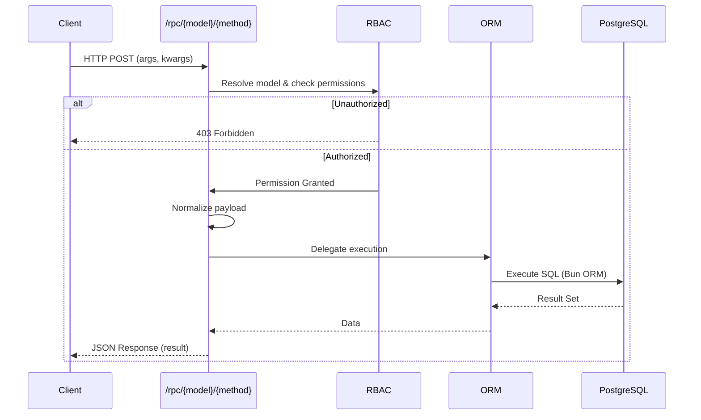
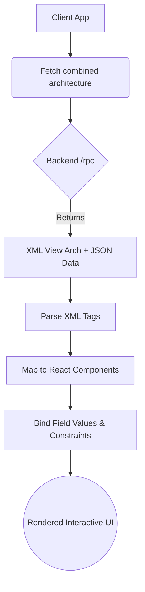
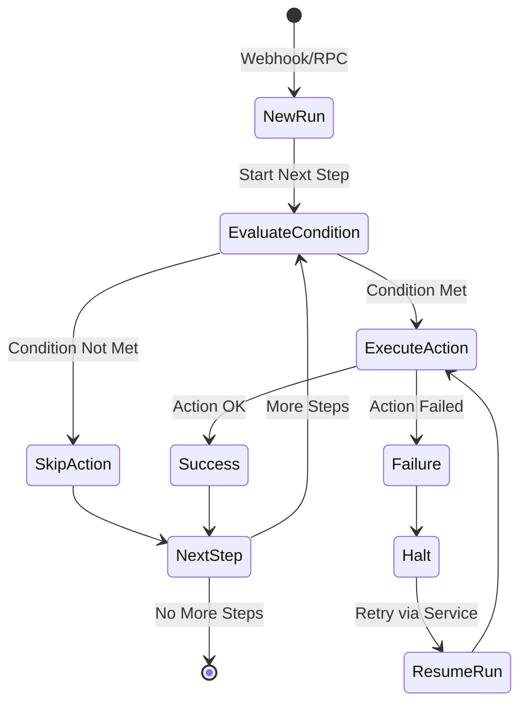
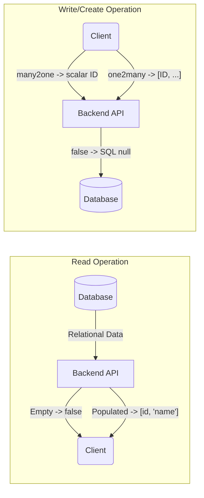

# SRS: Base HUB Platform

| Field | Value |
|---|---|
| Author | Product Manager / Systems Architect |
| Status | Draft |
| Version | 1.0 |
| Date | 2026-05-12 |
| Related PRD | Base HUB Core Platform PRD |
| Reviewers | Engineering Team |

---

## 1. Introduction

### 1.1 Purpose
This document specifies the software requirements for the Base HUB platform. It provides precise behavioral definitions, interface contracts, and architectural guardrails for the engineering team to build and maintain the metadata-driven backend and server-driven UI (SDUI).

### 1.2 Scope
This SRS covers the core components of the Base HUB platform:
- The metadata-driven backend runtime (Go, PostgreSQL, Bun ORM).
- The Server-Driven UI (React, Vite, Tailwind).
- The workflow and event orchestration engine.
- The RBAC and security layer.

### 1.3 Definitions and abbreviations

| Term | Definition |
|---|---|
| SDUI | Server-Driven UI. A pattern where the client renders UI components dynamically based on backend-provided structures (e.g., XML view architectures). |
| RBAC | Role-Based Access Control. Security layer driven by `res.groups` and `sys.rule`. |
| ORM | Object-Relational Mapping (using Bun ORM). |
| SPA | Single Page Application (React-based frontend). |

### 1.4 References
- Backend Context: `.agents/memory/context/backend-context.md`
- Frontend Context: `.agents/memory/context/frontend-context.md`

---

## 2. System overview
The Base HUB is an ERP and business workflow platform. It relies on a "metadata-driven" architecture where database schemas, business logic models (`sys.model`), and user interfaces (`ui.view`) are defined as data records rather than strictly compiled code. 

The backend dynamically translates RPC requests against generic models into optimized SQL queries via the Bun ORM. The React frontend SPA acts as a thin rendering client, transforming backend XML view definitions into interactive React components using shadcn and Tailwind CSS. The system also includes an integrated workflow engine (`base.workflow`) and service bus (`base.service.bus`) to automate business processes asynchronously.

---

## 3. Functional requirements

### SRS-F-001: Metadata-Driven API Runtime

**Description:**
The backend must provide a generic RPC interface capable of handling dynamic business logic for any registered model without requiring static, hardcoded endpoints for each entity.

**Flow Diagram:**


**Inputs:**
| Input | Source | Type | Validation rules |
|---|---|---|---|
| `model` | URL Path | String | Must exist in `sys.model` |
| `method` | URL Path | String | Must be a recognized model method (e.g., `search_read`, `write`) |
| `args` | JSON Body | Array | Method-dependent |
| `kwargs` | JSON Body | Object | Method-dependent |

**Processing:**
1. Intercept HTTP POST request at `/rpc/{model}/{method}`.
2. Resolve the model structure and check RBAC rules (`sys_model_access` / `sys.rule`).
3. Normalize the payload (e.g., coerce relation fields, drop unknown fields).
4. Delegate execution to the underlying ORM or registered model handler.

**Outputs:**
| Output | Destination | Type | Description |
|---|---|---|---|
| JSON Response | Client | Object | JSON-RPC style envelope containing `result` or `error`. |

**Error conditions:**
| Condition | System behavior | Error response |
|---|---|---|
| Unauthorized / No RBAC access | Reject request | 403 Forbidden (`unauthorized`) |
| Model not found | Reject request | 404 Not Found (`not_found`) |
| Validation / DB constraint | Rollback transaction | 400 Bad Request (`validation_error`) |

**Priority:** Must

---

### SRS-F-002: Server-Driven UI (SDUI) Rendering

**Description:**
The frontend must render forms, lists, and menus dynamically based on XML architectures served by the backend, rather than static React components.

**Flow Diagram:**


**Inputs:**
| Input | Source | Type | Validation rules |
|---|---|---|---|
| XML Arch | Backend `ui.view` | XML String | Must parse into valid DOM nodes |
| Model Data | Backend RPC | JSON | Field keys must align with XML field tags |

**Processing:**
1. Fetch the combined architecture via `get_combined_arch` or `default_view`.
2. Parse XML tags (e.g., `<form>`, `<field>`, `<group>`, `<button>`).
3. Map tags to corresponding React components (e.g., `form-renderer.tsx`, `list-renderer.tsx`).
4. Bind field values and handle interactive constraints (e.g., `domain`, `context`).

**Outputs:**
| Output | Destination | Type | Description |
|---|---|---|---|
| Rendered UI | Browser DOM | Elements | Interactive React component tree. |

**Priority:** Must

---

### SRS-F-003: Workflow Execution and Resume

**Description:**
The platform must support sequential, conditional execution of tasks and provide robust retry/resume mechanics for failures.

**Flow Diagram:**


**Inputs:**
| Input | Source | Type | Validation rules |
|---|---|---|---|
| Workflow Run Request | Webhook / RPC | JSON | Must map to an active `base.workflow` |

**Processing:**
1. Instantiate a new workflow run and capture the payload.
2. Iterate through ordered `base.workflow.action` steps.
3. Evaluate `extra_params.condition` to gate step execution.
4. Record state changes to PostgreSQL.
5. If a step fails, halt the workflow and allow the `ResumeDueRuns` or `ResumeRun` service to retry from the point of failure.

**Outputs:**
| Output | Destination | Type | Description |
|---|---|---|---|
| DB State | PostgreSQL | Table | `base_workflow_run` status updates. |

**Priority:** Must

---

### SRS-F-004: Relational Payload Normalization

**Description:**
Both the frontend client and backend runtime must agree on strict normalization rules for relational fields (`many2one`, `one2many`, `many2many`) over JSON payloads.

**Flow Diagram:**


**Processing:**
1. **Backend Read:** generic read operations serialize empty relation fields as `false`. Populated `many2one` fields return `[id, name]` tuples.
2. **Backend Write/Create:** frontend submits scalar IDs for `many2one` and ID arrays for `one2many`/`many2many`. 
3. **Backend Coercion:** raw boolean `false` for relational/object fields must be coerced to SQL `null`.

**Priority:** Must

---

## 4. Non-functional requirements

### 4.1 Performance

| Metric | Threshold | Measurement conditions |
|---|---|---|
| RPC Read Response (p95) | < 250ms | Standard `search_read` with < 50 records |
| Workflow Resume Batch | < 5s | Batch size of 100 runs |

### 4.2 Reliability

| Attribute | Target |
|---|---|
| Execution Guarantee | At-least-once for asynchronous workflows via `base.service.bus` and retry mechanics. |
| Crash Resilience | Process panics/restarts must not strand workflow runs in processing state permanently. |

### 4.3 Security

| Requirement | Detail |
|---|---|
| Authentication | Session authentication via `/oauth/token` (yielding API key) required for all non-public flows. |
| Authorization / RBAC | Evaluated based on user `group_id` mapped via `tbl_group_implied_rel` for all ORM reads/writes. |
| Sudo Access | Reserved strictly for internal system processes or superadmin overriding ACL safely. |

### 4.4 Scalability

| Dimension | Constraint |
|---|---|
| Database Connections | Must utilize pgx pooling; transactional scopes must not leak connections. |

---

## 5. Data requirements

### 5.1 Data model changes

| Table | Component | Description |
|---|---|---|
| `sys_model` | Runtime | Registry of all active data entities. |
| `ui_view` | SDUI | Stores XML form/list/search definitions as `text` (not `varchar`). |
| `base_workflow` | Workflow | Holds dynamic process definitions. |
| `base_service_bus`| Messaging | Durable event queue for async messaging. |

### 5.2 Normalization and Serialization

- JSON serialization uses `base.JSONMarshal` which rewrites all strict `null` values to `false` prior to network transmission, conforming to historical ecosystem compatibility.
- Database table aliases adhere to stable naming (`tbl_users`, `tbl_groups`, `tbl_country`).

---

## 6. API and interface contracts

### 6.1 Generic RPC Endpoint

| Attribute | Value |
|---|---|
| Method | POST |
| Path | `/rpc/{model}/{method}` |
| Auth | Required (API Key or Session) |

**Request:**
```json
{
  "args": [
    [["id", "=", 10]]
  ],
  "kwargs": {
    "limit": 10,
    "fields": ["name", "email"]
  }
}
```

**Response (200):**
```json
{
  "result": [
    {"id": 10, "name": "John Doe", "email": false}
  ]
}
```

**Error responses:**

| Status | Code | When |
|---|---|---|
| 403 | `unauthorized` | The user lacks ACL rights for the model/method. |
| 404 | `not_found` | The `{model}` or `{method}` does not exist. |

---

## 7. Constraints

| Constraint | Description |
|---|---|
| Technology stack | Go (Fiber), Bun ORM, PostgreSQL, React 19, Vite, Tailwind CSS. |
| Backward compatibility | Must support `widget="xml"` and mobile-first responsive table overflows on the frontend. |
| Architecture | Frontend is deployed via embedded `frontend/dist` compiled directly into the Go binary. |

---

## 8. Assumptions and dependencies

### 8.1 Assumptions
- All backend routes are authenticated except explicitly public webhook entrypoints.
- The PostgreSQL database is the single source of truth for schema definitions at runtime (`sys.model`).

### 8.2 Dependencies

| Dependency | Type | Owner | Status |
|---|---|---|---|
| PostgreSQL 15+ | Infrastructure | DevOps | Active |
| Redis (Optional) | Infrastructure | DevOps | Replaced mostly by pgx/in-memory patterns |

---

## 9. Open questions

| # | Question | Owner | Due date | Status |
|---|---|---|---|---|
| 1 | Does `base.service.bus` require migration to external Kafka clusters at scale? | Architecture | TBD | Open |
